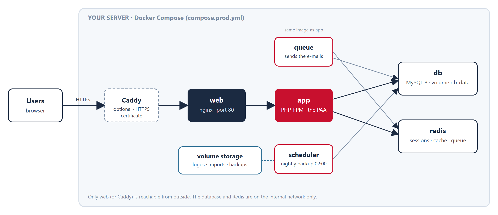
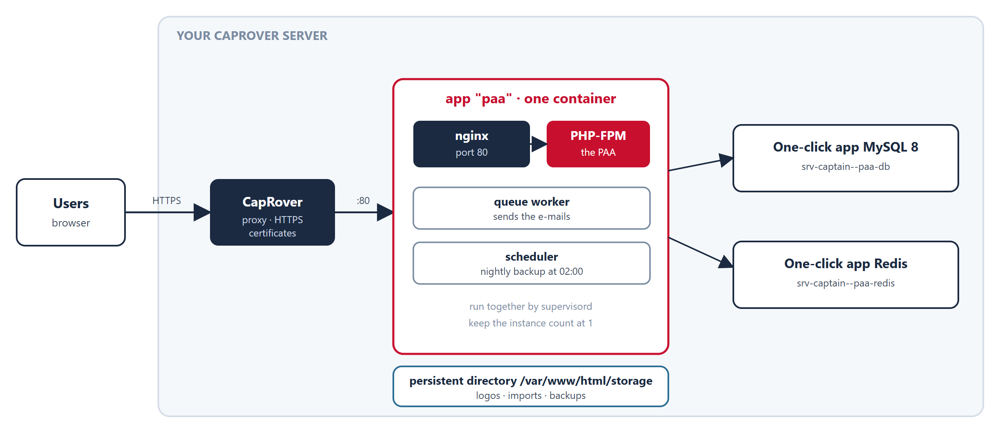

# Deployment manual

**Putting the Plano de Ação Anual (PAA) into production with Docker Compose or CapRover: installing, e-mail, backups, updating and operating it.**

This manual is for the people who install and look after the system: the institution's IT staff or its hosting partner. It does not describe how to use the application; for that, see the user manual.

## Contents

1. [Before you start](#1-before-you-start)
2. [Deploy with Docker Compose](#2-deploy-with-docker-compose)
3. [Deploy on CapRover](#3-deploy-on-caprover)
4. [Settings reference](#4-settings-reference)
5. [E-mail and notifications](#5-e-mail-and-notifications)
6. [Backups and restore](#6-backups-and-restore)
7. [Updating and rolling back](#7-updating-and-rolling-back)
8. [Operating the system](#8-operating-the-system)
9. [Security checklist](#9-security-checklist)
10. [Troubleshooting](#10-troubleshooting)
11. [Go-live checklist](#11-go-live-checklist)

---

## 1. Before you start

### 1.1 Choose how to deploy

| | **Docker Compose** | **CapRover** |
|---|---|---|
| Good for | A server you manage yourself, with Docker | A server that already runs CapRover, or where you want a web console |
| What runs | Six containers: web, app, queue, scheduler, MySQL, Redis (and Caddy for HTTPS, if you ask for it) | One container for the application, plus two one-click apps: MySQL and Redis |
| HTTPS | Caddy (included, optional) or your own proxy | CapRover does it |
| Configuration file | `compose.prod.yml` and `.env.production` | The app's environment variables in the CapRover console |
| Where to read | Part 2 | Part 3 |

Both run **the same application image**. Everything else in this manual (settings, e-mail, backups, updating, security) applies to both.

> The compose file is **not** used by CapRover. CapRover reads only the `captain-definition` file at the root of the repository, which points to the `Dockerfile`.

### 1.2 What the application needs

| Component | Why | Notes |
|---|---|---|
| **MySQL 8** (5.7 also works) | The database | `utf8mb4`. Not MariaDB. |
| **Redis 7** | Sessions, cache and the queue | Not published outside the server. |
| **PHP-FPM and nginx** | The application | Inside the image. |
| **Queue worker** | Sends e-mail notifications in the background | Inside the stack. Idle when e-mail is off. |
| **Scheduler** | Runs the nightly backup at 02:00 | Inside the stack. |
| **SMTP account** | Only if you want e-mail notifications | Any provider or your institution's mail server. |

**Sizing.** For a ministry-sized user base (some hundreds of users): 2 CPU cores, 4 GB of memory and 20 GB of disk are comfortable. 1 core and 2 GB works for a trial or a small office. The application itself needs about 512 MB; MySQL needs most of the rest.

### 1.3 What to prepare

- A **server** (Linux for production) with Docker Engine and the Compose plugin, or a CapRover server.
- A **name** for the application, for example `paa.example.gov.tl`, with its DNS record pointing at the server, if you want HTTPS.
- **Ports** 80 and 443 reachable from the people who will use it. Do not open 3306 (MySQL) or 6379 (Redis).
- An **SMTP account** and a sender address your mail server accepts, for e-mail notifications.
- **Secrets**, each long and random: the application key, the database passwords, the Redis password and the administrator's password. Keep them in the institution's password manager, not in the repository.
- A **place off the server** for backups (another machine, a share, a bucket).

---

## 2. Deploy with Docker Compose

### 2.1 How it is put together



Only the web container (or Caddy, in front of it) is reachable from outside. The database and Redis stay on the internal network. The queue and the scheduler run the same image as the application, with a different command. Four volumes keep the data: the database, Redis, the application's `storage` folder (logos, imports, logs, backups) and Caddy's certificates.

### 2.2 Get the code and write the settings

```bash
git clone <repository> paa
cd paa
cp .env.production.example .env.production
```

Edit `.env.production` and fill in every value marked **CHANGE**. The most important:

| Setting | What to put |
|---|---|
| `APP_KEY` | A new key, generated with the command below |
| `APP_URL` | The address people open, for example `https://paa.example.gov.tl` |
| `DB_PASSWORD`, `DB_ROOT_PASSWORD`, `REDIS_PASSWORD` | Long random passwords |
| `ADMIN_EMAIL`, `ADMIN_PASSWORD` | The first administrator (the password at least 12 characters) |
| `APP_DOMAIN` | The same name, if you use HTTPS through Caddy |
| `MAIL_*` | Your SMTP account, if you want e-mail (Part 5) |

Generate the application key:

```bash
docker compose --env-file .env.production -f compose.prod.yml run --rm --no-deps -e WAIT_FOR_DB=false app php artisan key:generate --show
```

Copy the printed value (it starts with `base64:`) into `APP_KEY`.

> **Typing less.** Set these once in your shell and drop `--env-file` and `-f` from the commands below: `export COMPOSE_FILE=compose.prod.yml COMPOSE_ENV_FILES=.env.production`.

> **Windows.** Docker Desktop cannot build from a folder whose path contains characters outside plain ASCII (for example `Orçamento`): it fails with `non-printable ASCII char`. Use a plain path such as `C:\paa`. A Linux server does not have this problem.

### 2.3 Start it

```bash
docker compose --env-file .env.production -f compose.prod.yml up -d --build
```

The first build takes several minutes. When the **app** container starts, it waits for the database, builds it from the schema baseline and the migrations, and starts PHP-FPM. The queue, scheduler and web containers wait for it. Check:

```bash
docker compose --env-file .env.production -f compose.prod.yml ps
```

All services should be `Up` or `healthy`.

### 2.4 Create the roles and the first administrator

```bash
docker compose --env-file .env.production -f compose.prod.yml exec -u www-data app php artisan db:seed --force
```

This creates the roles, the economic categories, the default settings and the administrator from `ADMIN_EMAIL` and `ADMIN_PASSWORD`. Open `http://<server>:8080` (the `WEB_PORT`), sign in, **change the password at once**, and continue with Part 4 of the user manual. The optional sample data is refused in production on purpose.

### 2.5 HTTPS

The simplest way is the Caddy service of the stack, which obtains and renews a free certificate by itself. It needs `APP_DOMAIN` in `.env.production`, the name pointing at the server, and ports 80 and 443 free and reachable:

```bash
docker compose --env-file .env.production -f compose.prod.yml --profile https up -d
```

Open `https://<APP_DOMAIN>`. Keep `TRUSTED_PROXIES=*` and `SESSION_SECURE_COOKIE=true`. If you already have your own proxy or load balancer, point it at the web container (`WEB_PORT`) and keep the same two settings.

For a **trial on your own computer** over plain http, set `APP_URL=http://localhost:8080` and `SESSION_SECURE_COOKIE=false`. In production the application forces `https` links unless `APP_URL` starts with `http://`.

---

## 3. Deploy on CapRover

CapRover runs one container per app, so the repository has a single-container image for it: nginx, PHP-FPM, the queue worker and the scheduler run together in the app. The database and Redis are two separate CapRover apps.

### 3.1 How it is put together



### 3.2 The database and Redis

In **Apps → One-Click Apps/Databases**:

1. **MySQL** (version 8): name it `paa-db` and set a root password. Other apps reach it at `srv-captain--paa-db`.
2. **Redis**: name it `paa-redis` and set a password. Its address is `srv-captain--paa-redis`.

### 3.3 The application

1. Create an app named `paa` and tick *Has Persistent Data*. Enable **HTTPS** and *Force HTTPS* for its domain.
2. **App Configs → Persistent Directories**: add `/var/www/html/storage` with a label such as `paa-storage`. This keeps uploaded logos, logs and **backups** across deployments. Without it they are lost every time you deploy.
3. **App Configs → Environmental Variables → Bulk Edit**: paste the block below and fill it in.

```ini
APP_NAME=Plano de Ação Anual (PAA)
APP_ENV=production
APP_DEBUG=false
APP_KEY=base64:...
APP_URL=https://paa.your-domain
APP_LOCALE=tet
APP_FALLBACK_LOCALE=pt
LOG_CHANNEL=stderr
LOG_LEVEL=warning
TRUSTED_PROXIES=*
SESSION_SECURE_COOKIE=true

DB_CONNECTION=mysql
DB_HOST=srv-captain--paa-db
DB_PORT=3306
DB_DATABASE=paa
DB_USERNAME=root
DB_PASSWORD=<the MySQL root password>

REDIS_CLIENT=predis
REDIS_HOST=srv-captain--paa-redis
REDIS_PORT=6379
REDIS_PASSWORD=<the Redis password>
SESSION_DRIVER=redis
CACHE_STORE=redis
QUEUE_CONNECTION=redis

AUTO_CREATE_DB=true
RUN_MIGRATIONS=true
SEED_IF_EMPTY=true
ADMIN_NAME=Administrator
ADMIN_EMAIL=admin@your-domain
ADMIN_PASSWORD=<at least 12 characters>

MAIL_MAILER=smtp
MAIL_HOST=smtp.your-provider
MAIL_PORT=587
MAIL_USERNAME=...
MAIL_PASSWORD=...
MAIL_FROM_ADDRESS=paa@your-domain
```

To get a value for `APP_KEY`, run `php artisan key:generate --show` on any computer with the project, or use 32 random bytes encoded in base64 with the prefix `base64:`.

The three switches on the first start do this: `AUTO_CREATE_DB` creates the database if it does not exist (the user must be allowed to create databases, as root is), `RUN_MIGRATIONS` builds and updates its tables on every start, and `SEED_IF_EMPTY` creates the roles and the first administrator **once**, only while there is no user. They never touch existing data on later deployments.

### 3.4 Deploy

Deploy the repository by any CapRover method: a GitHub or GitLab webhook, `caprover deploy`, or an uploaded tar of the repository. The repository root must contain `captain-definition`. If CapRover says *"Captain Definition file does not exist"*, the branch you are deploying does not have it. The first build takes several minutes.

### 3.5 After the deployment

- Open `https://paa.your-domain`, sign in with `ADMIN_EMAIL` and `ADMIN_PASSWORD`, and **change the password at once**.
- *App Logs* shows `[paa] ...` lines for each start-up step. `GET /up` answers 200 when the app is running.
- **Keep the number of instances at 1.** The scheduler runs inside the container, and a second instance would run the nightly backup twice.

---

## 4. Settings reference

These are environment variables: in `.env.production` for Docker Compose, in the app's environment for CapRover.

| Setting | Default or example | Meaning |
|---|---|---|
| `APP_KEY` | none | Encryption key. Required. Never change it after people use the system: sessions and encrypted values stop working. |
| `APP_ENV`, `APP_DEBUG` | `production`, `false` | Leave as they are in production. |
| `APP_URL` | none | The public address. `https://` in production. |
| `APP_LOCALE`, `APP_FALLBACK_LOCALE` | `en`, `en` | Default language (`en`, `pt`, `tet`) and the one used where a text is missing. People can switch language themselves. |
| `LOG_CHANNEL`, `LOG_LEVEL` | `stderr`, `warning` | Logs go to the container's output (`docker compose logs`, CapRover *App Logs*). |
| `TRUSTED_PROXIES` | empty | `*` behind Caddy or CapRover, so that links and cookies use https. |
| `SESSION_SECURE_COOKIE` | unset | `true` when the address is https; `false` for a trial over plain http. |
| `DB_HOST`, `DB_PORT`, `DB_DATABASE`, `DB_USERNAME`, `DB_PASSWORD` | `db`, `3306`, … | The database. |
| `DB_ROOT_PASSWORD` | none | Docker Compose only: the MySQL root password. |
| `REDIS_HOST`, `REDIS_PORT`, `REDIS_PASSWORD` | `redis`, `6379` | Redis. |
| `SESSION_DRIVER`, `CACHE_STORE`, `QUEUE_CONNECTION` | `redis` | Keep `redis` in production. |
| `RUN_MIGRATIONS` | `true` (app container) | Build and update the database when the app starts. |
| `SEED_IF_EMPTY` | `false` | Run the base seeder once, while there is no user. |
| `AUTO_CREATE_DB` | `false` | Create the database if it does not exist. |
| `ADMIN_NAME`, `ADMIN_EMAIL`, `ADMIN_PASSWORD` | none | The first administrator, created by the seeder. The password is required in production. |
| `MAIL_MAILER`, `MAIL_HOST`, `MAIL_PORT`, `MAIL_USERNAME`, `MAIL_PASSWORD`, `MAIL_SCHEME`, `MAIL_FROM_ADDRESS`, `MAIL_FROM_NAME` | `log` | The SMTP account (Part 5). With `log`, mail is only written to the log. |
| `BACKUP_ENABLED` | `true` | The nightly backup. |
| `BACKUP_KEEP_DAYS` | `30` | Older backups are deleted after each run. |
| `BACKUP_COPY_PATH` | empty | A second folder each backup is copied to (for example `/backups`). |
| `BACKUP_MAX_AGE_HOURS` | `36` | `/health` reports "degraded" when the newest backup is older than this. |
| `WEB_PORT` | `8080` | Docker Compose only: the port of the web container on the server. |
| `APP_DOMAIN` | none | Docker Compose only: the name for the Caddy certificate. |
| `BACKUP_HOST_DIR` | `./backups` | Docker Compose only: the server folder mapped to `/backups`. |

---

## 5. E-mail and notifications

**Inside the application** nothing needs setting up. Notifications appear in the bell at the top. While a page is open the bell checks for new ones every 20 seconds and shows a short message when one arrives, so people do not have to reload.

**By e-mail** needs three things:

1. The `MAIL_*` settings of your SMTP account. Use `MAIL_PORT=587` with `MAIL_SCHEME=null` (STARTTLS), or `465` with `MAIL_SCHEME=smtps`. `MAIL_FROM_ADDRESS` must be an address your mail server lets you send from.
2. The **queue worker** running. It is part of both deployments.
3. An administrator switching on **System → Settings → Send notifications by e-mail**. It is off by default. Each person can opt out under **Profile → Also send me notifications by e-mail**; the bell is never optional.

The mail is sent in the background, so a slow or broken mail server never holds up what a person is doing. A failed mail is retried three times and then recorded in the `failed_jobs` table.

**To test it:** switch it on, trigger a notification (for example, send an activity for approval), and follow the queue worker's output: `docker compose logs -f queue` with Docker Compose, or *App Logs* on CapRover. You should see `SystemNotificationEmail ... DONE`. If you only see it with `MAIL_MAILER=log`, the mail went to the log, not to a server.

---

## 6. Backups and restore

**What is backed up.** The scheduler makes a gzip-compressed `mysqldump` of the database every night at 02:00, keeps it in the `storage` volume under `app/backups`, deletes those older than `BACKUP_KEEP_DAYS`, and, if `BACKUP_COPY_PATH` is set, copies each to that folder as well. The `storage` volume also holds the uploaded logos and imports; they are small and rarely change.

> **A backup on the same disk is not a backup.** Copy the folder off the server every day: another machine, a mounted share or a bucket. With Docker Compose, `BACKUP_HOST_DIR` (default `./backups`) is a folder on the server you can copy from. On CapRover, use a second persistent directory, for example `/backups`, with `BACKUP_COPY_PATH=/backups`.

**Run one now (Docker Compose):**

```bash
docker compose --env-file .env.production -f compose.prod.yml exec -u www-data scheduler php artisan paa:backup
```

**Restore into the database (Docker Compose).** Stop the application first, so that nobody writes while you restore:

```bash
docker compose --env-file .env.production -f compose.prod.yml stop app queue scheduler web
gunzip -c backups/paa_YYYYMMDD_HHMMSS.sql.gz | docker compose --env-file .env.production -f compose.prod.yml exec -T db sh -c 'mysql -uroot -p"$MYSQL_ROOT_PASSWORD" "$MYSQL_DATABASE"'
docker compose --env-file .env.production -f compose.prod.yml start app queue scheduler web
```

**Restore on CapRover.** Find the backup file in the persistent volume (`docker volume ls`, then `docker volume inspect <volume>` shows its folder on the server), then on the server:

```bash
gunzip -c paa_YYYYMMDD_HHMMSS.sql.gz | docker exec -i $(docker ps -q -f name=srv-captain--paa-db) mysql -uroot -p<root password> paa
```

Stop the `paa` app in the CapRover console while you restore, and start it again afterwards.

**Practise a restore** once on a spare server before you need it. `GET /health` reports the age of the newest backup.

---

## 7. Updating and rolling back

### 7.1 Update

1. Take a backup (Part 6) and copy it off the server.
2. Get the new version and start it.

   **Docker Compose:**

   ```bash
   git pull
   docker compose --env-file .env.production -f compose.prod.yml up -d --build
   ```

   **CapRover:** deploy the new version by the same method as the first time.

3. The database is migrated when the application starts (`RUN_MIGRATIONS=true`). The queue worker restarts with the new code in the same step.
4. Open the application, sign in and check the pages you use most.

### 7.2 Roll back

Migrations are not undone. To go back to the previous version:

1. Stop the application.
2. Restore the backup taken **before** the update (Part 6).
3. Start the previous version of the code: `git checkout <previous tag or commit>` and `up -d --build` with Docker Compose, or deploy the previous commit on CapRover.

### 7.3 Updating the other services

With Docker Compose, MySQL, Redis and Caddy have their own images: `docker compose ... pull` then `up -d` brings them up to date. Do it at a quiet time and after a backup. Do not move MySQL to a new major version without reading its upgrade notes.

---

## 8. Operating the system

| What | Docker Compose (after `COMPOSE_FILE` and `COMPOSE_ENV_FILES` are set) | CapRover |
|---|---|---|
| State of the services | `docker compose ps` | The app's page in the console |
| Application logs | `docker compose logs -f app` | *App Logs* |
| Queue worker logs (e-mail) | `docker compose logs -f queue` | *App Logs* (same container) |
| An artisan command | `docker compose exec -u www-data app php artisan <command>` | `docker exec -it <app container> su-exec www-data php artisan <command>` on the server |
| Stop everything (data is kept) | `docker compose down` | Stop the apps in the console |

> **Never run `docker compose down -v`** on a server in use: `-v` deletes the volumes, and the database with them.

**Health.** `GET /up` is the plain liveness check (HTTP 200 when the application runs). `GET /health` returns JSON with the state of the database, cache, storage, queue, disk and the latest backup, and no secrets. `"status": "ok"` is HTTP 200; `"degraded"` is also HTTP 200 and means something needs attention (failed or stuck queue jobs, under 10% free disk, no recent backup); `"down"` is HTTP 503 and means the database or the storage is unavailable. Point an uptime monitor at `/health` and read the `status` field, not only the HTTP code.

**What is kept where.**

| Data | Docker Compose | CapRover |
|---|---|---|
| Database | volume `db-data` | the MySQL app's own data |
| Sessions, cache, queued jobs | volume `redis-data` | the Redis app's own data |
| Logos, imports, logs, backups | volume `storage` | the persistent directory |
| HTTPS certificates | volume `caddy-data` | CapRover |

**Housekeeping.** The scheduler also clears failed jobs older than a week and expired password-reset tokens every day. Look at the free disk space from time to time: backups and Docker images grow. `docker image prune` removes old images.

---

## 9. Security checklist

- [ ] `.env.production` (or the CapRover variables) holds secrets: never commit them, and limit who can read them on the server.
- [ ] `APP_DEBUG=false` and `APP_ENV=production`.
- [ ] All passwords are long and random, and kept in a password manager.
- [ ] Ports 3306 and 6379 are **not** published. The compose file does not publish them.
- [ ] HTTPS is on, with `SESSION_SECURE_COOKIE=true` and `TRUSTED_PROXIES=*` behind the proxy.
- [ ] The first administrator's password was changed at the first sign-in, and the administrator uses two-factor sign-in (Profile).
- [ ] Self-registration stays off (the default): accounts are created by an administrator.
- [ ] The server's operating system and Docker are kept up to date; the application is rebuilt for each new version.
- [ ] Backups are copied off the server, and a restore has been practised.
- [ ] Only the people who administer the server have shell access to it; the application's administrators do not need it.

---

## 10. Troubleshooting

| What you see | What it means and what to do |
|---|---|
| CapRover: *Captain Definition file does not exist* | The branch deployed has no `captain-definition` at its root. Deploy a version that has it. |
| `APP_KEY is not set` in the logs | Add `APP_KEY` to the settings. The container stops on purpose without it. |
| `the database did not answer in time` | Check `DB_HOST` (`db` with Docker Compose, `srv-captain--paa-db` on CapRover), the password, and that the database is running and healthy. |
| `Access denied` or `Unknown database` | The database or its user does not exist or the password differs. On CapRover set `AUTO_CREATE_DB=true` with the root user; with Docker Compose the `db` service creates it on its first start from `DB_DATABASE`, `DB_USERNAME` and `DB_PASSWORD`: if you changed them afterwards, the old volume still has the old ones. |
| The page shows no styling, or links start with `http://` | `APP_URL` must be the `https://` address, with `TRUSTED_PROXIES=*` and HTTPS forced at the proxy. |
| Docker build fails with `non-printable ASCII char` | The project folder has a non-ASCII character in its path (Windows). Use a plain path. |
| Docker build stops while downloading images | A network interruption. Run the build again: layers already downloaded are kept. |
| The app container restarts again and again | `docker compose logs app` shows why: usually a missing setting or a database that does not answer. |
| No e-mail arrives | Check, in this order: the switch in **Settings** is on; the person has not opted out; `MAIL_MAILER` is `smtp` and not `log`; the queue worker's log shows `DONE` or an error; the address in `MAIL_FROM_ADDRESS` is accepted by your mail server; the `failed_jobs` table. |
| The bell does not update | The page must be open and visible: the check pauses in a hidden tab. Reload once; check the browser's network tab for failing requests. |
| Uploaded logos disappear after an update | The `storage` volume or persistent directory is missing: add it (Part 3.3) and upload them again. |
| `/health` says `degraded` | Read which part: usually the newest backup is older than `BACKUP_MAX_AGE_HOURS`, the disk is nearly full, or queue jobs failed (look at the queue worker's log and the `failed_jobs` table). `down` means the database or storage cannot be reached. |

---

## 11. Go-live checklist

**Before**

- [ ] The server is ready, with the name pointing at it and ports 80 and 443 open.
- [ ] Every secret is generated and stored.
- [ ] `.env.production` or the CapRover variables are filled in, with `APP_URL` as the `https://` address.
- [ ] A trial deployment has been tried once, including an update and a restore.

**Go-live**

- [ ] The stack is up and every service is healthy; `/up` and `/health` answer 200.
- [ ] You can sign in as the administrator, and the password has been changed.
- [ ] The institution's name, logo, language and rules are set in **System → Settings** (user manual, Part 4).
- [ ] E-mail has been tested with one real notification.
- [ ] A first backup exists, and it is copied off the server.

**After**

- [ ] An uptime monitor watches `/health`.
- [ ] Someone is named to apply updates and to watch disk space and backups.
- [ ] The institution's own people have the user manual and the administrator account is held by more than one person.
