# Plano de Ação Anual (PAA) — Administrator Manual

**Setting up and running the Annual Action Plan of a public body: the institution, its structure and people, the calendar, the rules of the cycle, budget decisions and the records.**
Implemented by G-Kakaroto.

This manual is for the **administrators** of the system, usually in the planning office. An administrator sets up the institution, keeps its structure, people and calendar, chooses the optional rules, records the budget decisions and runs the adjustment rounds. An administrator can always act on any step.

Read the **User manual** first: it explains the ideas of the system (activities, versions, revisions, the approval chain, reporting) and how everyone else works with it. This manual covers only what administrators do. Installing the server, e-mail delivery, backups and updates are in the **Deployment manual**.

The screenshots come from the optional sample dataset (the Ministry of Transport and Communications). Nothing in the system is tied to one institution.

---

## Contents

1. [The administrator's year](#1-the-administrators-year)
2. [Settings](#2-settings)
3. [Structure and funding sources](#3-structure-and-funding-sources)
4. [Users, roles and permissions](#4-users-roles-and-permissions)
5. [The calendar and late units](#5-the-calendar-and-late-units)
6. [Approval lists, interim approvers and reorganizations](#6-approval-lists-interim-approvers-and-reorganizations)
7. [Ending planning for a directorate](#7-ending-planning-for-a-directorate)
8. [Optional rules](#8-optional-rules)
9. [Budget decisions and the adjustment round](#9-budget-decisions-and-the-adjustment-round)
10. [Loading activities from a file](#10-loading-activities-from-a-file)
11. [Notifications and e-mail](#11-notifications-and-e-mail)
12. [The audit log](#12-the-audit-log)
13. [Sample data](#13-sample-data)
14. [Running the system](#14-running-the-system)
15. [Questions and troubleshooting](#15-questions-and-troubleshooting)

---

## 1. The administrator's year

The menu groups the administrator's pages under **Administration** (*System Users*, *Structure*, *Funding sources*) and **System** (*Settings* with its tabs *Optional rules* and *Calendar*, *Import Activities*, *Audit Log*, *Sample Data*).

**Once, when the system is new.**

1. *Settings*: the institution's name, the texts, the logo, the level of the institution and the approval rules (Part 2).
2. *Structure*: the tree of units as the law defines it, and the economic categories (Part 3).
3. *Funding sources* (Part 3).
4. *System Users*: each unit's technical officer and director (Part 4).
5. *Optional rules*: only those your institution's rules ask for (Part 8).

**Before each year.**

6. *Structure*: the **programs and subprograms** of the new year; the units that start or stop existing.
7. *Calendar*: the dates for submitting, approving and finalizing the plan, and for reporting each month and quarter (Part 5).
8. *Optional rules → Guidance for preparing the plan*: the text of the planning circular for the year, if any.
9. Check that every unit has a director: the *Structure* page lists the units nobody directs.

**During planning and approval.**

10. Watch *Waiting for you*: late units, requests to reopen a step, units without a director.
11. Give a late unit more time when it is justified (Part 5).

**After the budget is decided** (budget review committee, State Budget law, supplementary budget).

12. Record the decision and, if the plan has to follow it, open an adjustment round (Part 9).

**During the year.**

13. Keep users and approval lists up to date as people come and go (Parts 4 and 6).
14. Use the audit log to answer who changed what, and why (Part 12).

---

## 2. Settings

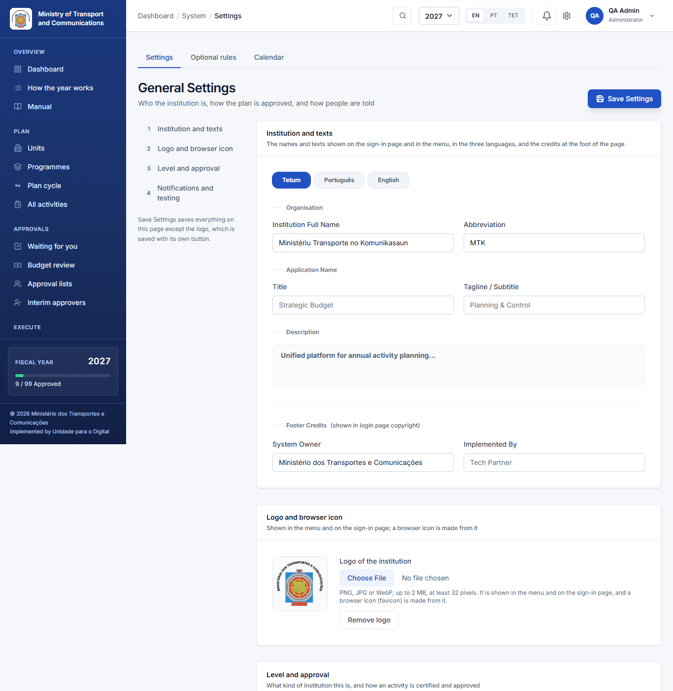

**System → Settings** is one page in four parts, listed on the left (the list stays in view as you scroll). The **Optional rules** and **Calendar** tabs above it are the rest of the same area.

1. **Institution and texts**: the full name and abbreviation of your institution; the name, tagline and description of the system, in Tetum, Portuguese and English (choose the language with the buttons); and the credits at the foot of the sign-in page (the owner, and who implemented the system). These are what users see; nothing is fixed in the code.
2. **Logo and browser icon**: choose an image (PNG, JPG or WebP, up to 2 MB) and press **Use this logo**. It is resized and shown in the menu, on the sign-in page and above the header of the printed reports, and a browser icon (favicon) is made from it. **Remove logo** goes back to the abbreviation. This part has its own save buttons.
3. **Level and approval**:
    - the level: *a whole ministry* (several directorates, each finalizing its own plan) or *one directorate or gabinete* (its plan is sent to the ministry, and you can say who it is sent to);
    - whether the director of the unit above **validates** after the unit's own certification (on by default, so that a unit → national directorate → general directorate structure checks once at each level; where the unit above is the directorate itself, its head's validation and approval are one click);
    - whether **finance confirms the budget** of each activity before it is certified;
    - whether the person who prepared an activity may also certify or approve it.
4. **Notifications and testing**: whether notifications are also sent **by e-mail** (off by default, see Part 11), and the **testing mode** (off by default). In testing mode activities can be planned for **any year** (otherwise only the current year and the next), the year selector offers more years, and the *Testing Zone* menu appears; an amber bar on every page says that it is on. Switch it off for real use.

Click **Save Settings** to save parts 1, 3 and 4.

---

## 3. Structure and funding sources

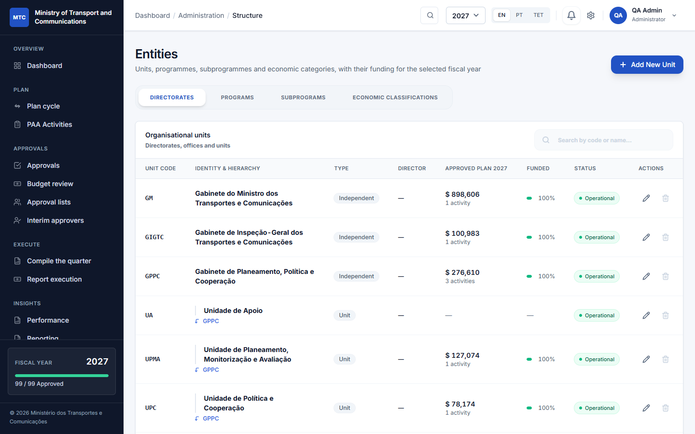

**Administration → Structure** has four tabs:

1. **Directorates**: the tree of units. *Add New Unit* with a code, name, type and **parent**. A unit with no parent is a top-level unit (a directorate or gabinete). Set the years the unit existed, and deactivate rather than delete a unit that has history. Two columns say who is in each unit:
    - **Director**: the people who hold the Director role in the unit. A unit without one shows *Directed from ROOT* when a unit above it has a Director, or **No Director** when nobody directs it.
    - **People**: how many users belong to the unit. Click the number to open them in System Users, or *+ Add* to create the unit's first person with the unit already chosen.

    A banner at the top lists the units that nobody directs. Without a Director, nobody can give the final approval of their activities, so give a user the Director role in each of those units.
2. **Programs**: the OGE programs for the year, with code, name and objective.
3. **Subprograms**: the subprograms under each program.
4. **Economic classifications**: the economic categories (10 to 50, and the detail codes below them).

Add only the structure the law defines: the system does not invent departments.

**Administration → Funding sources** is the list of where money comes from (the State Budget, development partners and so on). Technical officers pick one for each budget line.

---

## 4. Users, roles and permissions

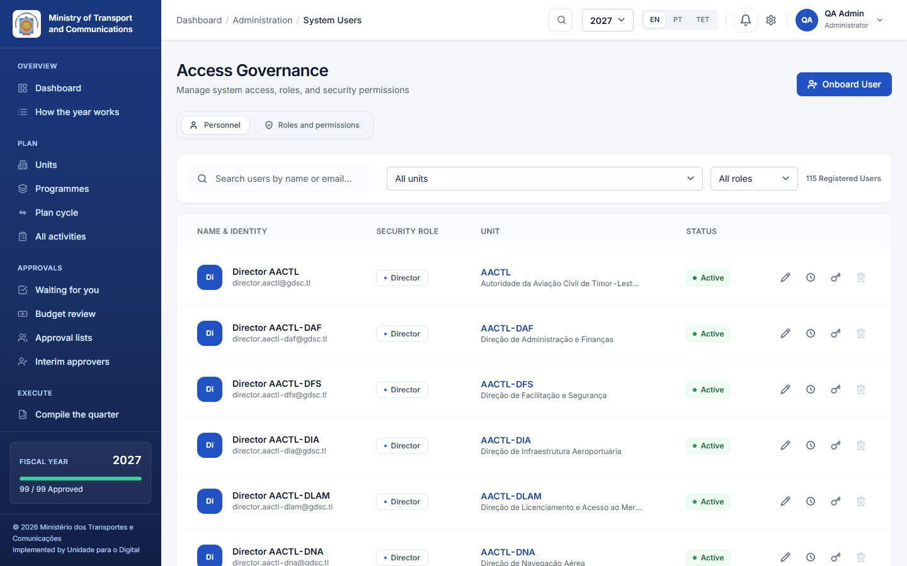

**Administration → System Users**:

- **Create** an account with a name, e-mail, **role** and **unit**. There is no self-registration: every account is created here.
- **Edit** a user's details, role and unit.
- **Deactivate** someone who has left. Deactivate rather than delete a person who has acted in the system, so that their name stays on the records they made.

Give **each unit its own people**: a technical officer who prepares and a director who certifies. A person's unit decides what they can see and plan.

The list can be **filtered by unit** (the unit and every unit below it, or *No unit*) and **by role**, next to the search. A banner warns when directors or officers have **no unit**: they cannot see any activity until they get one (*Show them*). The unit code in each row opens the unit's page, and the clock icon opens the **Audit Log** already filtered to that person.

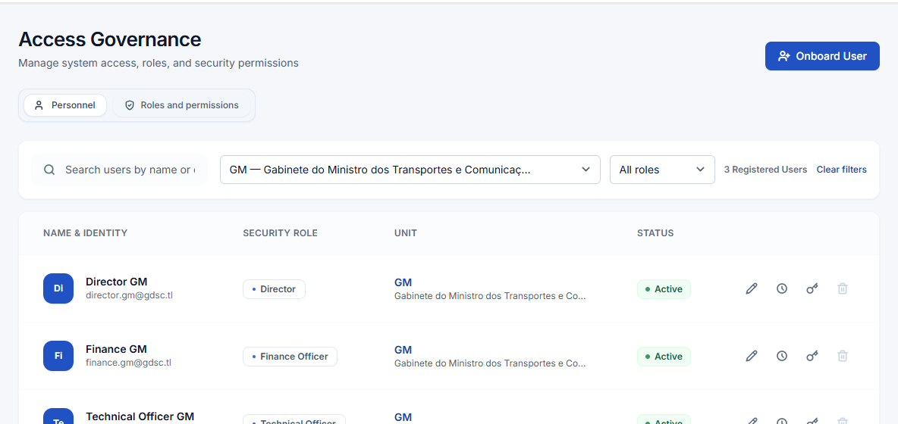

| Role | In one line |
|---|---|
| **Admin** | Sets up and runs the system; always allowed to act. |
| **Minister** | Sees every plan and every report; does *not* approve plans. |
| **Director** | Head or director of a unit: certifies, and for a top-level unit gives the final approval. |
| **Planning** (technical officer) | Prepares activities, indicators and budget lines. |
| **Finance** | Confirms budget lines and verifies the reported executed amounts. |
| **Viewer** | Reads plans and reports; changes nothing. |

The tab **Roles and permissions** is one grid: switch a permission on or off for a role, and the change applies at once to everyone with that role.

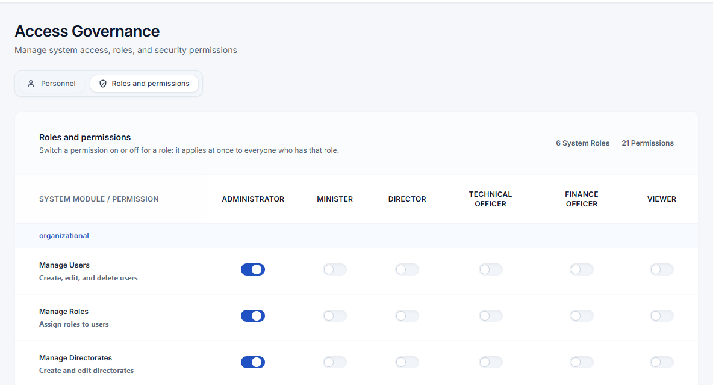

On the page of a unit (**Plan → Units**, open a unit), the card **People of this unit** lists:

- its people, with their role;
- the steps they are named for in its approval lists (*Prepares*, *Certifies*, *Approves*);
- who stands in for the director today.

E-mail addresses are shown only to administrators and the unit's director. Administrators can add a person to the unit from there.

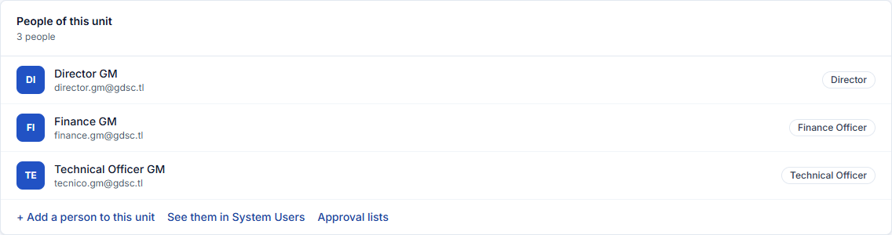

---

## 5. The calendar and late units

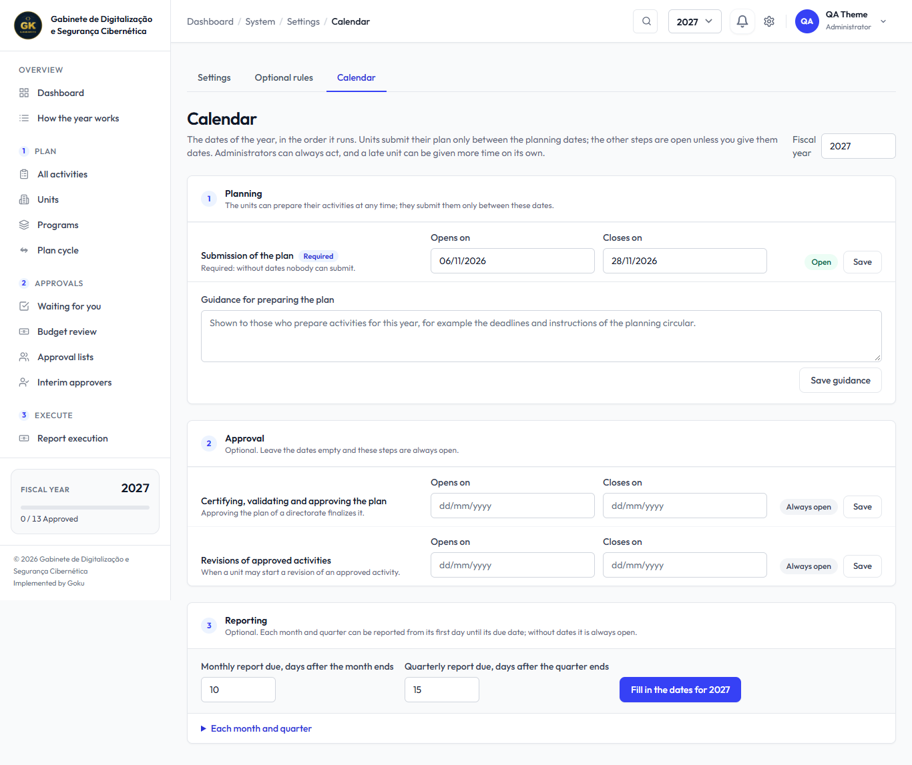

**System → Calendar** holds the dates of the fiscal year for:

- the **plan submission** (when units may submit their activities);
- the **approval** (when submitted activities are certified and approved);
- the **finalizing** of the plan (when a directorate may end planning);
- each **month** (the monthly executed amount and narrative);
- each **quarter** (the quarterly indicators and the quarter's text);
- optionally, the **revisions** of approved activities.

Pick the step, the month or quarter, *Opens on*, *Closes on* and an optional note, then **Save**. Outside its dates a unit cannot act in that step, but an administrator always can. A step with no dates is open. Revisions are never held back by the plan-submission dates.

**Who sees the dates.** Each person sees the dates that concern them, on the dashboard, in *My work*, in *Waiting for you*, in the activity list and in *Report execution*. These are:

- a step that opens or closes within two weeks;
- a step that closed with work left in their unit;
- any extra time their unit was given.

**A unit that is late.** A unit is late when a step has closed and it still has work left in it: activities not submitted or not decided, a plan not finalized, a month without an executed amount, or a quarter without indicator figures. It then appears under **Late** on the calendar page and as an item in the administrator's *Waiting for you*.

To give it more time:

1. Choose **Reopen for this unit**.
2. Give a date and a reason. Without a date, the unit gets seven days.

Only that unit, and the units below it, can act again until then; the step stays closed for everybody else. The unit is told, the reopening is recorded in the audit log, and it can be withdrawn. The people of a late unit see a button to **ask the administrator** to reopen the step; the administrators are notified (at most once a day per person and step).

**The order of the year.** A directorate's activities are certified and approved, and its plan finalized, only once every one of its activities has been submitted. Until then, the decisions wait and the directorate sees why. This rule is on by default; you can switch it off in *The plan must be complete before approval* (Part 8). Finalizing always needs every activity of the directorate to be decided.

Before a report of the plan is printed or downloaded, the application warns when the plan is not fully approved or not finalized, asks for confirmation, and prints a *Draft state* line on the document.

---

## 6. Approval lists, interim approvers and reorganizations

Approval lists and interim approvers are described in the User manual (Part 6). Directors keep them for their own units; administrators can keep them for **any** unit, and are never held up by a list that signs in order.

Authority is worked out from the unit tree and the lists **at the moment someone acts**; nothing is stored on the activity. So after a reorganization:

- **A unit moves to another parent**: in *Structure*, edit the unit and change its parent. The heads and lists above it take over each activity from where it stands. There is nothing to clean up.
- **One person replaces another everywhere**: *Approval lists → **Replace someone in every list***. Choose who leaves and who takes over; every list is updated at once, and you are told if a list is left empty. Then deactivate the person who left (Part 4).
- **An activity belongs to another unit**: on the activity page, **Move to another unit**, with a remark that stays in the audit trail.
- **Somebody is away for a while**: appoint an interim (*Approvals → Interim approvers*).

---

## 7. Ending planning for a directorate

The head of each directorate approves and finalizes its plan in one step, **Approve the plan** on *Waiting for you* (User manual, 5.3 and Part 7). An administrator sees that card for **every** directorate, can approve or finalize any of them, reopen one with a reason, and act outside the finalizing dates of the calendar. On **PAA Activities**, **Show directorates** lists every directorate with its state and the **Finalize plan** or **Reopen** button.

Finalizing stops **new activities** for that directorate and year: no new activities, imported lines or copies from last year. Revisions of approved activities are still possible. An adjustment round that allows new activities lifts this stop for its directorates until they confirm (Part 9).

---

## 8. Optional rules

**System → Optional rules** holds rules that stay **off** until your institution confirms that its own rules ask for them. One rule, the order of the year, is **on** by default and can be switched off. Each rule changes only what is described here.

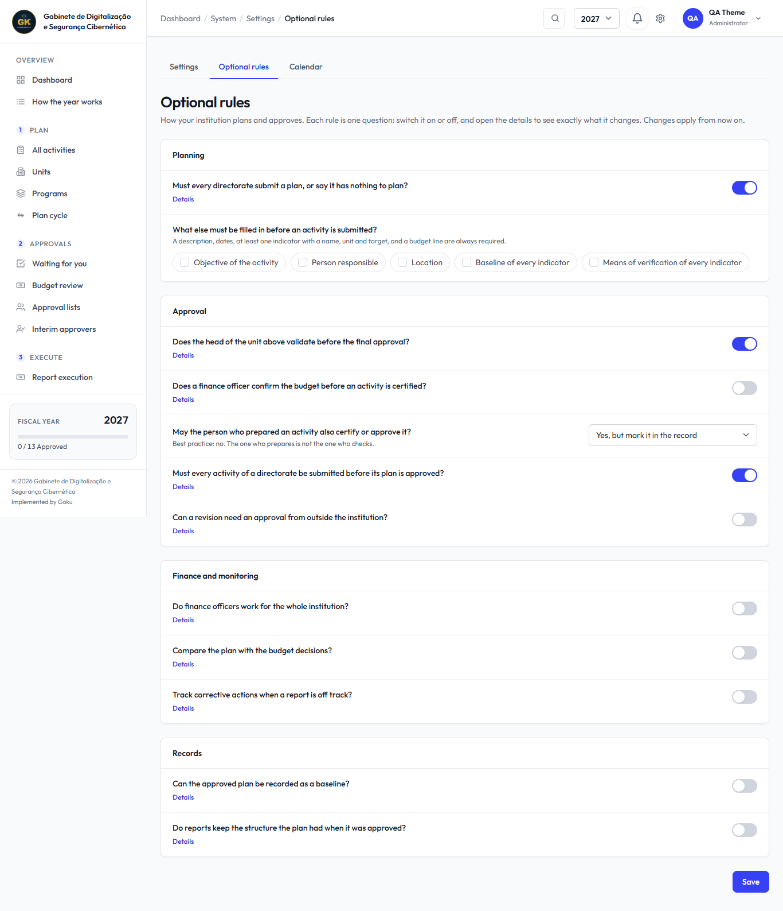

| Rule | When it is on |
|---|---|
| **The plan must be complete before approval** (on by default) | A directorate's activities are certified and approved, and its plan finalized, only once every activity of the directorate has been submitted. Until then the decisions wait, and *Waiting for you* and the approval page say which directorate still has activities to submit. Switch it off if your institution decides activity by activity. |
| **Every active directorate must submit** | Each active top-level unit of the year must either finalize a plan or declare that it has **nothing to plan** (a nil return, with a reason). The year ends only when all of them have done one or the other. |
| **Also required before an activity is submitted** | The fields you tick (objective, person responsible, location, indicator baselines, means of verification) must be filled in before an activity can be submitted. |
| **Guidance for preparing the plan** | Free text for each fiscal year, shown at the top of the activity form (for example the deadlines of the planning circular). |
| **Some revisions need an approval outside the institution** | A revision can be marked as needing it. It is then approved only once the reference of that approval is recorded on the activity page. |
| **Record the approved plan as a baseline** | An administrator records the approved plan of a year as it stands (*Final plan report → Record baseline*), and the report can then be printed as it stood at that moment. Recording a baseline approves nothing. |
| **Finance officers work for the whole institution** | Finance officers see every unit, and confirm budgets and verify executed amounts everywhere. |
| **Track corrective actions** | In *Report execution → Narrative*, the unit records corrective actions with a person responsible and a due date, and closes them when they are done. |
| **Reports keep the structure at approval** | The final report shows each activity under the unit it belonged to when it was approved, even after a restructuring. |
| **Compare the plan with the budget decisions** | Adds *Plan → Budget decisions* and *Plan → Adjustment round* (Part 9). |

Nothing in these rules decides who approves the consolidated plan of the institution: no such step is assumed.

---

## 9. Budget decisions and the adjustment round

The plan the directorates approve is the institution's proposal. The amount the institution finally gets is decided outside it:

- first by the budget review committee;
- then by the State Budget law;
- and sometimes, during the year, by a supplementary budget (*orçamento retificativo*).

To follow these decisions, switch on the optional rule **Compare the plan with the budget decisions** (Part 8).

### 9.1 Record a decision

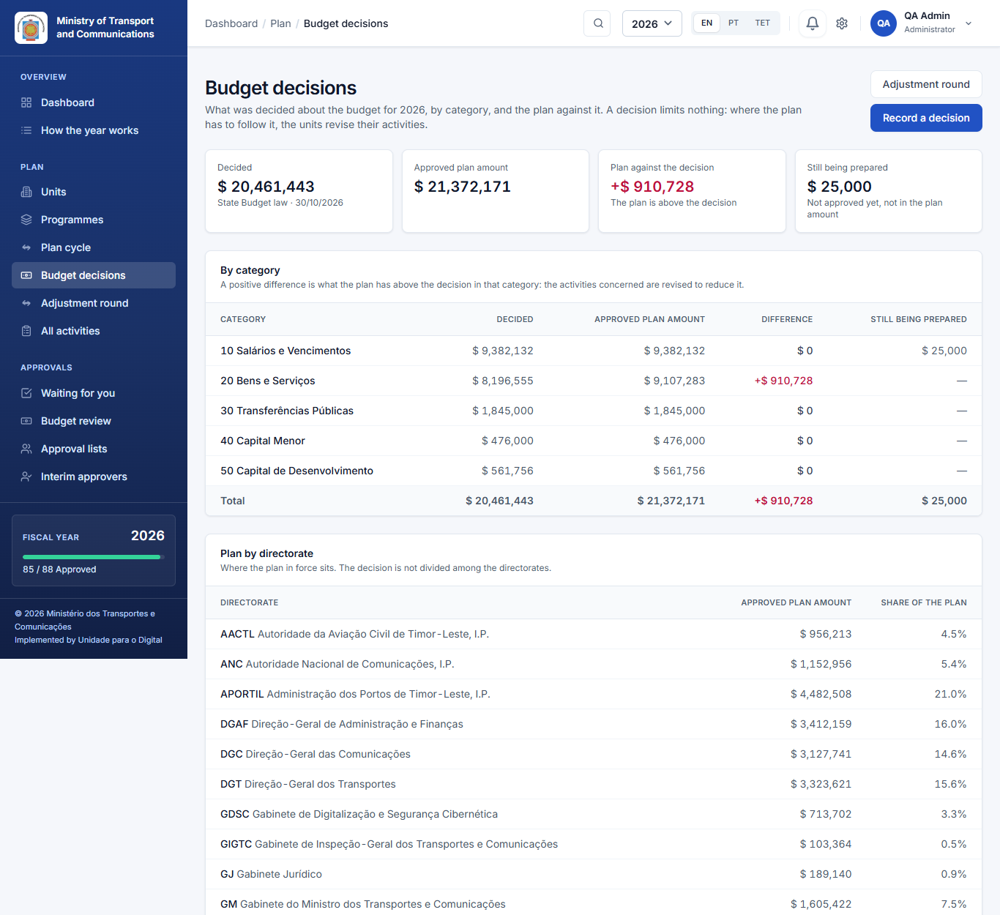

1. After each decision, open **Plan → Budget decisions** and click **Record a decision**.
2. Enter who decided it, the date, the reference (for example the number of the law or of the minutes) and the **amount for each economic category**. The form starts from the amounts of the previous decision, so you only type the categories that changed.
3. The plan in force at that moment is kept with the decision as a baseline. *Decisions of the year* lists every decision, and its *Plan then* figure opens the final plan report as it stood.

The page compares the **approved plan amount** with the latest decision, by category:

- a positive difference is how much the plan is above the decision;
- *Still being prepared* shows activities not approved yet, which are not counted in the plan amount;
- *Plan by directorate* shows where the plan sits. The decision is **not** divided among the directorates.

While the plan is above or below the latest decision, those who see every plan get a **Budget** line on the dashboard.

A decision is a **reference only**. It does not block submitting, approving or finalizing, and it changes no activity. Several decisions can be recorded in a year; the latest one counts.

### 9.2 Open an adjustment round

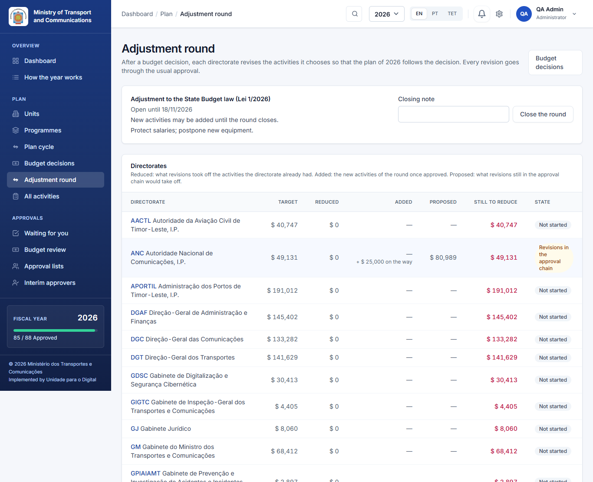

To make the plan follow a decision, open **Plan → Adjustment round**. There is at most one open round per year, linked to the latest decision.

1. Set a **deadline**, and write the **instructions** (for example *protect salaries; postpone new equipment*).
2. Give each directorate a **target reduction**. The targets are suggested by sharing the difference between the plan and the decision in proportion to each directorate's approved plan. Change any of them, or enter zero to ask a directorate for no reduction.
3. For a supplementary budget that brings **new money**, tick **Directorates may add new activities in this round**. Leave it unticked for a round that only cuts, for example after the budget review committee.
4. Open the round. The directors and planners of each directorate are notified, and an alert appears on the dashboard and on each unit's home page.

**With new activities allowed**, until the round closes or until a directorate confirms, the directorates of the round can:

- create new activities, although their plan is finalized;
- submit and approve them outside the calendar.

Once approved, their amount appears in the round's **Added** column.

### 9.3 Follow the round

The directorates then revise the activities they choose, and add new ones where allowed (User manual, 8.5). For each directorate, the table shows:

- the **target**;
- what approved revisions have **reduced**;
- what new activities have **added**;
- what is **proposed** in revisions still in the approval chain;
- what is **still to reduce**. This counts the plan as a whole: what revisions took off, minus what new activities added;
- the state: *Not started*, *Revisions in the approval chain*, *Ready to confirm* or *Confirmed*.

The head of each directorate **confirms** the adjustment once its revisions are approved, with a remark if the target was not reached.

### 9.4 Close the round

When the work is done (for example once the law is published), **close** the round with a note. Activities can still be revised afterwards, but no longer as part of that round. A budget line can never be reduced below what has already been reported as executed against it.

---

## 10. Loading activities from a file

**System → Import Activities**:

1. Download the **CSV template**.
2. Fill it in: unit code, program and subprogram, description, dates, quarters, indicators and budget lines.
3. Upload it.

The importer checks every line first and tells you which lines are wrong and why. Nothing is saved until the whole file is clean. It refuses lines for a year or a directorate whose planning has ended.

---

## 11. Notifications and e-mail

Notifications are **inside the application**. Each person sees them in the bell at the top and on their **Notifications** page, as soon as the action happens. Nothing has to be configured for this.

**E-mail notifications are off by default.** To send each notification by e-mail as well:

1. Switch on **System → Settings → Notifications and testing → Send notifications by e-mail**. The **Mail server** form opens below it.

    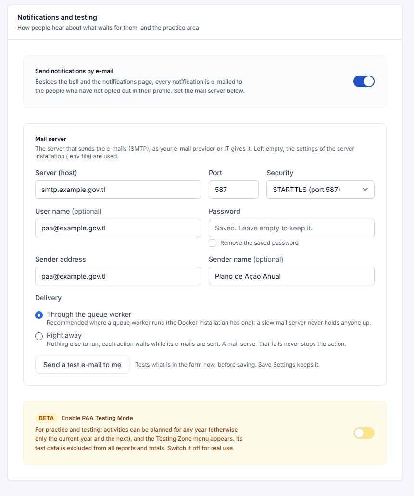

2. Fill in the server as your e-mail provider or IT department gives it: **server (host)**, **port**, **security** (STARTTLS, port 587, or SSL/TLS, port 465), **user name** and **password**, and the **sender address** and name the e-mails come from. The password is stored encrypted and never shown again; leave the field empty to keep it. Left empty, the server set in the installation (the `.env` file, see the Deployment manual) is used.
3. Choose the **delivery**:
    - **Through the queue worker** (recommended where one runs; the Docker installation has one): e-mails are sent in the background, so a slow mail server never holds anyone up.
    - **Right away**: nothing else has to run; each action waits while its e-mails are sent. A mail server that fails never stops the action: the failure is logged and the notification stays in the application.
4. Press **Send a test e-mail to me**. It uses what is in the form at that moment, before saving, and shows the mail server's own answer if something is wrong (a wrong password, port or host).
5. **Save Settings**.

From then on, every notification is also e-mailed to the people who have an e-mail address and have not turned it off in **Profile → Also send me notifications by e-mail**. Switching e-mail off again stops the e-mails; the notifications inside the application continue in either case.

---

## 12. The audit log

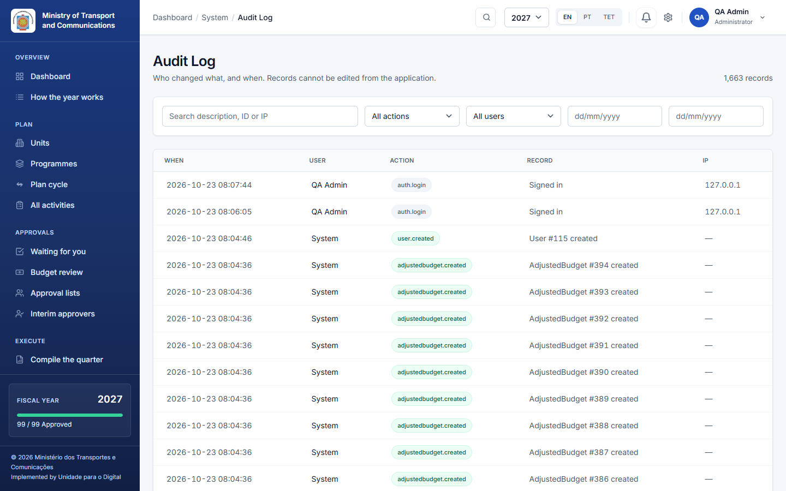

**System → Audit Log** records every change to plans, budgets, approvals, users and settings, with **who**, **when**, the old and the new values, and any remark. The log cannot be edited from the application. Use it to answer "who changed this, and why".

**Sign-ins, sign-outs and failed sign-in attempts** are recorded too: the e-mail that was typed, never the password. Each person sees their own entries in their profile. An administrator can open anyone's from the clock icon in System Users.

---

## 13. Sample data

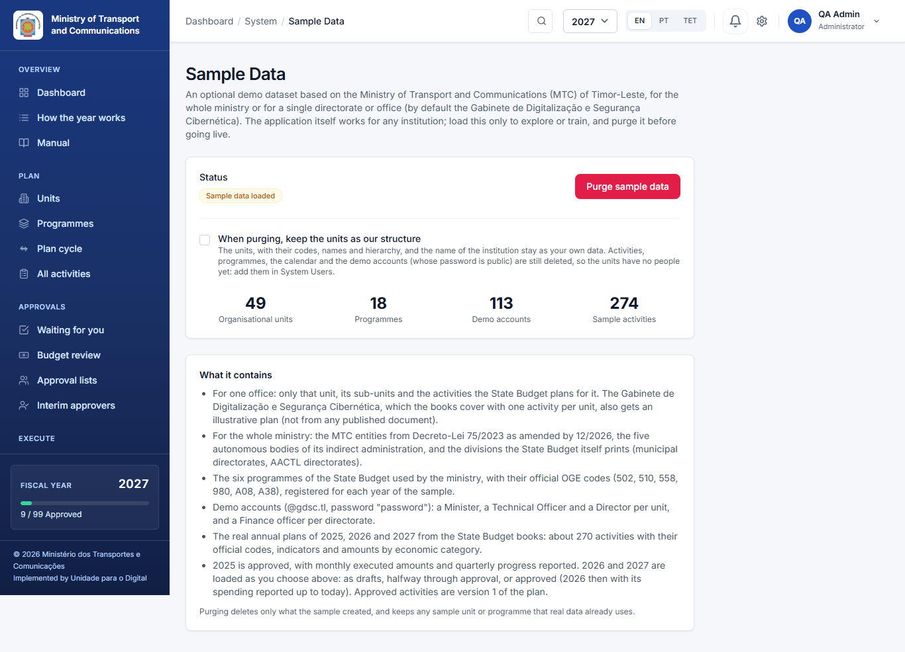

**System → Sample Data** loads (or removes) an optional demonstration dataset, so that people can practice before real use. It brings:

- the structure, the people and the plans of the **years you choose** (*From year* and *To year*, last year to next year by default). The sample holds the real plans of 2025, 2026 and 2027 from the State Budget books; any other year takes the plan of the nearest of these, with its dates, programs, calendar and reported spending moved to the year you chose;
- the earlier year approved, with its reported amounts and progress, and its **reporting calendar** (each month may be reported until the 10th of the next month, each quarter's indicators until the 15th after it);
- the **current year and the next** in the state you choose before loading:
    - **Everything to do: all drafts** (the default): practice the whole cycle, from submitting to reporting;
    - **Halfway through approval**: each directorate at one stage, in turn (still drafting; submitted, with one activity returned with a reason; certified and waiting for the head; approved), so that every role finds work;
    - **Approved and being carried out**: every activity approved, the current year with its spending reported up to today.

Planning dates are left open on purpose. Loading is refused in production. *Purge* removes only what the sample created; your real data is never touched.

**Keep the units.** If the sample's structure is your own (or a good start for it), tick **When purging, keep the units as our structure** before purging. The units stay, with their codes, names and hierarchy, and so does the name of the institution; they become ordinary records that a later purge leaves alone. Everything else of the sample is still deleted: activities, programs, the calendar, plans finalized while practicing, and the demo accounts, whose password is public. The units therefore have no people yet: add them in *System Users*. From the command line: `php artisan paa:purge-samples --keep-units`.

---

## 14. Running the system

For the person who installs and runs the server (the **Deployment manual** has the full instructions):

- **Backups**: `php artisan paa:backup` makes a verified, compressed backup and deletes old ones. It is scheduled nightly at 02:00, so the server must run the Laravel scheduler (`* * * * * php artisan schedule:run`).
- **Notifications** are written to the database at once and shown in the application; no queue worker is needed for them. A queue worker is needed only when e-mail notifications are switched on (Part 11).
- **Health check**: the `/health` address answers for uptime monitoring.
- **Security**: sign-in attempts are rate-limited, registration is closed, permissions are checked on the server for every action (not only hidden in the menu), and senior roles use two-factor sign-in.

---

## 15. Questions and troubleshooting

**A unit's activities cannot get their final approval.** Nobody directs the unit or a unit above it. *Structure* lists the units nobody directs: give a user the Director role in that unit, or name approvers in its approval list.

**A director sees no activities.** The user has no unit. *System Users* warns about users without a unit; edit the user and choose the unit.

**A unit cannot add an activity to a past year.** Only the current and the next year take new activities. For practice with other years, switch on the testing mode in Settings, and off again afterwards.

**A unit asks for more time.** Open *System → Calendar*, find the unit under **Late** and choose **Reopen for this unit** with a date and a reason. The step stays closed for everybody else.

**Somebody left.** Use *Replace someone in every list* in Approval lists so that their approvals pass to a colleague, then deactivate the user.

**A directorate must add an activity after finalizing.** Reopen its plan with a reason (Part 7), or, after a supplementary budget, open an adjustment round that allows new activities (Part 9).

**Nobody receives e-mails.** E-mail notifications are off by default. Check that they are switched on in Settings, press **Send a test e-mail to me** to check the mail server, and, with delivery *through the queue worker*, that a worker is running (or choose *right away*) (Part 11). The notifications inside the application are not affected.

**The pages show the sample ministry.** The sample data is loaded. Purge it in *System → Sample Data* before real use.
