# Plano de Ação Anual (PAA) — User Manual

**The Annual Action Plan of a public body, from the first activity to the report of the year, with its calendar, its approvals and its reports.**
Implemented by G-Kakaroto.

This manual is for everyone who works with the plan: the technical officers who plan activities, the directors who certify them, the heads of directorates who approve them, the finance officers who confirm and verify figures, and the readers who follow the results. Read Parts 1 to 3 first, then the parts for your role. Part 11 walks through a whole year with all the roles together.

Setting the system up (the institution, its structure, its people, the calendar and the optional rules) is described in the separate **Administrator manual**. Installing and running the server is described in the **Deployment manual**.

**The plan is the center.** Everything in the application hangs on the activities of the Annual Action Plan. Units write them, directors certify them and the heads of directorates approve them. An activity is revised when it has to change, and it is reported month by month and quarter by quarter. The budget is part of the plan: each activity carries its budget lines, and what an approved activity may spend is what its approved version says. There is no separate budget to register or distribute.

The screenshots come from the optional sample dataset (the Ministry of Transport and Communications). The system is not tied to one institution: your institution's name, structure, programs and people are set in the application.

---

## Contents

1. [Getting started](#1-getting-started)
2. [How the system thinks](#2-how-the-system-thinks)
3. [The annual cycle at a glance](#3-the-annual-cycle-at-a-glance)
4. [Planning activities](#4-planning-activities)
5. [Approving: prepare, certify, approve](#5-approving-prepare-certify-approve)
6. [Approval lists and interim approvers](#6-approval-lists-and-interim-approvers)
7. [Ending planning per directorate](#7-ending-planning-per-directorate)
8. [Changing an approved activity: revisions and versions](#8-changing-an-approved-activity-revisions-and-versions)
9. [Executing and reporting](#9-executing-and-reporting)
10. [Reports, dashboard and printed forms](#10-reports-dashboard-and-printed-forms)
11. [A whole year, step by step (tutorial)](#11-a-whole-year-step-by-step-tutorial)
12. [Roles and what each can do](#12-roles-and-what-each-can-do)
13. [Questions and troubleshooting](#13-questions-and-troubleshooting)
14. [Glossary](#14-glossary)

---

## 1. Getting started

### 1.1 Signing in

Open the address your administrator gave you and sign in with your e-mail and password.

- There is **no self-registration**: an administrator creates your account.
- After five wrong attempts, signing in is paused for a short time.
- Senior roles may be asked for a **two-factor code** from an authenticator app. Keep your recovery codes safe; they are shown only once.
- Change your password and set up two-factor sign-in under **Profile** (your name, top right).

### 1.2 The screen

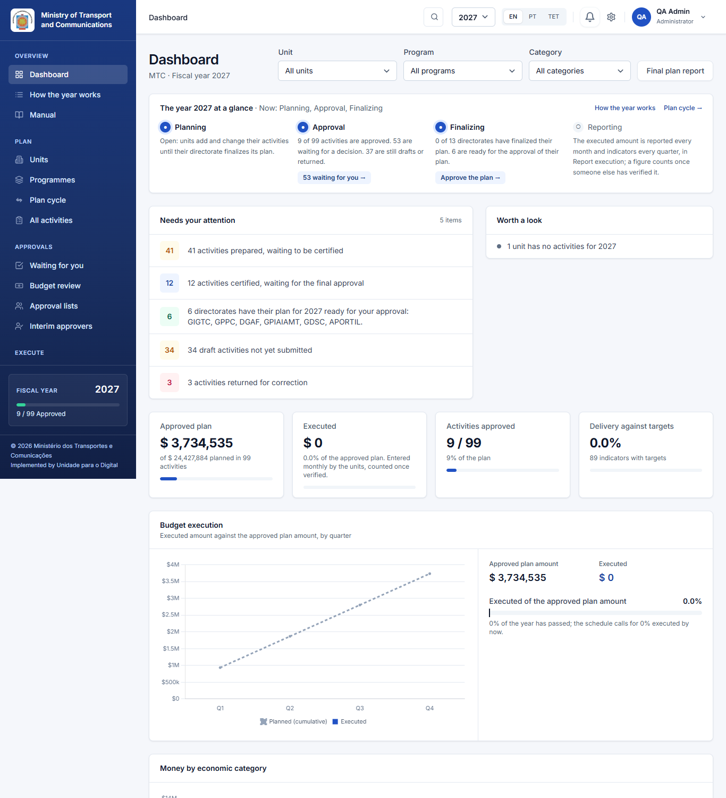

- **Left menu**: the places you may use. It is built for your role, so you only see what is yours. It follows the annual cycle, and its four steps are numbered in the order they are done: *Overview*, then **1 Plan → 2 Approvals → 3 Execute → 4 Insights**. Within each step, the entries come in the order you use them.
- **Top bar**: a search that jumps to any page (press **Ctrl + K**), the **fiscal year** selector, the language buttons **EN / PT / TET**, your notifications (the bell) and your profile.
- **Fiscal year**: almost every screen shows one year at a time. Change it at the top and the whole application follows.
- **Language**: English, Portuguese and Tetum. Your choice is remembered.
- **Notifications**: the bell lists what happened that concerns you (an activity submitted to you, returned to you or approved), and your Notifications page keeps all of them. Click one to go to it. They are inside the application; e-mail is sent only where the administrator has switched it on (10.5).
- **Dates**: every date field opens a small calendar. Click the day. Dates are shown as dd/mm/yyyy, with Monday as the first day of the week, and you never type them.
- **Your profile** (your name, top right): your details and password, two-factor sign-in, whether you also want notifications by e-mail, and **Your recent activity**, which shows when you signed in and what you did in the system, newest first. Nobody can edit it.
- **Manual** (under *Overview*): this manual, to read in the application or download as a PDF.

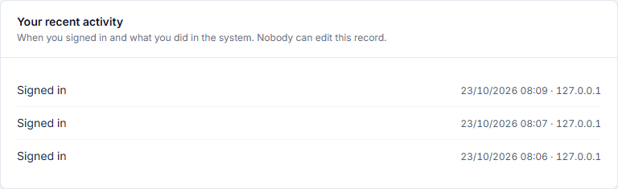

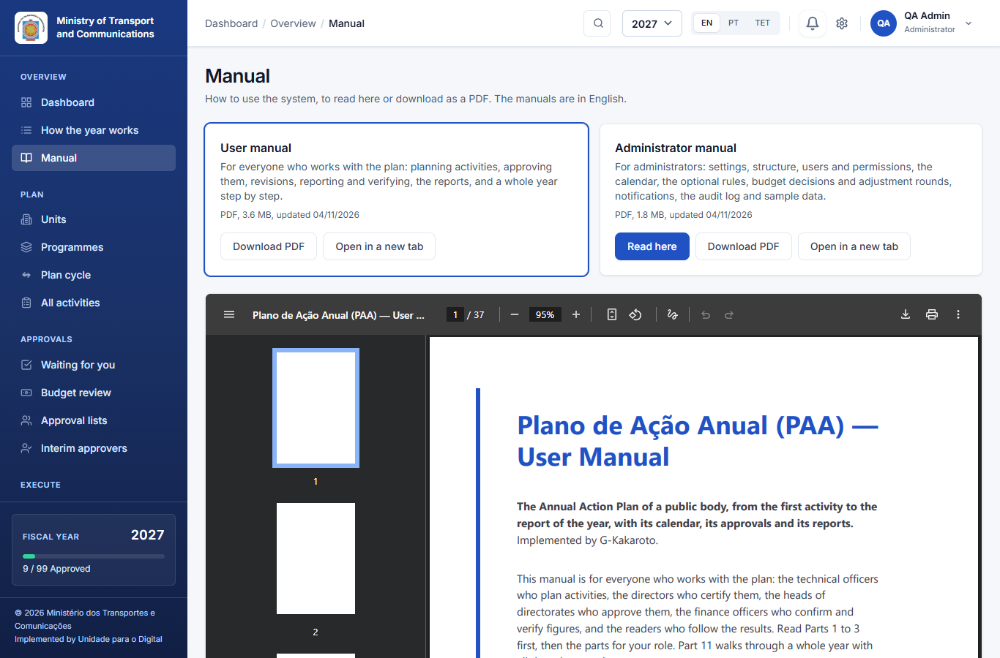

### 1.3 What you see first

Those who see every plan land on the **Dashboard**; everyone else lands on **My work**, which shows their own unit. The dashboard shows the year in one view:

- the **plan cycle tracker**: four steps (plan submission, approval, plan finalized, reporting), with the current step marked;
- key figures: what is planned, the approved plan in force, what has been executed (verified only), how many activities are approved, and delivery against targets;
- **Dates to keep in mind**: a line for each step of the calendar that concerns you, with a link to the page where you act. A line appears when a step closes within two weeks, opens soon, has extra time given to your unit, or has closed with work left in your unit;
- **Needs your attention**: what you can act on (the same list as *Approvals*);
- charts by economic category, status and unit.

Filter it by unit, program and category at the top. **How the year works** (under *Overview*) shows on one page who does what, when and where, with your own steps marked.

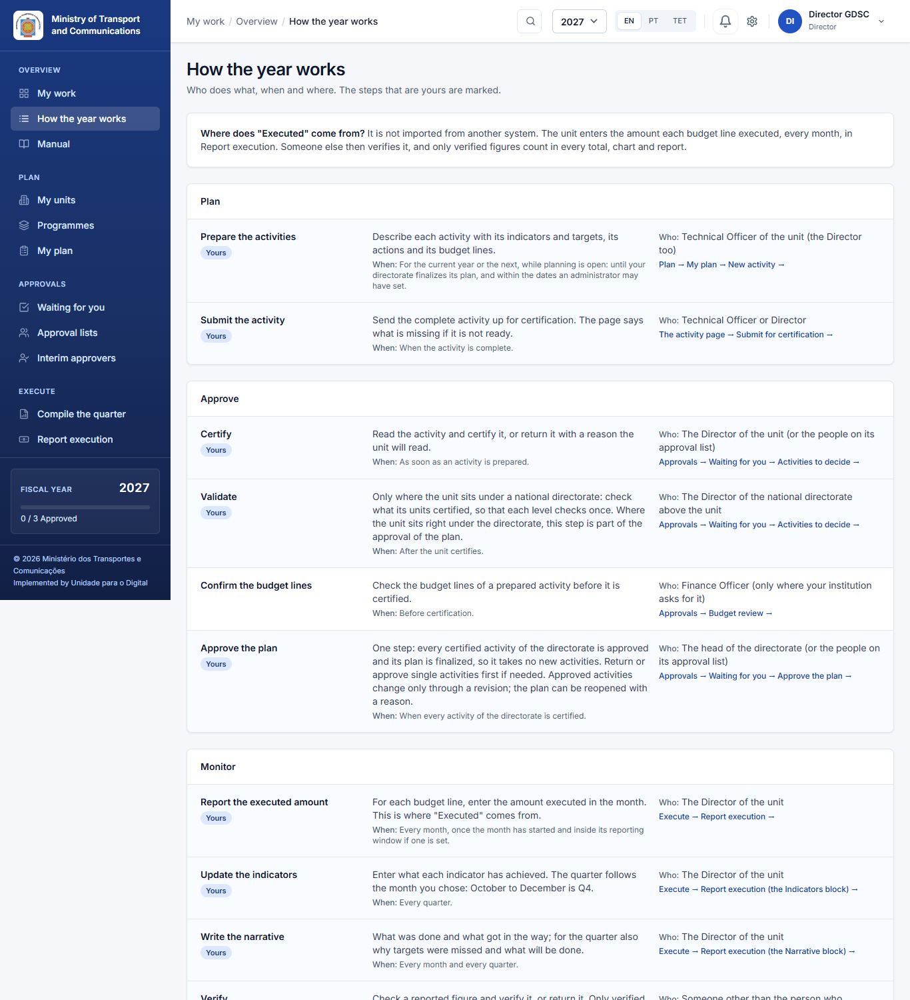

### 1.4 The menu

The left menu is grouped by what you do, and the steps of the year are numbered 1 to 4, so the next step is always the next number. Each person sees only the groups and entries their role allows.

| Group | What is in it |
|---|---|
| **Overview** | *Dashboard* (those who see every plan) or *My work* (everyone else), *How the year works*, *Manual*. |
| **1 Plan** | The activities themselves (*All activities* or *My plan*), then *Units* (the plan of any unit you may see), *Programs*, *Plan cycle* and, where the institution uses them, *Budget decisions* and the *Adjustment round* (8.5). |
| **2 Approvals** | *Waiting for you* (what needs your decision or check, and *Approve the plan* for heads of directorates), and, where your role has them, budget review, approval lists and interim approvers. |
| **3 Execute** | *Report execution* (what was spent and achieved, every month), then *Compile the quarter*. |
| **4 Insights** | Performance and reports. |

Administrators also see *Administration* and *System*; they are described in the Administrator manual.

**Plan → Programs** is for reading. Each program lists its sub-programs, with:

- how many activities each has, and how many are approved;
- the amount planned and the approved plan amount;
- what has been executed (verified).

A directorate sees the programs and figures of its own units only; anyone who sees every plan sees them all. *Open activities* opens the activity list already filtered to that program or sub-program.

---

## 2. How the system thinks

You do not need to memorise this, but everything in the application follows these ideas.

**Institution and units.** Your institution is a tree. At the top are the *top-level units* (directorates, gabinetes or autonomous bodies), with *units* below them, to any depth the law defines. Each unit has its own people. Authority follows the tree: the head of a top-level unit gives the final approval for everything below it.

**Program and subprogram.** The budget classification of the State (the OGE codes). Every activity belongs to one program and one subprogram.

**Activity.** What a unit will do in the year. It has a description, a priority, the quarters it runs in, start and end dates, and the person responsible. It starts as a **Draft**.

**Indicator.** What success looks like: a target, a baseline, a unit of measure and the means of verification. Under each indicator, the unit lists the numbered **actions** that carry it out, each with the **months** in which it takes place. The quarters in which the indicator is reported follow from those months.

**Budget line.** The money, by **economic category** (10 Salaries and wages, 20 Goods and services, 30 Public transfers, 40 Minor capital, 50 Development capital). Each line has an amount and a **funding source** (the State Budget, a development partner and so on). A line can say which indicator it pays for.

**Version.** Every approval of an activity makes a version (1, 2, ...): a copy of what was approved, kept unchanged. The amounts of the latest approved version are in force, and spending is reported against them.

**Revision.** The way to change an approved activity. It needs a reason, and the activity goes back to Draft and through the whole approval chain again. While it does, the version in force stays. When the revision is approved, it becomes the next version.

**Windows.** The dates between which something may be done: submitting the plan, or reporting a month or a quarter. **When no dates are set, the step is open.**

**Verified by someone else.** The figures units report (executed amounts, indicator progress) count only after another person verifies them. Nobody verifies their own report.

---

## 3. The annual cycle at a glance

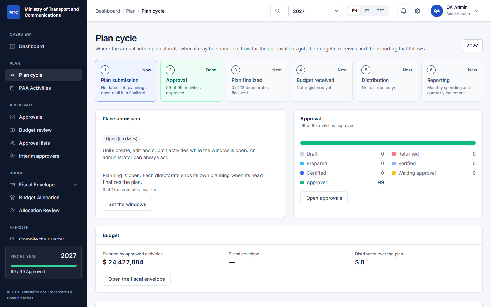

| # | Step | What happens | Who |
|---|---|---|---|
| 1 | **Plan submission** | Units draft activities with indicators, actions and budget lines, and submit them while the submission window is open. | Technical officers, unit directors |
| 2 | **Certification** | The director of the unit certifies each activity; where the unit sits under a national directorate, its director validates (Part 5). | Unit directors, national directors |
| 3 | **Approval of the plan** | The head of the directorate approves the plan: every certified activity is approved and the plan is finalized, in one step. It then takes no new activities. | Head of the directorate |
| 4 | **Reporting** | Units report the executed amount monthly and indicators quarterly; someone else verifies them; the quarter is compiled; reports are printed. Changing an approved activity needs a revision (Part 8). | Units, finance, directors |

The *Plan cycle* page (**Plan → Plan cycle**) shows where the year stands and links to what comes next. The same tracker is on the dashboard.

Each step has its dates in the **calendar**, which the administrator keeps. The order matters:

1. The plan of a directorate is **complete** when all its activities are submitted.
2. Only then are its activities certified and approved.
3. Approving the plan also **finalizes** it.

**Which years can be planned.** New activities go into the plan of the **current year** (until its directorate finalizes) or the **next year**. Earlier years cannot take new activities; their approved activities can still be revised. (For practice, an administrator can switch on a testing mode in which any year can be planned.)

---

## 4. Planning activities

For technical officers and unit directors. Open **Plan → PAA Activities** (or *My plan*).

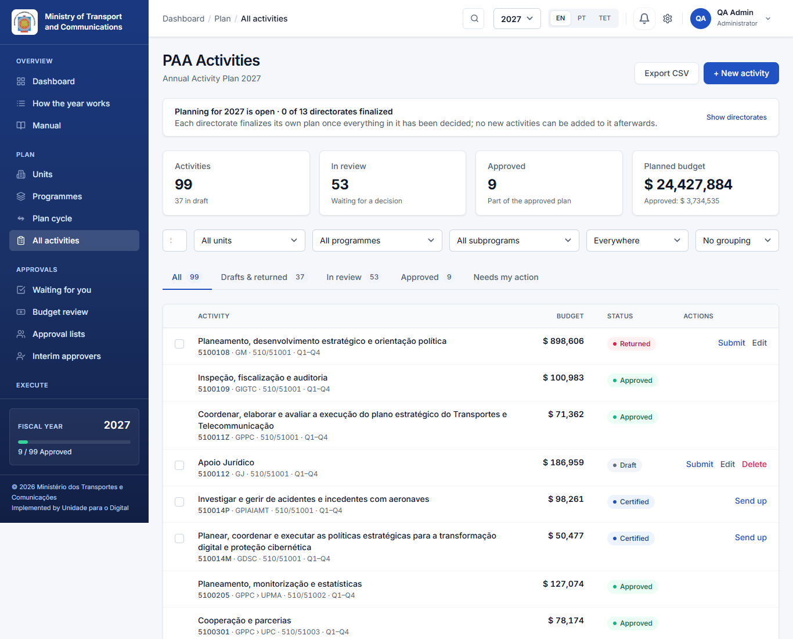

The list shows the activities you may see: those of your unit and of the units below it. It has the tabs *All*, *Drafts & returned*, *In review*, *Approved* and *Needs my action*, and you can filter by unit, program and subprogram. A banner says whether planning for the year is open for your directorate.

### 4.1 Create an activity

Click **+ New activity** (or **Copy from last year**, see 4.6).

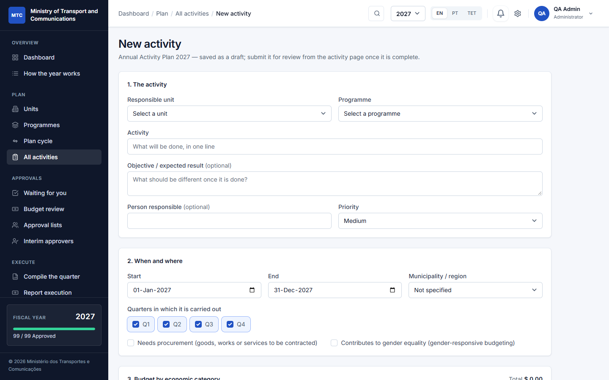

1. **The activity**: choose the **responsible unit** and the **program**, and describe in one line what will be done. Optionally add the expected result, the person responsible and the priority.
2. **When and where**: the start and end dates, the municipality or region, and the **quarters** in which the activity is carried out. Tick *needs procurement* or *contributes to gender equality* where they apply.
3. **Budget by economic category**: the amount for each category. Add the lines under **Budget lines** (4.3).
4. **More details**: the indicators and their actions (4.2).

Save. The activity is a **Draft** with a code, visible only to your unit and the people above it. You can edit it freely while it is a draft or after it has been returned.

### 4.2 Indicators and actions

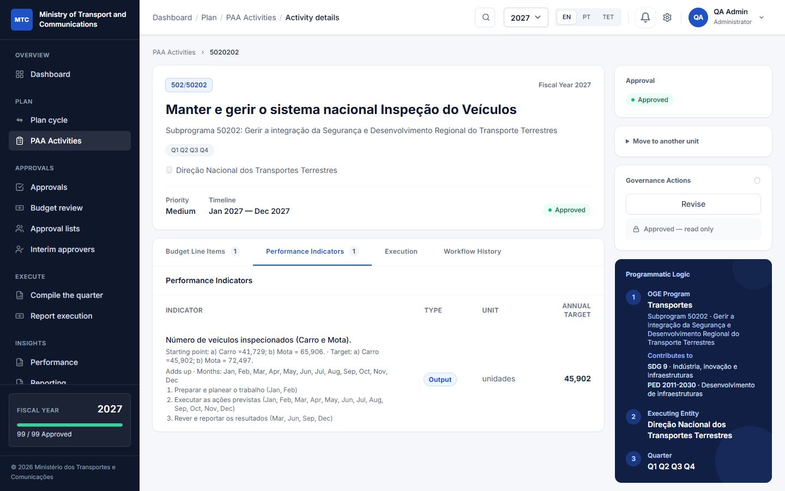

On the activity page open **Performance Indicators**, or edit the activity and open *More details*:

- **Indicator**: the description, the **unit of measure**, the **baseline**, the **target** and the means of verification.
- **Actions**: under each indicator, add the numbered actions that carry it out (for example *1. Prepare and plan the work*, *2. Carry out the planned actions*, *3. Review and report the results*) and tick the **months** in which each takes place.
    - The months must fall inside the quarters the activity runs in.
    - The quarters in which the indicator is reported follow from these months.

### 4.3 Budget lines

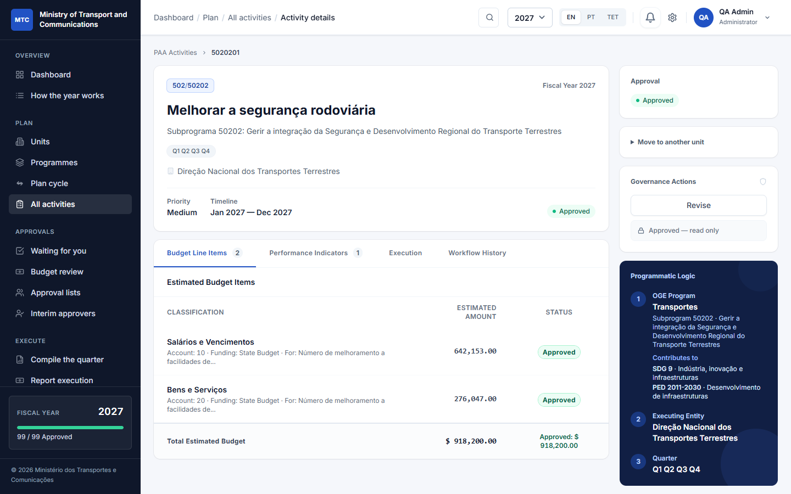

Open **Budget Line Items** on the activity page, or the *Budget lines* screen:

- choose the **economic category** and enter the **amount**;
- choose the **funding source**;
- optionally choose the **indicator** the line pays for. An indicator's allocation is the sum of its lines; a line with no indicator belongs to the whole activity.

### 4.4 Submit for approval

An activity can be **submitted** only when it is complete:

- at least one **budget line with an amount**;
- at least one **indicator with a target**;
- an **end date that is not before the start date**;
- the plan submission window is open for your unit.

Your institution may require more fields before submission (for example the objective or the person responsible); the page says which ones are missing.

Open the activity and click **Submit** (the button names the next step). The activity becomes **Prepared**, and the people who certify it are told. You can also tick several drafts in the list and move them on together: the ones that are not ready are skipped and counted.

### 4.5 If it is returned

A reviewer can **return** an activity with a written reason. It goes back to *Returned*, and the reason is shown at the top of the activity. Correct what was asked and submit it again. A returned activity keeps its history.

### 4.6 Copy last year's plan

At the start of a year that has no activities yet, **Copy from last year** copies the previous year's plan into the new year as **drafts**. This can be done once, and units whose planning has already ended for that year are skipped. Review each draft, adjust the amounts and dates, then submit it.

### 4.7 Approved activities are changed by revision

An approved activity cannot be edited. To change it (for example, a cost went up, an action was added or a target changed), start a **revision** with a written reason (Part 8). The activity never disappears from the plan while the revision is pending.

### 4.8 Export

**Export CSV** at the top of the list downloads the activities you can see, with one amount column per economic category.

---

## 5. Approving: prepare, certify, approve

Every activity goes through the same short chain, whatever the size of the institution: **the unit submits, its director certifies, and the head of the directorate approves the plan**. Where a unit sits under a national directorate (unit → national directorate → general directorate), the national director validates in between, so that each level of management checks once.

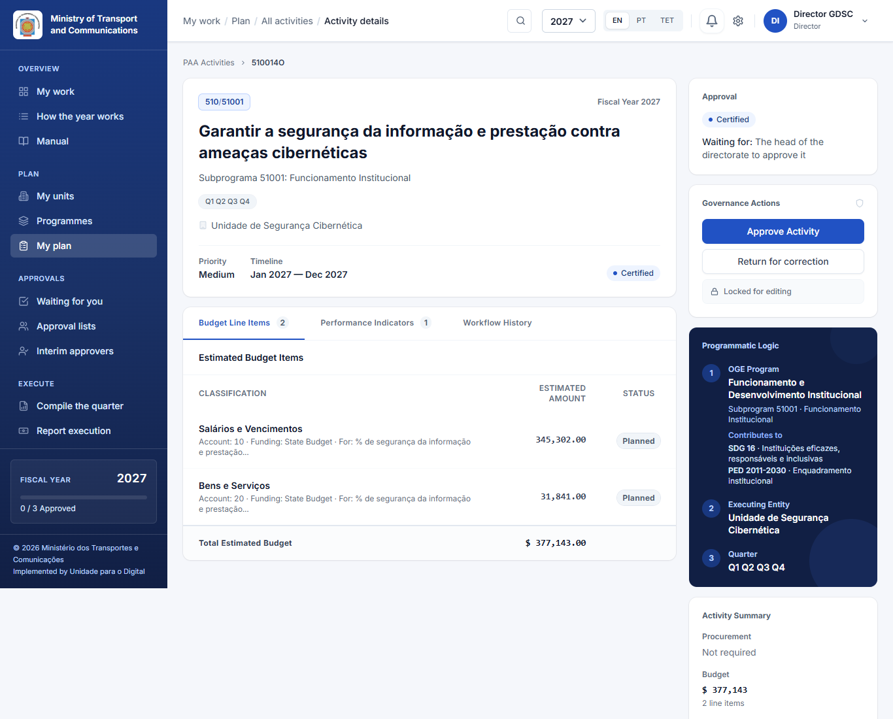

| Status shown | Meaning | Who moves it on |
|---|---|---|
| **Draft** | Being prepared by the unit. | Technical officer or unit director → *Submit for certification* |
| **Prepared** | Submitted; waits for certification. | Director of the unit → *Certify* (or first the finance officer, where budget confirmation is on) |
| **Verified** | Certified by the unit's director; waits for the national directorate above it. | Director of the unit above → *Validate* |
| **Certified** | Ready for the final approval. | Head of the directorate → *Approve the plan* |
| **Approved** | Final approval given; the activity is locked. | |
| **Returned** | Sent back with a reason; the unit corrects it. | |

These words are the same on every page: in the lists, on the activity, on the dashboard and in the messages.

**One person, one click.** When the next step is yours as well, the same click takes it. For example:

- the head of the directorate certifies an activity of the directorate itself: the button reads **Certify and approve**;
- the unit above a unit is the directorate itself, so its head validates and approves: **Validate and approve**.

Each step is still recorded on its own in the history. This never applies to submitting: the person who prepares an activity never checks it. Where an approval list makes several people sign in order, each of them still signs.

**Who gives the final approval.** The head of a top-level unit approves the plans of their own directorate and of the units below it. The Minister does *not* approve plans; the Minister sees every plan and every report. Where a unit has an **approval list** (Part 6), the people named on it do the step instead.

### 5.1 Waiting for you

**Approvals → Waiting for you** is one page with only what needs a decision or a check from you. It has three blocks, and each line has a count and one button:

- **Approve the plan** (heads of directorates): one line for each directorate you head, saying where its plan stands (see 5.3).
- **To decide**: activities prepared and waiting to be certified, and activities certified and waiting for the final approval. Each line opens *Activities to decide* on that queue, so you land on the list the count refers to.
- **To verify**: executed amounts and progress reports entered by others (never your own).

Your own drafts, returned work and reports due are not here: they are in **My work**. The dashboard's *Needs your attention* lists all of them together.

### 5.2 Certify or approve one activity

Open the activity. The panel on the right says where it stands and what you can do. Add a **note** if you wish, and click the action: **Certify**, **Validate**, **Approve**, or **Return** (a reason is required). Every step is written in the **Workflow History** tab: who, when, and the note.

### 5.3 Approve the plan (heads of directorates)

The head of a directorate does not approve activity by activity. On **Approvals → Waiting for you**, the card **Approve the plan** shows each directorate you head:

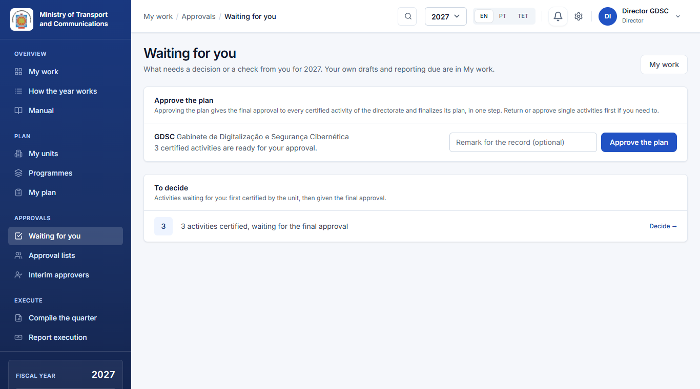

- **Not ready yet**, with what is missing: activities still being certified, or still with the units (drafts or returned).
- **Ready**: *N certified activities are ready for your approval*. Write a remark for the record if you wish, and click **Approve the plan**.

That one step gives the final approval to every certified activity of the directorate, each checked and recorded on its own, and then **finalizes the plan** (Part 7). Activities of units right under the directorate that wait for your own validation are included. Before approving the plan you can still open a single activity to **return** it with a reason, or approve some on their own.

If an activity cannot be approved at that moment (for example, a list still needs a signature), the others are approved but the plan is not finalized. The message says which activity and why.

### 5.4 Approve many at once

1. In *Activities to decide*, tick the activities in the *Ready for approval* queue and use the bulk action.
2. Confirm *Approve the selected activities?*, with an optional note for the record. You can approve up to 200 at a time.
3. The dialog says how many will be left out because you cannot approve them now.

Each activity is checked again as it is approved. One that was returned in the meantime, or that is not your turn, is skipped and listed with the reason. Every approval is recorded with the batch it belonged to, and each unit is told once.

### 5.5 Budget review (finance)

Where **budget confirmation** is on, **Approvals → Budget review** lists submitted activities whose budget lines finance must confirm **before** they are certified. The finance officer checks the lines and **confirms** them, or returns the activity with a reason.

### 5.6 Workflow History and versions

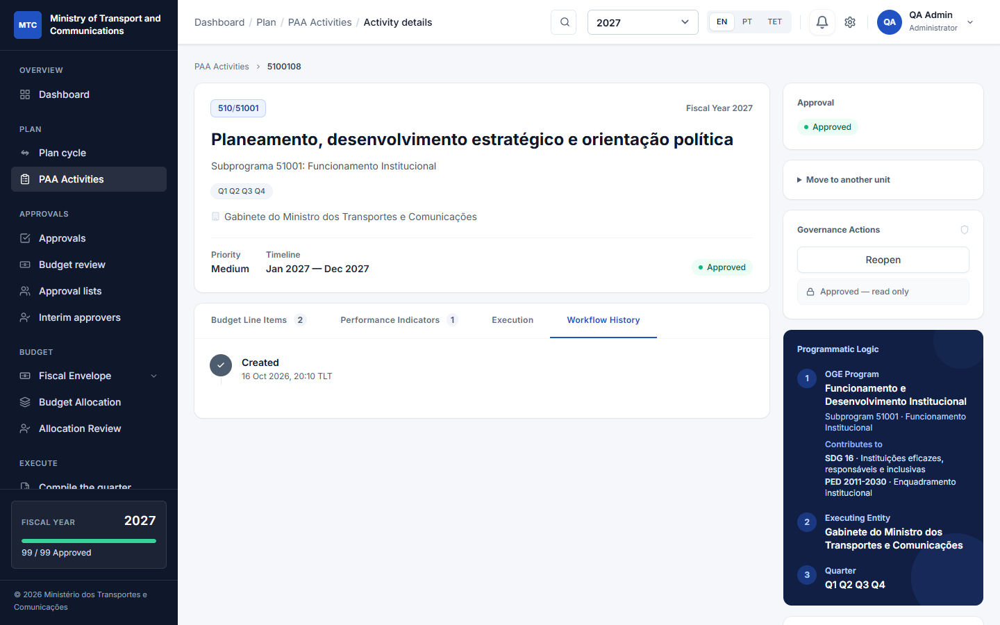

The **Workflow History** tab lists every step, with who did it, when, and any note or reason:

- creation, submission, certification and approval;
- returns;
- revisions started.

It is read from the audit log, so it cannot be edited. Where a list signs in order (6.2), every **signature** of every **round** appears too. This includes signatures given before the activity was returned or reopened, which are marked as voided with who voided them and why.

---

## 6. Approval lists and interim approvers

Directors keep these for the units they direct; administrators can keep them for any unit.

### 6.1 Approval lists

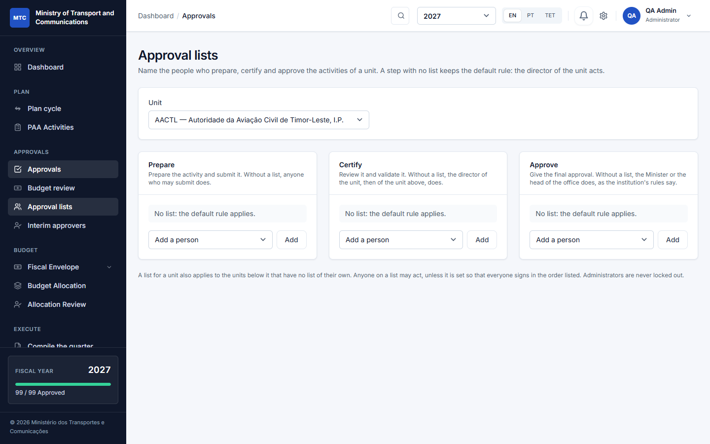

Open **Approvals → Approval lists**, choose a **unit**, and name the people for each step:

- **Prepare**: who prepares and submits the unit's activities;
- **Certify**: who reviews and validates;
- **Approve**: who gives the final approval.

Rules:

- A step **with no list** keeps the default rule: the director acts.
- A unit's list also applies to the units **below** it that have no list of their own; the nearest list above wins.
- Where a step has a list, only the people on it (and administrators) can act, and the activity says who it is waiting for.
- The order of the list is the order in which people are named. Move a person with ↑ ↓, or *Remove* them. If a list becomes empty, the default rule applies again.

### 6.2 Everyone signs, in order

For a **Certify** or **Approve** list of two or more people, tick **Everyone signs, in the order listed**:

- Each person signs **in turn**. The activity page says who is next and how many have signed (for example *Signing in order: Maria is next (1 of 3 signed)*), and the next person is notified.
- The activity **moves on only after the last signature**.
- Nobody signs twice in a round. An **interim** of the unit may sign in place of the next name, and the record shows who actually signed.
- **Administrators** are never held up by the order.
- If the activity is **returned**, or a **revision** is started, a new **round** starts. The earlier signatures are **kept and shown as voided**, with who voided them, when and why; nothing is deleted.

Without the tick, any one person on the list may act on their own.

### 6.3 Interim approvers (someone is away)

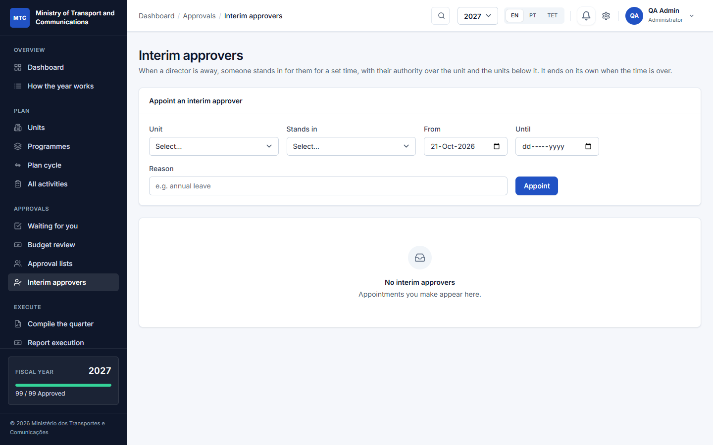

**Approvals → Interim approvers**: a director (or an administrator) appoints someone to **stand in** for a director between two dates. Choose the unit, the person, *from* and *to*. The interim:

- may **certify and approve** for that unit, even where the unit's list names other people;
- does **not** prepare in place of the preparers;
- stops automatically on the end date, or when you **revoke** the appointment.

### 6.4 When someone is replaced

Authority is worked out from the unit tree and the lists **at the moment someone acts**; nothing is stored on the activity. When one person replaces another, open *Approval lists → **Replace someone in every list***, choose who leaves and who takes over: every list of the units you keep is updated at once, and you are told if a list is left empty. Moving a unit or an activity to another place in the structure is done by an administrator.

---

## 7. Ending planning per directorate

Each top-level unit (directorate) ends its own planning. Normally this happens when its head **approves the plan** (5.3): approving and finalizing are one step.

Where every activity was already approved one by one, the same card says *the plan only needs to be finalized* and offers **Finalize the plan**. On **PAA Activities**, the banner also shows, for example, *Planning for 2027 is open · 0 of 13 directorates finalized*, and **Show directorates** lists them with their **Finalize plan** button.

- **Finalizing** says that this directorate's plan is final. After it, the directorate takes no new activities, imported lines or copies from last year for that year. The remark you write is kept.
- The **year ends** when every directorate that planned has finalized. Finalizing stops **new activities** only: an approved activity can still be changed by a revision.
- **Reopening** a directorate's plan, to allow new activities again, is done by its head (or an administrator) with a **reason**. Finalizing and reopening are both recorded in the audit trail.
- The *Approvals* inbox tells each head when the plan of their directorate is ready for their approval.
- **The order.** A directorate can be finalized only when nothing in it is waiting for a decision. Unless the institution has switched the rule off, every one of its activities must also have been submitted. Outside the finalizing dates of the calendar, a directorate can be finalized only where the administrator has reopened that step for it.

---

## 8. Changing an approved activity: revisions and versions

The plan is the budget. What an approved activity may spend is what its **approved version** says, and any change goes through a **revision**. That way nothing is overwritten, and the record always shows what was approved, by whom, and why it changed.

### 8.1 Versions

Every approval makes a **version** of the activity: a copy of the activity, its indicators with their actions, and its budget lines, kept unchanged.

- The first approval is **version 1**.
- The **amounts of the latest version are in force**, and spending is reported against them.
- On the activity's **Workflow History** tab, *Approved versions* lists every version, with who approved it, when, its total, and the reason for the revision that made it. *Show what was approved* opens its budget lines and indicators.

### 8.2 Start a revision

On an approved activity, open *Governance Actions → **Revise*** and give a **reason** (required). A revision can be started by someone who prepares for the unit, the director of the unit, whoever gives the final approval, or an administrator.

- The activity becomes a **Draft** that the unit can edit: amounts, lines, indicators, targets, actions and dates.
- **The approved version stays in force**: its amounts are untouched, the activity keeps its place in the plan and in the reports, and the unit keeps reporting spending against it.
- A banner on the activity says *Revision in progress: version 2* and lists **what changes compared with version 1**, line by line and indicator by indicator, with the total before and after, so that reviewers see exactly what they are approving.

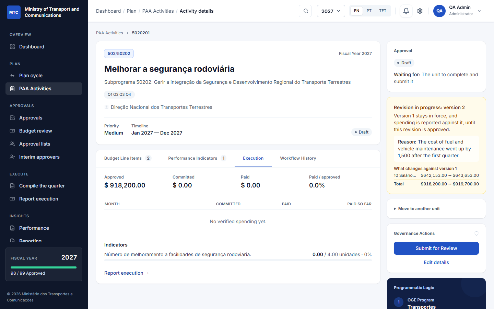

### 8.3 Approve the revision

The revision goes through **the whole chain again**: prepared, certified (and validated by the unit above, where that applies), and approved by the head of the directorate or the named approvers. On lists that sign in order, its signatures belong to a new round. It can be returned for correction like any other activity. When the revision is approved it becomes **version 2**: its amounts take over, and the history shows both versions.

### 8.4 What a revision cannot do

- **Remove a budget line that already has an executed amount reported against it**, or an indicator that already has progress reported. Change its amount or target instead, so that the reported figures stay tied to their line.
- **Reduce a budget line below what has already been reported as executed against it.**
- **Delete the activity**: an activity that was approved once is part of the record of the plan.

Finalizing a directorate's plan (Part 7) does not stop revisions.

### 8.5 When the institution's budget changes

The plan the directorates approve is the institution's proposal. The amount the institution finally gets is decided outside it: by the budget review committee, then by the State Budget law, and sometimes changed during the year by a supplementary budget (*orçamento retificativo*). Where the institution uses this, an administrator records each decision. The administrator then opens an **adjustment round** so that the plan can follow the decision.

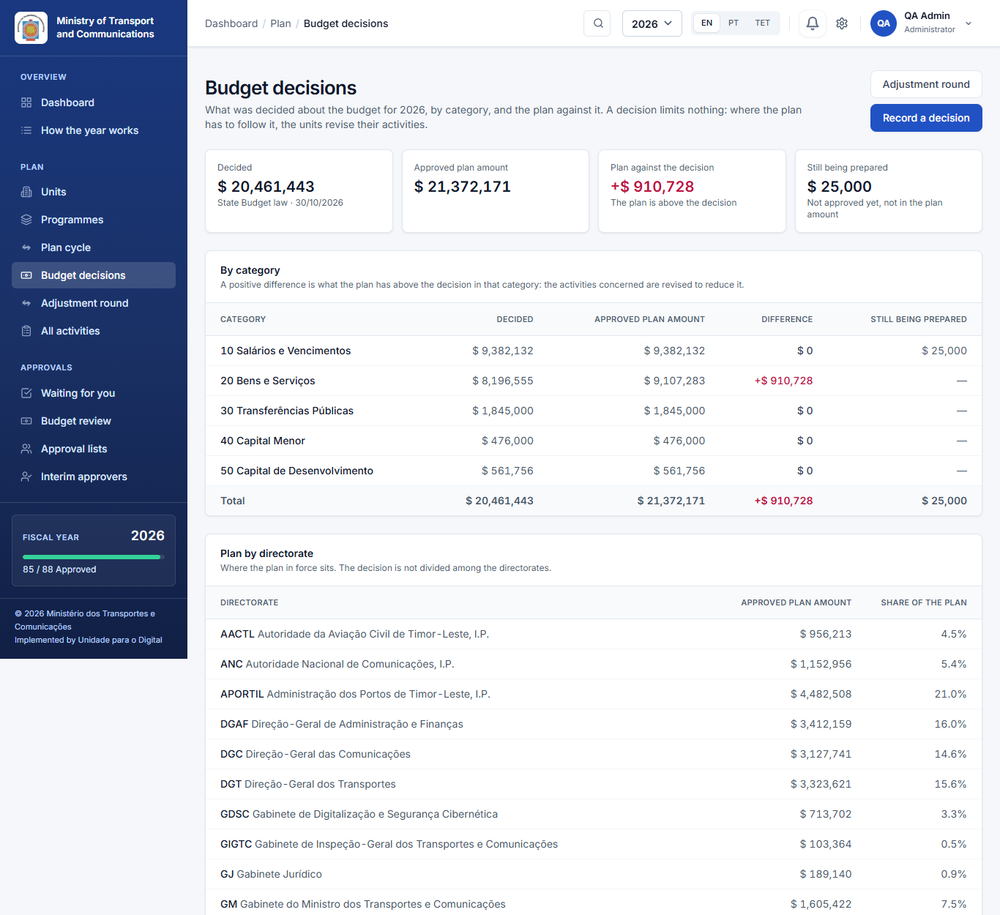

**Plan → Budget decisions** compares the approved plan with the latest decision, by economic category. While the two differ, a **Budget** line appears on the dashboard. A decision is a reference only: it blocks nothing and changes no activity.

**Plan → Adjustment round** is where your directorate does its part. When a round opens, its directors and planners are notified, and an alert appears on the dashboard and on the unit's home page.

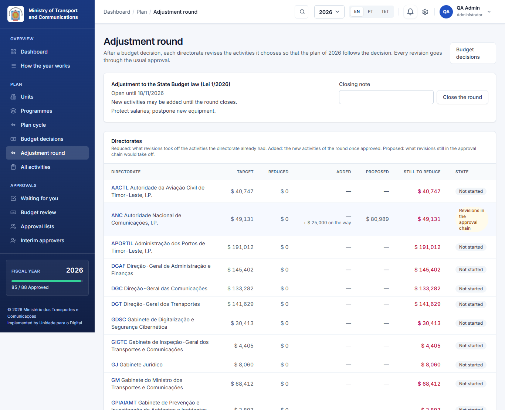

1. **Read the target.** The table shows each directorate's **target** reduction (a suggestion the administrator may have changed), how much has been **reduced**, any amount **added** by new activities, what is **proposed** in revisions still in the approval chain, and what is **still to reduce**.
2. **Choose and revise.** Click your directorate to list its approved activities, biggest first. Click **Revise for this round** on the ones you choose. Each goes back to Draft with the round as the reason. Change its amounts, postpone a part or reduce a line, then submit it through the approval chain as usual. Activities you do not choose are not touched.
3. **New activities.** Where the round allows them (a supplementary budget with new money), the card *New activities of the round* has a **+ New activity** button. It works even though your directorate's plan is finalized, until your directorate confirms or the round closes. Once a new activity is approved, its amount appears under **Added**.
4. **Confirm (the head of the directorate).** When the revisions are approved, the head clicks **Confirm the adjustment**. This is not possible while a revision of the round is still in the approval chain. If the target has not been reached, a remark explaining why is required.

What is still to reduce counts the plan as a whole: what revisions took off, minus what new activities added.

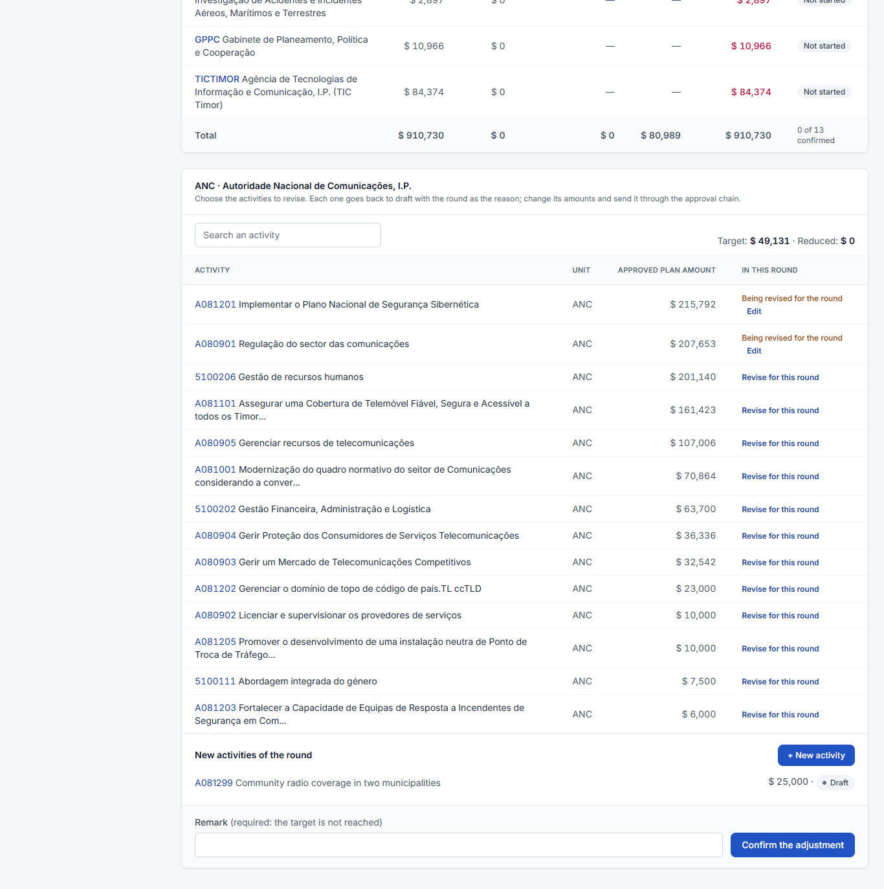

---

## 9. Executing and reporting

Once an activity has an approved version, its unit reports what it spent and achieved. The figures count only once **someone else verifies** them.

### 9.1 Monthly executed amount

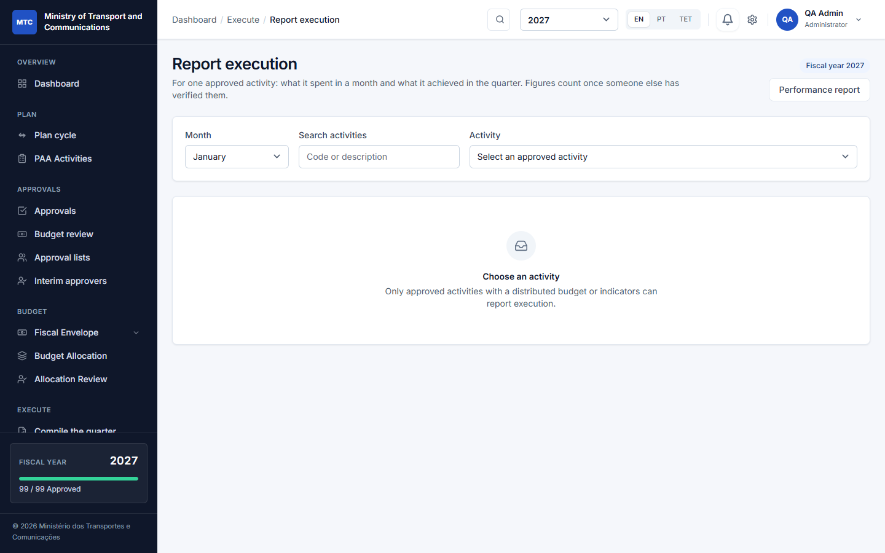

**Execute → Report execution** starts with the **reporting calendar** of the year: the twelve months grouped in four quarters, each with its dates and where it stands for your unit (*closes 31/10*, *2 days left*, *closed 30/09*, *open until 12/11* when your unit was given more time, *not started*). The indicators of each quarter show their own dates above its months. Click a month to report it.

Below the calendar is a **worklist** of the approved activities you may report.

- Choose the **month**. Indicators follow the quarter the month belongs to: October to December is Q4.
- Each row shows where the activity stands for that month: *To report*, *Returned*, *Waiting for verification* or *Verified*, once for the executed amount and once for the indicators.
- The filters above the list (*To report*, *Waiting for verification*, *Done*) narrow it, and the search box finds an activity by code or words.

Click a row to open it.

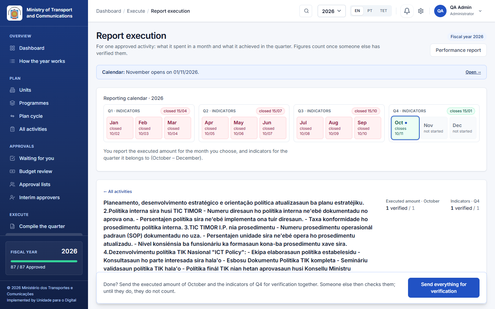

An opened activity shows a short checklist (1 Executed amount, 2 Indicators, 3 Narrative) with how many items are verified. **← All activities** takes you back to the list.

1. For each budget line, enter the amount **executed** in that month. As you type, the page shows what is left of the approved amount.
    - **Copy the amounts of last month** starts from last month's figures.
    - **Nothing executed this month** reports 0 for the lines that have nothing to report, so that "nothing" is reported and not forgotten.
2. The narrative is optional and stays folded until you open it.
3. One button at the bottom, **Send everything for verification**, sends the month's executed amount and the quarter's indicators together.

The month must be within its reporting window.

### 9.2 Quarterly indicators

On the same screen, enter the progress each indicator achieved in the **quarter**. The quarter must be one in which the indicator is reported (from the months of its actions).

### 9.3 Narratives

For each month and each quarter, the unit writes the **narrative**: the results achieved, the implementation constraints, and the rating (from the list). It is part of the report. Where the institution tracks corrective actions, the unit also records them here, each with a person responsible and a due date, and closes them when they are done.

### 9.4 Verification

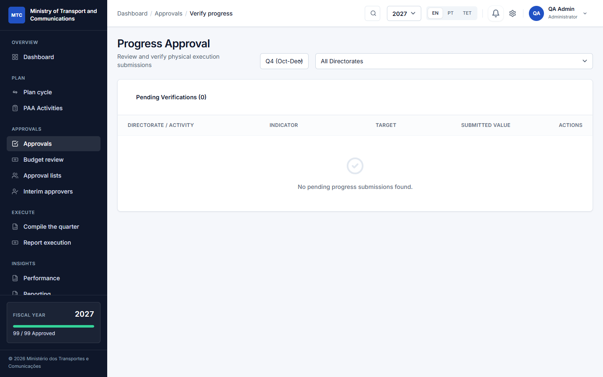

A different person opens the figures and **verifies or returns** them:

- **Executed amount**: a director or the finance officer, from the items in **Approvals** or from *Report execution*.
- **Indicator progress**: a director, from *Report execution*. Open a line with **Details** to see:
    - who reported it, and when;
    - what the indicator is and how it is checked: its kind, baseline, means of verification, and what was planned for the quarter;
    - what was verified in the other quarters, and where the indicator now stands against its target;
    - the words the unit wrote for the quarter.

    Then **Verify**, or **Return with a reason** (the unit reads the reason).

Only verified figures appear on the dashboard, in the performance report and in the printed report. You cannot verify what you entered yourself; *Verify all* leaves those lines for someone else.

### 9.5 Compile the quarter

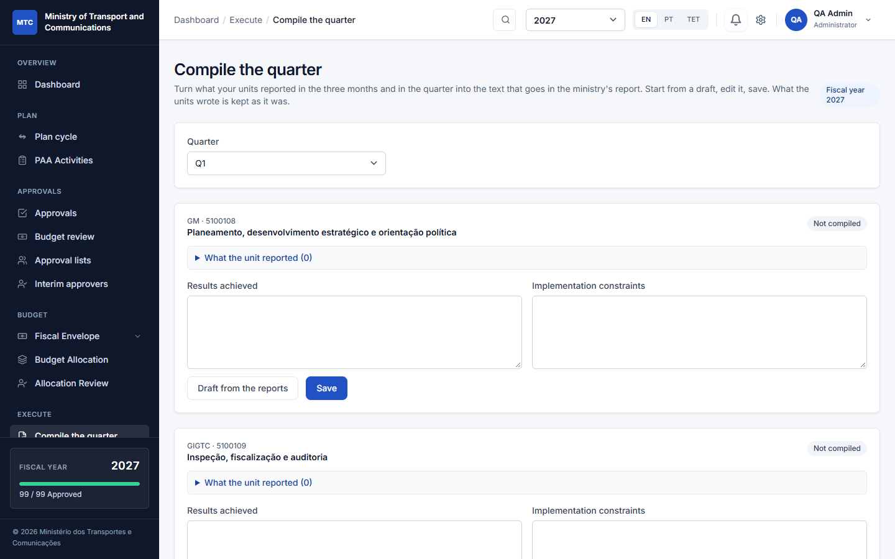

**Execute → Compile the quarter** (directors):

1. Choose the **quarter**. For each activity, the system shows what the unit reported.
2. Press **Draft from the reports** to prepare the text (*Results achieved* and *Implementation constraints*).
3. Edit it and **Save**.

What the unit wrote is kept as it was. The compiled text becomes the text of the institution's report.

### 9.6 Performance

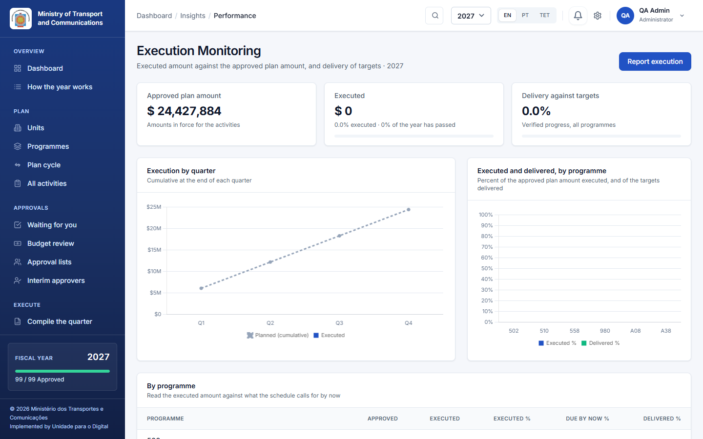

**Insights → Performance**: what was executed and delivered against the plan, by quarter and program, with the activities falling behind.

---

## 10. Reports, dashboard and printed forms

### 10.1 The dashboard and the Reporting page

The **Dashboard** (1.3) and **Insights → Reporting** show the annual performance report: planned and approved amounts by unit, added up through the unit tree. The report offers **Export Data** (CSV), **Final plan report** and **Print Report**.

*Print Report* downloads the annual report as a **PDF document** (A4 landscape), not the browser's print of the page. It contains:

- the institution's name, a reference such as `PAA-2027`, and who made it and when;
- the totals of each unit, added up through the tree;
- the programs with their categories, activities and indicators.

### 10.2 The final plan report

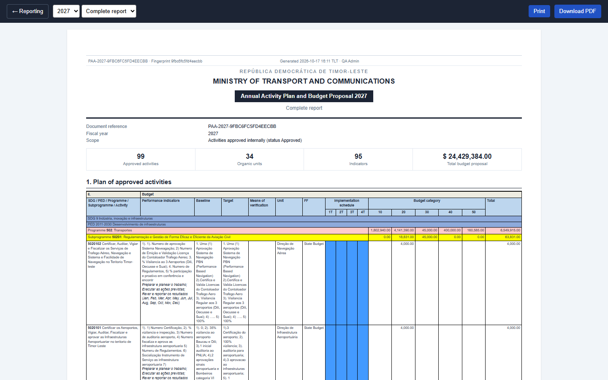

**Reporting → Final plan report** is the plan of approved activities in the layout of the Ministry of Finance form (A4 landscape), with bands for each program and subprogram. For each activity it shows:

- its indicators, baseline, target and means of verification;
- its unit and funding source;
- the quarterly implementation schedule;
- the amount by economic category.

It carries a document reference such as `PAA-2027`. Each export is recorded in the audit log with a code that identifies the exact content of the plan it came from. Choose **Complete report** or **Summary** from the selector, then **Print** to paper or **Download PDF**.

**A warning before you print.** The application warns you and asks you to confirm before printing or downloading in two cases:

- the plan is not fully approved: some activities are not yet submitted or are waiting for a decision;
- a directorate has not finalized its plan.

The document then carries a *Draft state* line with the same words. The implementation plan, the performance report and the annual report do the same. The institution's **logo**, when it has one, is printed above the header of these reports.

### 10.3 The implementation plan, per unit

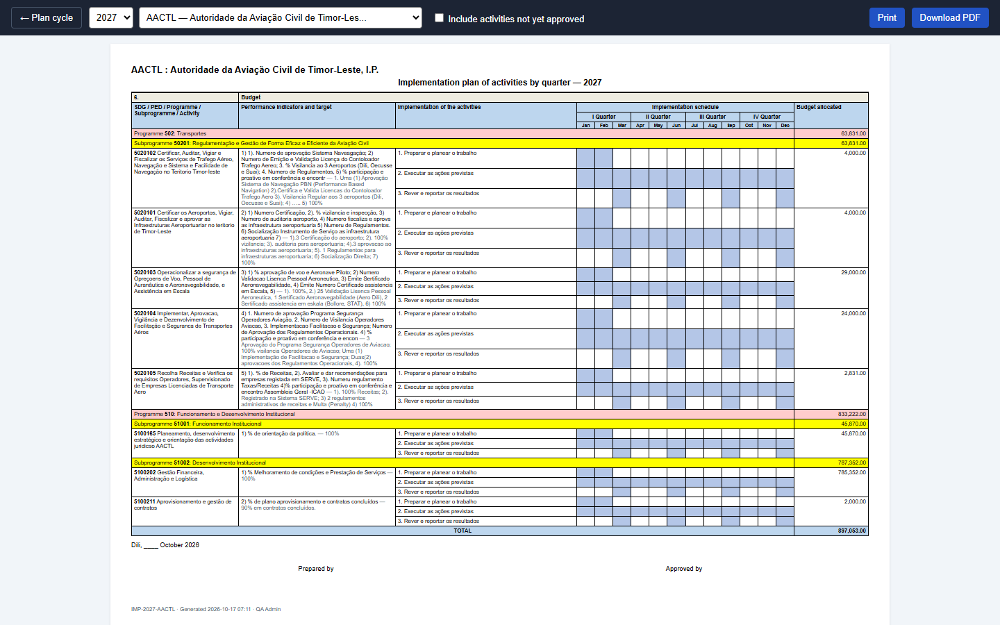

**Plan → Plan cycle → Where things are done → Implementation plan**: choose a unit at the top of the form and print its plan. For each activity it shows:

- its indicators and their numbered **actions**;
- a **Jan–Dec grid**, grouped by quarter, with the months of each action shaded;
- the **budget allocated** to each indicator;
- the *Prepared by / Approved by* names, taken from the unit's approval lists.

By default it lists approved activities; tick *Include activities not yet approved* for a working copy.

### 10.4 The performance report (monthly or quarterly)

**Plan → Plan cycle → Where things are done → Performance report** (or the *Performance report* button of *Report execution*): choose monthly or quarterly, and the period. It prints in the same Ministry of Finance layout, with the narratives, the verified spending and the indicator results. **Print** it or download it as a **PDF**.

### 10.5 Notifications and e-mail

Notifications are **inside the application**. You see them in two places:

- the **bell** at the top, as soon as the action happens. While a page is open, the bell checks for new ones every 20 seconds and shows a short message when one arrives, so you do not have to reload;
- your **Notifications** page (*View Notification History* at the bottom of the bell), which lists all of them, read and unread. Click one to go to what it is about.

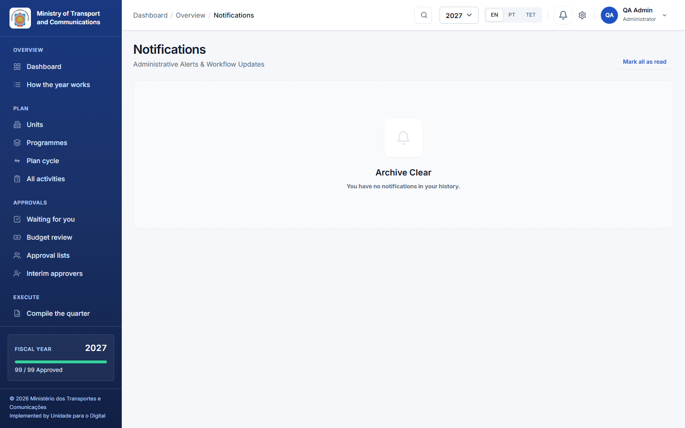

**E-mail is off by default.** Only when an administrator has configured and switched on e-mail notifications is each notification also sent to you by e-mail. You can then turn that off for yourself in **Profile → Also send me notifications by e-mail**. The notifications inside the application are always there.

---

## 11. A whole year, step by step (tutorial)

Follow Ana (technical officer), Bento (director of a unit), Carla (head of a directorate) and Dino (finance). Before the year starts, the administrator has set up the structure, the programs, the people and the calendar (see the Administrator manual).

**Planning (Ana, Bento).**

1. Ana opens **PAA Activities**. At the start of the year she presses **Copy from last year** (or **+ New activity**).
2. For each activity she completes the dates and quarters, the **indicators** (target, baseline, actions with their months) and the **budget lines** (category, amount, funding source).
3. Ana presses **Submit for certification**. The activity becomes *Prepared*, and Bento is notified.

**Certify and approve (Bento, Dino, Carla).**

4. If budget confirmation is on, Dino opens **Budget review** and confirms the lines.
5. Bento opens **Approvals**, reads each activity and presses **Certify**, or **Return** with a reason (Ana corrects it and submits it again).
6. Where Bento's unit sits under a national directorate, its director reads the activity and presses **Validate**. Where the unit sits right under Carla's directorate, there is no such step: Carla's approval covers it.
7. When every activity of the directorate is certified, the inbox tells Carla that the plan is ready for her approval. She opens **Waiting for you → Approve the plan**, writes a remark and confirms. Every certified activity is approved and locked, and the plan of her directorate is finalized: it takes no new activities.
8. (If she wants to send one activity back first, she opens it and presses **Return** with a reason; the plan is ready again once it is certified.)

**The plan in force.**

9. The amounts of each approved activity are what its unit may spend.
10. When something has to change (a cost went up, an action was added), the unit opens the approved activity, presses **Revise** and gives the reason. The activity is edited and goes through the chain again, while version 1 stays in force.
11. Carla approves the revision. It becomes **version 2**, and the history shows both versions.
12. If the State Budget law gives the institution less than the plan, an adjustment round opens. Carla's directorate revises the activities it chooses, and Carla confirms the adjustment (8.5).

**Execution (all year).**

13. Each month, Ana opens **Report execution**, chooses the month and the activity, enters the amount each line **executed** and the narrative, and sends them for verification.
14. Dino (executed amounts) or Bento (executed amounts and indicators) opens the figures from **Approvals** and verifies or returns them.
15. At the end of the quarter, the unit reports the indicators. Carla opens **Compile the quarter**, presses **Draft from the reports**, edits the text and saves it.

**Reporting.**

16. Anyone whose role allows it opens **Reporting** and the **Final plan report** (Complete or Summary), the **Performance report** and the **Implementation plan** of a unit, and prints them or downloads the PDF.

### Scenario A: a director is away for two weeks

Bento is on leave and activities are waiting for certification. Carla opens **Approvals → Interim approvers**, picks the unit and appoints Fernanda from the 10th to the 24th. Fernanda can certify and approve for that unit until the 24th, or until Carla revokes the appointment.

### Scenario B: someone leaves

Bento is replaced by Gil. In *Approval lists → Replace someone in every list*, Carla chooses Bento as the person leaving and Gil as the one taking over. The administrator deactivates Bento's account; his name stays on the records he made.

### Scenario C: three signatures on the final approval

A directorate wants the head of the directorate, the legal adviser and the director of finance to approve every activity, in that order. In **Approval lists**, add the three people under **Approve** and tick **Everyone signs, in the order listed**. Each signs in turn, and the activity is *Approved* after the third signature. If the third person returns it, a new round starts, and the first two signatures stay on record as voided.

---

## 12. Roles and what each can do

| Task | Admin | Minister | Director | Technical officer | Finance | Viewer |
|---|:-:|:-:|:-:|:-:|:-:|:-:|
| See own unit's plan | ✔ | ✔ (all) | ✔ | ✔ | ✔ | ✔ |
| See every unit's plan | ✔ | ✔ | own and below | own | own | own |
| Create and edit activities | ✔ | | ✔ | ✔ | | |
| Submit (prepare) | ✔ | | ✔ | ✔ | | |
| Confirm the budget lines | ✔ | | | | ✔ | |
| Certify | ✔ | | ✔ (unit, unit above) | | | |
| Final approval of a plan | ✔ | | ✔ (head of a directorate) | | | |
| Finalize / reopen a directorate's plan | ✔ | | ✔ (own directorate) | | | |
| Keep approval lists, interim approvers | ✔ | | ✔ (own units) | | | |
| Start a revision of an approved activity | ✔ | | ✔ | ✔ (own unit) | | |
| Report execution | ✔ | | ✔ | ✔ | | |
| Verify executed amounts | ✔ | | ✔ | | ✔ | |
| Verify indicator progress | ✔ | | ✔ | | | |
| Compile the quarter | ✔ | | ✔ | | | |
| Reports (view, print) | ✔ | ✔ | ✔ | ✔ | ✔ | ✔ |
| Users, structure, settings, calendar, import | ✔ | | | | | |

The exact rules also depend on the unit tree and the approval lists. An administrator can always act.

---

## 13. Questions and troubleshooting

**I cannot submit the activity.** It needs a budget line with an amount, an indicator with a target, and an end date that is not before the start date, and the plan submission window must be open. The message beside the *Submit* button says what is missing.

**The "New activity" button is missing, or it says planning has ended.** Your directorate has finalized its plan for that year. Ask the head of your directorate to reopen it, or plan for the next year. An approved activity can still be revised.

**It is not my turn.** The activity is waiting for somebody else. Open it: *Waiting for* names who. If the unit has an approval list that signs in order, the next person on the list must sign first.

**I cannot verify this figure.** You entered it yourself; someone else must verify it.

**I cannot add an activity to this year.** New activities go into the current year (until your directorate finalizes) or the next year only. Switch the year at the top. An approved activity of an earlier year can still be revised.

**I cannot approve: it says the plan is not complete.** Approval waits until every activity of the directorate has been submitted. Ask the unit to submit (or delete) its drafts; *Waiting for you* names the directorate and how many activities are left.

**The calendar is closed and my unit is late.** Use the button on the message (or on the dashboard line) to ask the administrator to reopen the step for your unit. They can give your unit more time without reopening it for everybody.

**I cannot report this month.** The reporting window of the month is closed. Use the button to ask the administrator to reopen it for your unit.

**An approved activity needs a change.** Start a revision: *Revise* on the activity, with a reason. It goes through the chain again, and the approved version stays in force meanwhile.

**I cannot confirm the adjustment.** A revision of the round is still in the approval chain: wait until it is approved or returned. If the target has not been reached, write a remark explaining why.

**The approver is away.** Ask the director to appoint an interim (6.3).

**The pages show text in the wrong language.** Use the EN / PT / TET buttons at the top.

---

## 14. Glossary

| Term | Meaning |
|---|---|
| **PAA** | Plano de Ação Anual: the annual action plan. |
| **OGE** | Orçamento Geral do Estado: the State Budget and its classification. |
| **Program / Subprogram** | The budget classification an activity belongs to. |
| **Activity** | What a unit will do in the year. |
| **Indicator** | A measurable result with a target and a baseline. |
| **Action** | A numbered step that carries an indicator out, with its months. |
| **Budget line** | An amount in an economic category, with a funding source. |
| **Economic category** | 10 Salaries, 20 Goods and services, 30 Transfers, 40 Minor capital, 50 Development capital. |
| **Version** | A copy of an activity as it was approved; the latest approved version is in force. |
| **Revision** | A change to an approved activity: a reason, the whole approval chain again, and the version in force stays until the revision is approved. |
| **Prepare / Certify / Approve** | The three groups of the approval chain: the unit submits, its director certifies (and the national directorate above validates, where there is one), the head of the directorate approves the plan. |
| **Approve the plan** | The head's one step that approves every certified activity of the directorate and finalizes its plan. |
| **Round (of signatures)** | One run of signatures; returning an activity or starting a revision starts a new round. |
| **Interim** | Someone standing in for a director between given dates. |
| **Calendar** | The dates of each step of the year: submitting, approving and finalizing the plan, revisions, and each month and quarter of reporting. |
| **Window** | The dates between which something may be done. |
| **Late** | A step whose dates have closed while a unit still has work left in it. |
| **Executed amount** | The amount a budget line spent in a month, reported by the unit and counted once someone else verifies it. |
| **Budget decision** | What the budget review committee, the State Budget law or a supplementary budget decided for the institution, by economic category. |
| **Adjustment round** | The work after a budget decision: each directorate revises the activities it chooses, and its head confirms. |
| **Directorate** | A top-level unit (a directorate, gabinete or autonomous body). |
| **Verified** | Confirmed by someone other than the person who reported it. |
| **MoF form** | The formal template of the Ministry of Finance used for the printed reports. |
