# Plano de Ação Anual (PAA) — User Manual

**The Annual Action Plan of a public body, from the first activity to the report of the year, with the budget that pays for it.**
Implemented by G-Kakaroto.

This manual is for everyone who uses the system: the people who plan activities, the directors who certify them, the heads of directorates who approve them, the finance officers who confirm and verify figures, the administrators who set it all up, and the readers who only follow the results. Read Part 1 and Part 2 first, then the part for your role. Part 12 walks through a full year with all roles together.

**The plan is the centre.** Everything in the application hangs on the activities of the Annual Action Plan: they are what units write, what directors certify and the heads of directorates approve, what is revised when it has to change, and what is reported month by month and quarter by quarter. The budget is part of the plan: each activity carries its budget lines, and what an approved activity may spend is what its approved version says. There is no separate budget to register or distribute.

The screenshots come from the optional sample dataset (the Ministry of Transport and Communications). The system is not tied to one institution: your name, structure, programmes and people are set in the application.

---

## Contents

1. [Getting started](#1-getting-started)
2. [How the system thinks: the ideas you need](#2-how-the-system-thinks)
3. [The annual cycle at a glance](#3-the-annual-cycle-at-a-glance)
4. [Setting up the institution (administrators)](#4-setting-up-the-institution-administrators)
5. [Planning activities (technical officers and unit directors)](#5-planning-activities)
6. [Approving: prepare, certify, approve](#6-approving-prepare-certify-approve)
7. [Approval lists, interim approvers and reshuffles](#7-approval-lists-interim-approvers-and-reshuffles)
8. [Ending planning: finalizing the plan of a directorate](#8-ending-planning-per-directorate)
9. [Changing an approved activity: revisions and versions](#9-changing-an-approved-activity-revisions-and-versions)
10. [Executing and reporting](#10-executing-and-reporting)
11. [Reports, dashboard and printed forms](#11-reports-dashboard-and-printed-forms)
12. [A whole year, step by step (tutorial)](#12-a-whole-year-step-by-step-tutorial)
13. [Administration: users, audit, backup, sample data](#13-administration)
14. [Roles and what each can do](#14-roles-and-what-each-can-do)
15. [Questions and troubleshooting](#15-questions-and-troubleshooting)
16. [Glossary](#16-glossary)

---

## 1. Getting started

### 1.1 Signing in

Open the address your administrator gave you and sign in with your e-mail and password.

- There is **no self-registration**: an administrator creates your account (Part 13).
- After five wrong attempts the sign-in is paused for a short time.
- Senior roles may be asked for a **two-factor code** from an authenticator app. Keep your recovery codes safe; they are shown once.
- Change your password and set up two-factor sign-in at **Profile** (your name, top right).

### 1.2 The screen

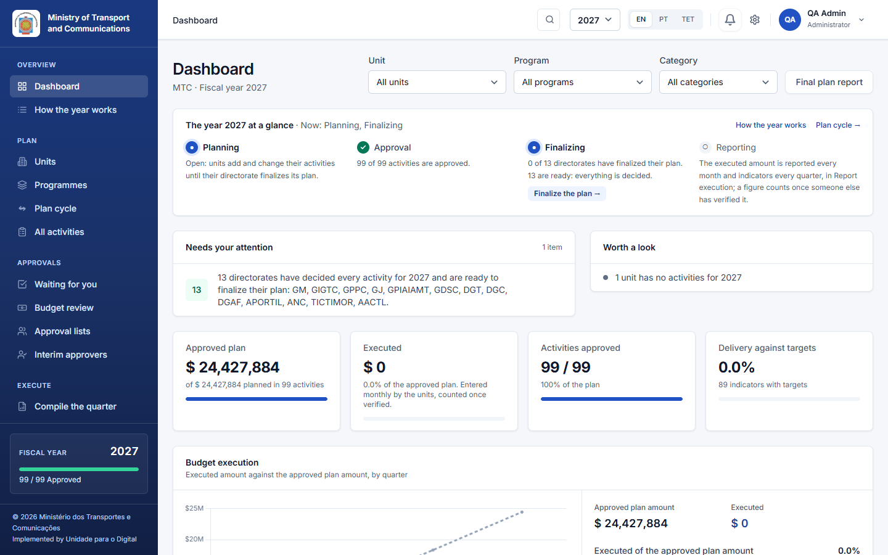

- **Left menu**: the places you may use. It is built for your role, so you only see what is yours. It follows the annual cycle: *Overview → Plan → Approvals → Budget → Execute → Insights → Administration*.
- **Top bar**: a search that jumps to any page (press **Ctrl + K**), the **fiscal year** selector, the language buttons **EN / PT / TET**, your notifications (the bell) and your profile.
- **Fiscal year**: almost every screen shows one year at a time. Change it at the top and the whole application follows.
- **Language**: English, Portuguese and Tetum. The choice is remembered for you.
- **Notifications**: the bell lists what happened that concerns you (an activity submitted to you, returned to you, approved). Click one to go to it.

### 1.3 What you see first

The **Dashboard** shows the year in one view:

- the **plan cycle tracker** (four steps: plan submission, approval, plan finalized, reporting) and which step is current;
- key figures: what is planned, the approved plan in force, what has been paid (verified), activities approved, delivery against targets;
- **Needs your attention**: the same list as *Approvals*, for what you can act on;
- charts by economic category, status and unit.

Filter it by unit, programme and category at the top.

---

## 2. How the system thinks

You do not need to memorise this, but everything in the application follows these ideas.

**Institution and units.** Your institution is a tree: a *top-level unit* (a directorate, a gabinete, an autonomous body) with *units* below it, to any depth the law defines. Each unit has its own people. Authority follows the tree: the head of a top-level unit gives the final approval for everything below it.

**Programme and subprogramme.** The budget classification of the State (the OGE codes). A programme is set up once by the administrator for the year; an activity always belongs to one programme and subprogramme.

**Activity.** What a unit will do in the year. It has a description, a priority, the quarters it runs in, start and end dates, and the person responsible. It starts as a **Draft**.

**Indicator.** What success looks like: a target, a baseline, a unit of measure and the means of verification. Under each indicator the unit lists the numbered **actions** that carry it out, each with the **months** it takes place in; the quarters the indicator is reported in follow from those months.

**Budget line.** The money, by **economic category** (10 Salaries and wages, 20 Goods and services, 30 Public transfers, 40 Minor capital, 50 Development capital). Each line has an amount and a **funding source** (State Budget, a development partner and so on). A line can say which indicator it pays for.

**Version.** Every approval of an activity makes a version (1, 2, ...), a copy of what was approved, kept as it was. The amounts of the latest approved version are in force: spending is reported against them.

**Revision.** The way to change an approved activity: it needs a reason, goes back to Draft and through the whole approval chain again, and while it does the version in force stays. When it is approved it becomes the next version.

**Windows.** Dates between which a thing may be done: the plan may be submitted, a month or a quarter may be reported. **No dates set means open**, and administrators can always act.

**Verified by someone else.** Figures that units report (committed, paid, indicator progress) count only after another person verifies them. Nobody verifies their own report.

---

## 3. The annual cycle at a glance

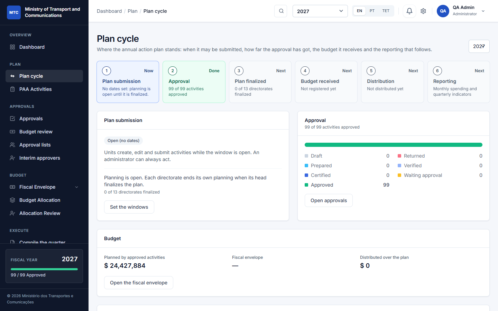

| # | Step | What happens | Who |
|---|---|---|---|
| 1 | **Plan submission** | Units draft activities with indicators, actions and budget lines, and submit them while the submission window is open. | Technical officers, unit directors |
| 2 | **Approval** | Each activity is prepared, certified and approved (Part 6). | Directors, heads of directorates |
| 3 | **Plan finalized** | When everything in a directorate is decided, its head finalizes the plan: no new activities. | Head of the directorate |
| 4 | **Reporting** | Units report spending and indicators monthly and quarterly; others verify; the quarter is compiled; reports are printed. A change to an approved activity is a revision (Part 9). | Units, finance, directors |

The *Plan cycle* page (**Plan → Plan cycle**) shows where the year stands and links to what comes next. The same tracker sits on the dashboard.

---

## 4. Setting up the institution (administrators)

Do these once, in this order. Everything is under **Administration** in the menu.

### 4.1 Settings

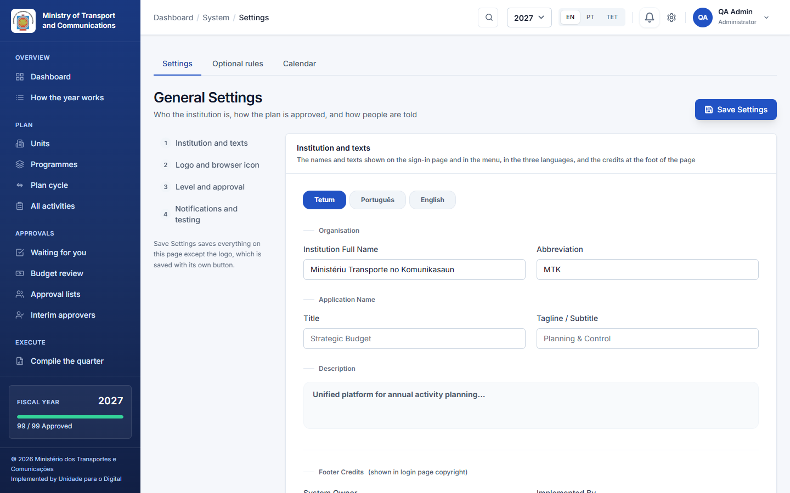

**Administration → Settings**:

- **Organisation**: the full name and abbreviation of your institution, in Tetum, Portuguese and English, and the texts of the login page. These are what users see; nothing is fixed in the code.
- **Institution level**: *a whole ministry* (several directorates, each finalizing its own plan) or *one directorate or gabinete* (its plan is sent to the ministry; you can say who it is sent to). This only changes the wording.
- **Approval chain**: whether the director of the unit above **validates** first (the default for a ministry), and whether **finance confirms the budget** of each activity before it is certified (off by default).
- **Next-year planning**: allow units to plan the next fiscal year.
- **Testing mode**: a practice area with its own test data (off by default).

Click **Save Settings**.

### 4.2 Structure: units, programmes, economic categories

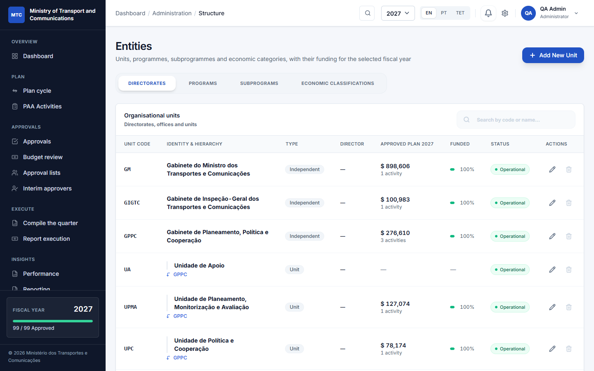

**Administration → Structure** has four tabs:

1. **Directorates**: the tree of units. *Add New Unit* with a code, name, type and **parent**. A unit with no parent is a top-level unit (a directorate or gabinete). Set the director's name and the years the unit existed. Deactivate rather than delete a unit that has history.
2. **Programs**: the OGE programmes for the year, with code, name and objective.
3. **Subprograms**: the subprogrammes under each programme.
4. **Economic classifications**: the economic categories (10 to 50 and the detail codes below them).

Add only the structure that the law defines; the system does not invent departments.

### 4.3 Funding sources

**Administration → Funding sources**: the list of where money comes from (State Budget, development partners and so on). Technical officers pick one for each budget line.

### 4.4 Users

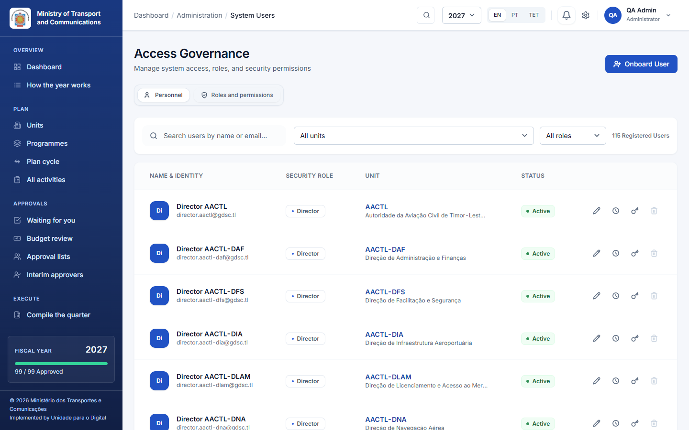

**Administration → System Users**: *create* an account with name, e-mail, **role** and **unit**; edit a user's details, role and unit; deactivate someone who left. Give **each unit its own people**: a technical officer who prepares and a director who certifies. The unit decides what a person can see and plan.

| Role | In one line |
|---|---|
| **Admin** | Sets up and runs the system; always allowed to act. |
| **Minister** | Sees every plan and every report; does *not* approve plans. |
| **Director** | Head or director of a unit: certifies, and for a top-level unit gives the final approval. |
| **Planning** (technical officer) | Prepares activities, indicators and budget lines. |
| **Finance** | Confirms budget lines and verifies reported spending. |
| **Viewer** | Reads plans and reports; changes nothing. |

### 4.5 Reporting windows

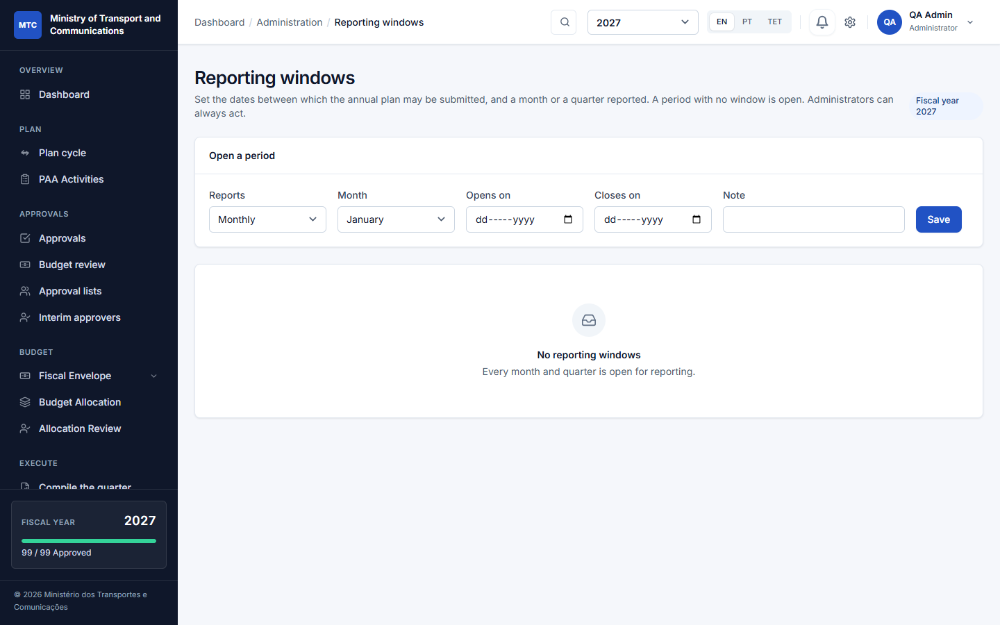

**Administration → Reporting windows**: for the fiscal year, give the dates of

- the **plan submission** window (when units may submit the plan);
- each **month** (monthly spending and narrative);
- each **quarter** (quarterly indicators and the quarter's text).

Pick the type, the month or quarter, *Opens on*, *Closes on* and an optional note, then **Save**. Outside its window a unit cannot report that period; an administrator always can. A period with no window is open.

### 4.6 Approval lists and interim approvers

Part 7. Directors keep these for their own units; administrators for any.

### 4.7 Loading activities from a file

**Administration → Import Activities**: download the **CSV template**, fill it (unit code, programme and subprogramme, description, dates, quarters, indicators, budget lines), and upload. The importer checks every line first and tells you which lines are wrong and why; nothing is saved until the file is clean. It refuses lines for a year or a directorate whose planning has ended.

### 4.8 Sample data

**Administration → Sample Data** loads (or removes) an optional demonstration dataset, so people can practise before real use. It is refused in production. *Purge* removes only what the sample created; your real data is never touched.

---

## 5. Planning activities

For technical officers and unit directors. Open **Plan → PAA Activities**.

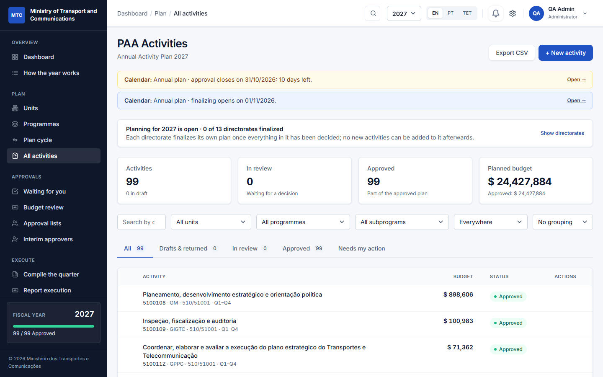

The list shows the activities you may see (your unit and the units below it), with tabs *All*, *Drafts & returned*, *In review*, *Approved* and *Needs my action*, and filters by unit, programme and subprogramme. A banner says whether planning for the year is open for your directorate.

### 5.1 Create an activity

Click **+ New activity** (or **Copy from last year**, see 5.6).

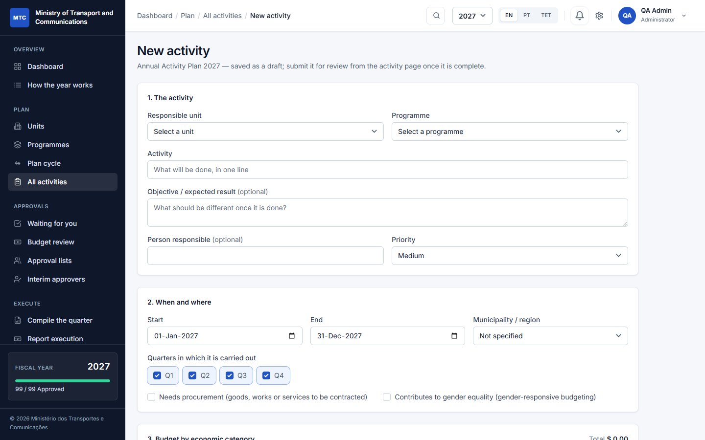

1. **The activity**: choose the **responsible unit** and the **programme**, write what will be done in one line, optionally the expected result, the person responsible and the priority.
2. **When and where**: start and end dates, the municipality or region, and the **quarters** in which it is carried out. Tick *needs procurement* or *contributes to gender equality* where they apply.
3. **Budget by economic category**: the amount for each category. Add lines under **Budget lines** (5.3).
4. **More details**: the indicators and their actions (5.2).

Save. The activity is a **Draft** with a code, visible only to your unit and the people above it. You can edit it freely while it is a draft or has been returned.

### 5.2 Indicators and actions

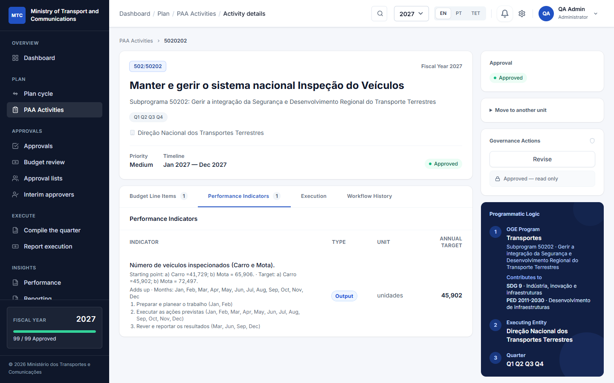

On the activity page open **Performance Indicators**, or edit the activity and open *More details*:

- **Indicator**: the description, the **unit of measure**, the **baseline** and the **target**, and the means of verification.
- **Actions**: under each indicator add the numbered actions that carry it out (for example *1. Prepare and plan the work*, *2. Carry out the planned actions*, *3. Review and report the results*) and tick the **months** each takes place in. The months must fall inside the quarters the activity runs in. The quarters in which the indicator is reported follow from these months.

### 5.3 Budget lines

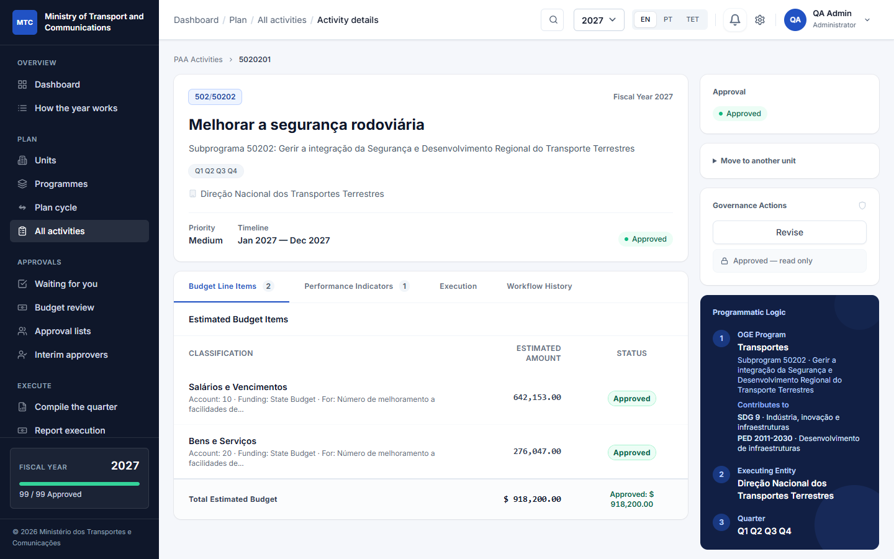

Open **Budget Line Items** on the activity page, or the *Budget lines* screen:

- choose the **economic category** and write the **amount**;
- choose the **funding source** (the real list from Administration);
- optionally choose the **indicator** the line pays for. An indicator's allocation is the sum of its lines; a line with no indicator belongs to the whole activity.

### 5.4 Submit for approval

An activity can be **submitted** only when it is complete:

- at least one **budget line with an amount**,
- at least one **indicator with a target**,
- the **end date is not before the start date**, and
- the plan submission window is open for your unit (an administrator can always submit).

Open the activity and click **Submit** (the button names the next step). It becomes **Prepared** and the people who certify are told. You can also tick several drafts in the list and move them on together; the ones that are not ready are skipped and counted.

### 5.5 If it is returned

A reviewer can **return** an activity with a written reason. It goes back to *Returned* and the reason is shown at the top of the activity. Correct what was asked, and submit again. Returned work keeps its history.

### 5.6 Copy last year's plan

At the start of a year with no activities yet, **Copy from 2026** copies the previous year's plan into the new year as **drafts** (once; units whose planning has ended for that year are skipped). Review each draft, adjust amounts and dates, then submit.

### 5.7 Approved activities are changed by revision

An approved activity cannot be edited. To change it (a cost went up, an action was added, a target changed), someone who prepares for the unit, its director, whoever gives the final approval, or an administrator starts a **revision** with a written reason (Part 9). It never disappears from the plan while the revision is pending.

### 5.8 Export

**Export CSV** at the top of the list downloads the activities you can see, with one amount column per economic category.

---

## 6. Approving: prepare, certify, approve

Every activity goes through the same chain, whatever the size of the institution.

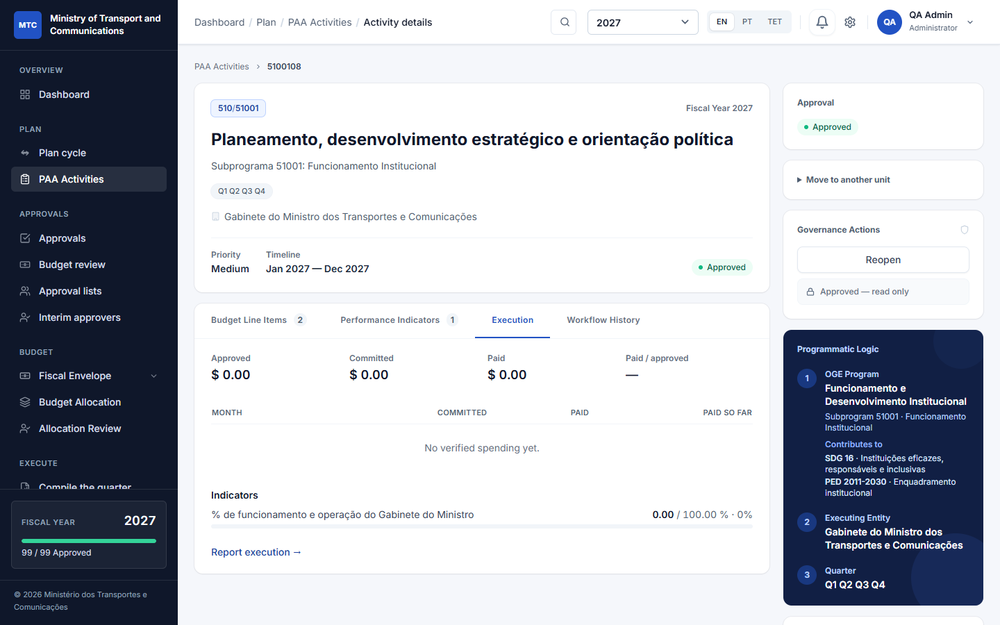

| Status shown | Meaning | Who moves it on |
|---|---|---|
| **Draft** | Being prepared by the unit. | Technical officer or unit director → *Submit* |
| **Prepared** | Prepared and submitted; waits for certification. | Director of the unit (or the finance officer first, if budget confirmation is on) |
| **Verified** | Certified by the unit's director; waits for the unit above. *Only where a unit above validates first.* | Director of the unit above |
| **Certified** | Validated; waits for the final approval. | Head of the top-level unit (the directorate) |
| **Approved** | Final approval given; the activity is locked. | |
| **Returned** | Sent back with a reason; the unit corrects it. | |

The three groups are **Prepare** (the unit), **Certify** (verify and validate) and **Approve** (the head of the directorate). If your institution sets *the director of the unit above validates first* to off, an activity goes straight from Prepared to Certified.

**Who gives the final approval.** The head of the top-level unit approves the plans of their own directorate and the units below it. The Minister does *not* approve plans; the Minister sees every plan and every report. Where a unit has an **approval list** (Part 7), the people named on it do the step instead of the default.

### 6.1 The Approvals inbox

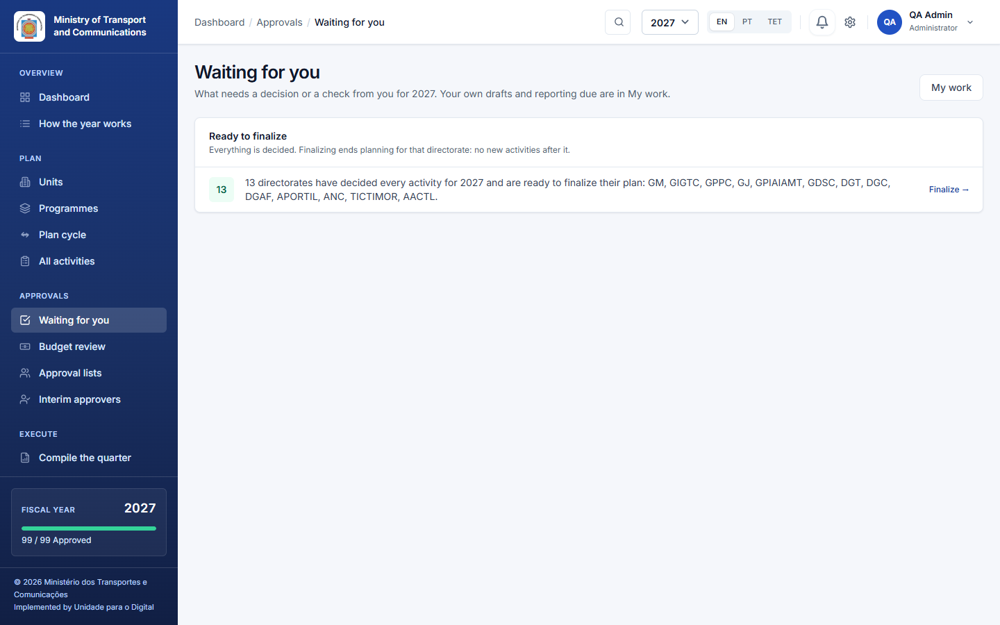

**Approvals** is one page with everything waiting for you, each with a count and a link:

- activities to decide (certify or approve);
- **execution figures to verify** (never your own);
- the **plan ready to be finalized** for the directorates you head;
- budget steps;
- your own drafts and returned work.

The dashboard's *Needs your attention* is the same list.

### 6.2 Certify or approve one activity

Open the activity. The panel at the right says where it stands and what you can do. Add a **note** if you wish and click the action: **Certify**, **Approve**, or **Return** (a reason is required). Every step is written in the **Workflow History** tab: who, when, and the note.

### 6.3 Approve many at once

In *Activities to decide*, tick the activities in the *Ready for approval* queue and use the bulk action, then confirm *Approve the selected activities?* with an optional note for the record (up to 200 at a time). The dialog says how many will be left out because you cannot approve them now. Each one is checked again as it is written: one that was returned meanwhile, or that is not your turn, is skipped and listed with the reason. Every approval is recorded with the batch it belonged to, and the units are told once.

### 6.4 Budget review (finance)

Where **budget confirmation** is on, **Approvals → Budget review** lists submitted activities whose budget lines must be confirmed by finance **before** they are certified. The finance officer checks the lines and **confirms** (or returns with a reason).

### 6.5 Revise an approved activity

On the approved activity, *Governance Actions → Revise*, give the reason. A revision starts (Part 9): the activity becomes a draft the unit can change and goes through the whole chain again, while the approved version stays in force.

### 6.6 Workflow History and versions

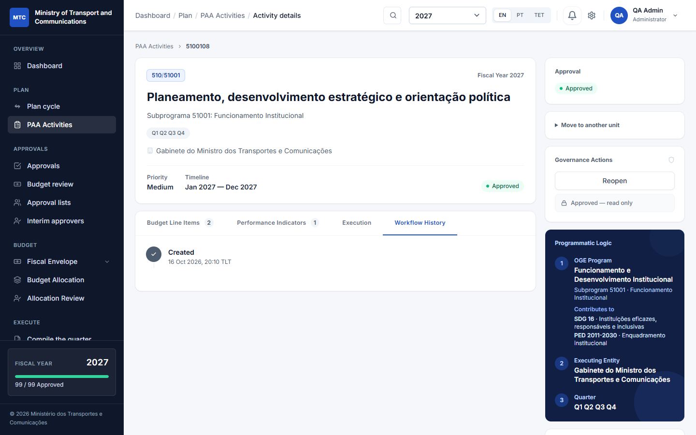

The **Workflow History** tab lists every step: creation, submission, certification, approval, returns, revisions started, with who and when, and any note or reason. It is read from the audit log, so it cannot be edited. Where a list signs in order (7.2), every **signature** of every **round** appears too, including signatures given before the activity was returned or reopened, marked as voided with who voided them and why.

---

## 7. Approval lists, interim approvers and reshuffles

### 7.1 Approval lists

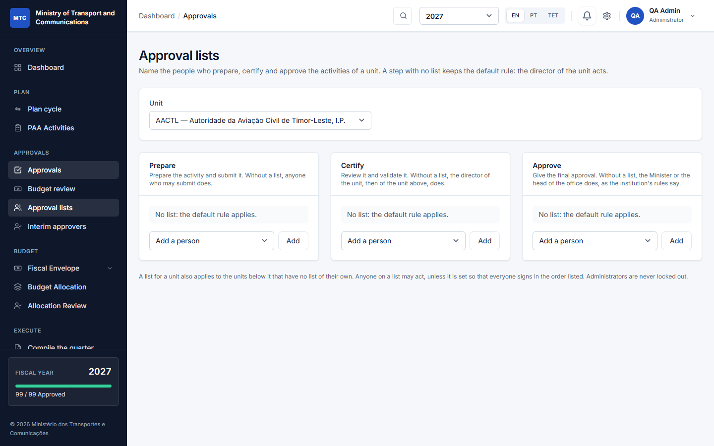

**Approvals → Approval lists** (directors for the units they direct; administrators for any). Choose a **unit** and, for each step, name the people:

- **Prepare**: who prepares and submits the unit's activities;
- **Certify**: who reviews and validates;
- **Approve**: who gives the final approval.

Rules:

- A step **with no list** keeps the default rule (the director acts).
- A unit's list also applies to the units **below** it that have no list of their own; the nearest list above wins.
- Where a step has a list, only the people on it (and administrators) can act, and the activity says who it is waiting for.
- The order of the list is the order they are named in. Move a person with ↑ ↓. *Remove* a person; if a list becomes empty the default rule applies again.

### 7.2 Everyone signs, in order

For a **Certify** or **Approve** list of two or more people, tick **Everyone signs, in the order listed**:

- each person signs **in turn**; the activity page says who is next and how many have signed (for example *Signing in order: Maria is next (1 of 3 signed)*) and the next person is notified;
- the activity **moves on only after the last signature**;
- nobody signs twice in a round; an **interim** of the unit may sign in the place of the next name, and the record shows who actually signed;
- **administrators** are never held up by the order;
- if the activity is **returned**, or a **revision** is started, a new **round** starts. The earlier signatures are **kept and shown as voided** (who voided them, when, and why); nothing is deleted. The History tab shows every signature of every round, so who signed before a reset can always be told.

Without the tick, any one person on the list may act on their own.

### 7.3 Interim approvers (someone is away)

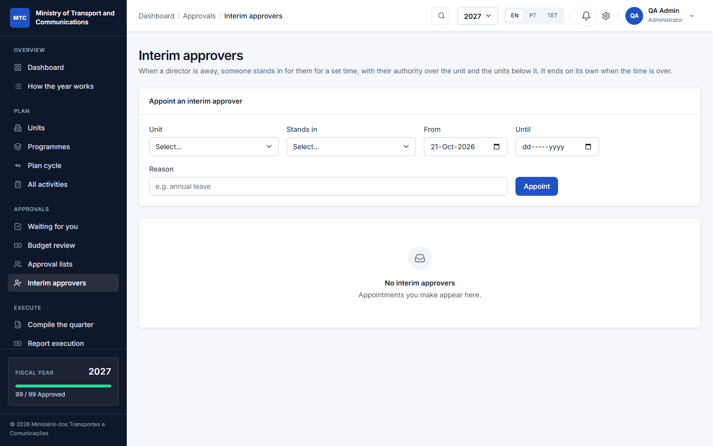

**Approvals → Interim approvers**: a director (or administrator) appoints someone to **stand in** for a director for dates. Choose the unit, the person, *from* and *to*. The interim:

- may **certify and approve** for that unit, even where the unit's list names other people;
- does **not** prepare in place of the preparers;
- stops automatically on the end date, or when you **revoke** the appointment.

### 7.4 Reshuffles and restructuring

Authority is worked out from the tree and the lists **at the moment someone acts**; nothing is stored on the activity. So after a reorganisation:

- **A unit moves to another parent** (Structure → edit the unit): the heads and lists above it take over from where each activity stands. Nothing to clean up.
- **One person replaces another everywhere**: *Approval lists → Replace someone in every list*: choose who leaves and who takes over; every list of the units you keep is updated in one go, and you are told if a list is left empty.
- **An activity belongs to another unit**: an administrator can **Move to another unit** from the activity page, with a remark that stays in the audit trail.
- **Somebody is away for a while**: appoint an interim (7.3).

---

## 8. Ending planning per directorate

Each top-level unit (directorate) ends its own planning. The plan of a directorate is **finalized** by its head once nothing in it, or in the units below, still waits for a decision.

On **PAA Activities** the banner shows *Planning for 2027 is open · 0 of 13 directorates finalized*. **Show directorates** lists them; the head sees **Finalize plan** for their own directorate (greyed out while something still waits, or there is nothing approved yet), an administrator for all.

- **Finalizing** says: this directorate's plan is final. It cannot take new activities, import lines or roll-forward copies for the year. The remark you write is kept.
- The **year ends** when every directorate that planned has finalized. Finalizing stops **new activities** only: an approved activity can still be changed by a revision.
- **Reopening** a directorate's plan (to allow new activities again) is for its head or an administrator, with a **reason**; both steps are recorded in the audit trail.
- The *Approvals* inbox tells each head when their directorate is ready to be finalized.

---

## 9. Changing an approved activity: revisions and versions

There is no fiscal envelope and no distribution in this application: the plan is the budget. What an approved activity may spend is what its **approved version** says, and a change goes through a **revision**, so that nothing is overwritten and the record always shows what was approved, by whom, and why it changed.

### 9.1 Versions

Every approval makes a **version** of the activity: a copy of the activity, its indicators with their actions, and its budget lines, kept as it was. The first approval is **version 1**; the **amounts of the latest version are in force**, and spending is reported against them. On the activity's **Workflow History** tab, *Approved versions* lists every version with who approved it, when, the total, and the reason for the revision that made it; *Show what was approved* opens its budget lines and indicators.

### 9.2 Start a revision

On an approved activity, *Governance Actions → **Revise***. Give a **reason** (required). It can be started by someone who prepares for the unit (its list of preparers, or anyone who may submit for it), the director of the unit, whoever gives the final approval, or an administrator.

- The activity becomes a **Draft** that the unit can edit: amounts, lines, indicators, targets, actions, dates.
- **The approved version stays in force**: its amounts are untouched, the activity keeps its place in the plan and its reports, and the unit keeps reporting spending against it.
- A banner on the activity says *Revision in progress: version 2* and lists **what changes against version 1**, line by line and indicator by indicator, with the total before and after, so that reviewers see exactly what they are approving.

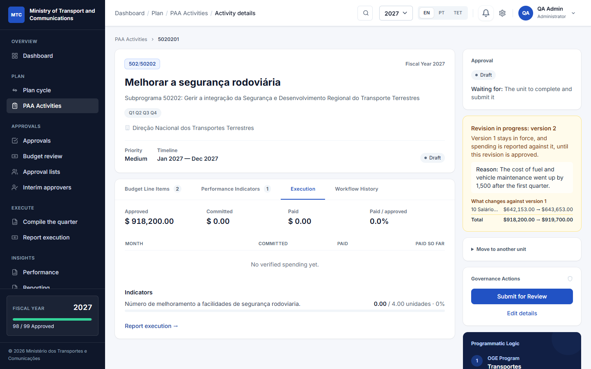

### 9.3 Approve the revision

The revision goes through **the whole chain again**: prepared, certified (and validated by the unit above where that applies), and approved by the head of the directorate or the named approvers (including lists that sign in order; its signatures belong to a new round). Returning it for correction works as before. When the revision is approved it becomes **version 2**: its amounts take over and the history shows both versions.

### 9.4 What a revision cannot do

- **Remove a budget line that already has spending reported against it**, or an indicator that already has progress reported: change its amount or target instead. This keeps the reported figures tied to their line.
- **Delete the activity**: an activity that was approved once is part of the record of the plan.

Finalizing a directorate's plan (Part 8) does not stop revisions.

---

## 10. Executing and reporting

Once an activity has an approved version, its unit reports what it spent and achieved. Figures count only once **someone else verifies** them.

### 10.1 Monthly spending

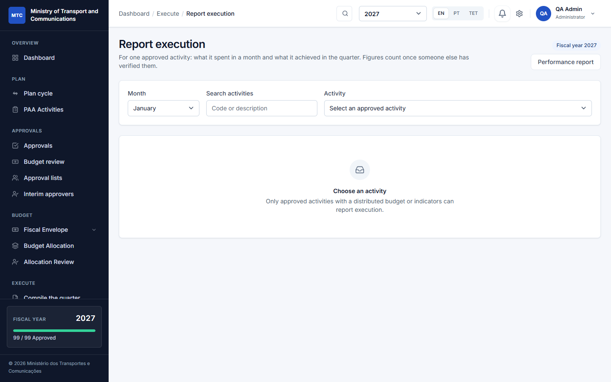

**Execute → Report execution**: choose the **month**, then an **approved activity**. For each budget line enter what was **committed** and what was **paid** in that month, and submit. The month must be within its reporting window (Part 4.5).

### 10.2 Quarterly indicators

On the same screen, enter for each indicator the progress achieved in the **quarter**; the quarter must be one the indicator is reported in (from its months).

### 10.3 Narratives

For each month and quarter the unit writes the **narrative**: results achieved, implementation constraints, and the rating (from the list). It is part of the report.

### 10.4 Verification

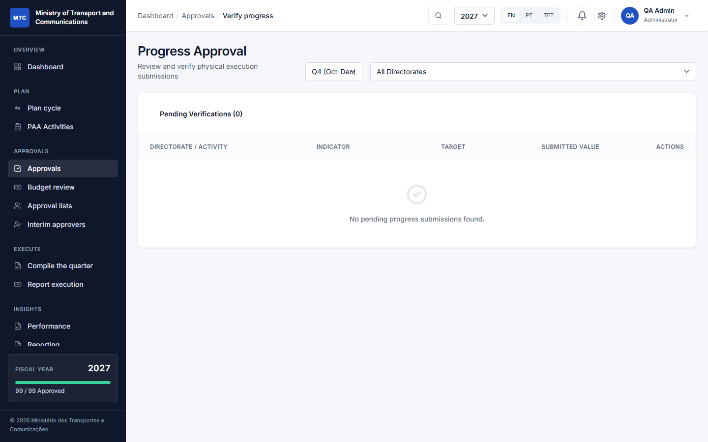

A different person opens the figures and **verifies or returns** them:

- **Spending (committed and paid)**: a director or the finance officer, from the items in **Approvals** or from *Report execution*.
- **Indicator progress**: a director from *Report execution*; administrators also have the page **Approvals → Verify progress**, which lists every pending record and can verify them together.

Only verified figures appear in the dashboard, the performance report and the printed report. You cannot verify your own entry; the system says so.

### 10.5 Compile the quarter

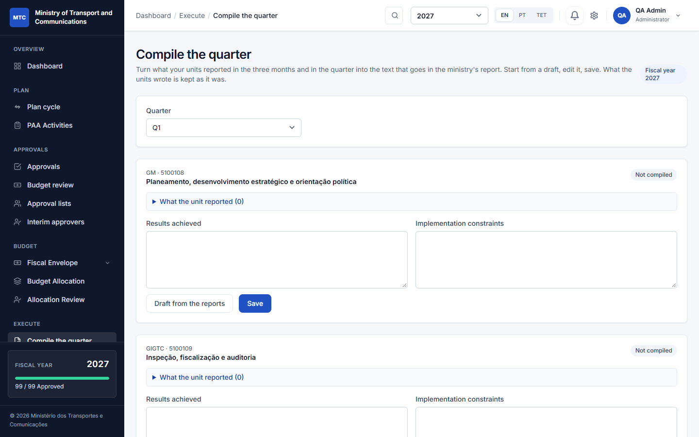

**Execute → Compile the quarter** (directors and administrators): choose the **quarter**. For each activity the system shows what the unit reported; press **Draft from the reports** to prepare the text (*Results achieved* and *Implementation constraints*), edit it, and **Save**. What the unit wrote is kept as it was. This becomes the text of the ministry's report.

### 10.6 Performance

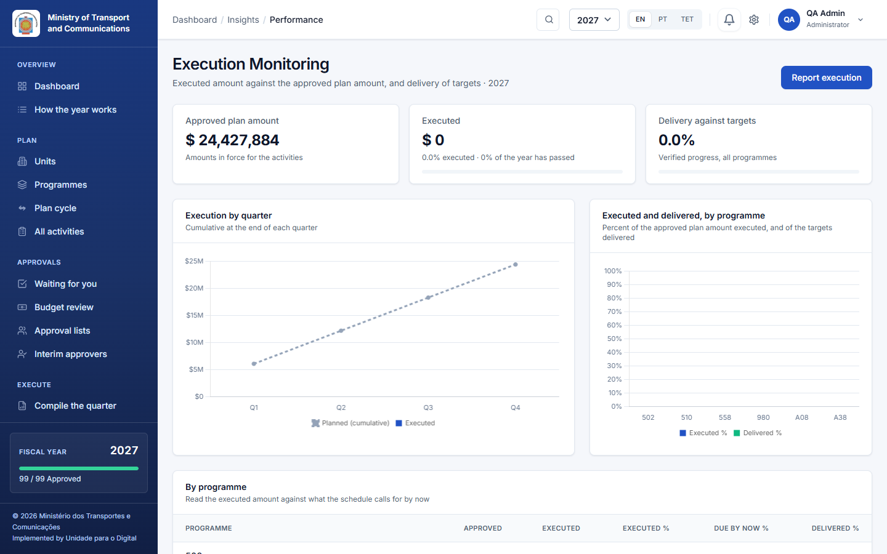

**Insights → Performance**: paid and delivered against the plan, by quarter and programme, with the activities falling behind.

---

## 11. Reports, dashboard and printed forms

### 11.1 The dashboard and Reporting page

The **Dashboard** (Part 1.3) and **Insights → Reporting** show the annual performance report: planned and approved by unit, rolled up the tree, with **Export Data** (CSV), **Final plan report** and **Print Report**.

### 11.2 The final plan report

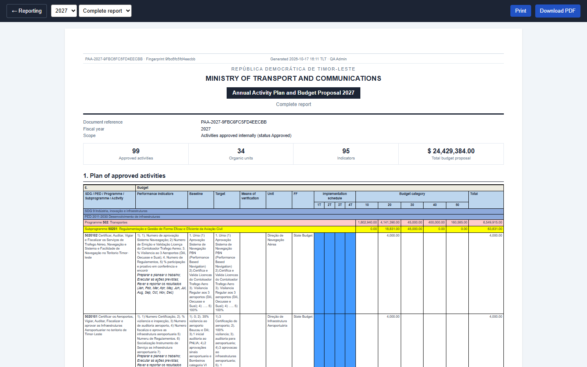

**Reporting → Final plan report** is the plan of approved activities in the layout of the Ministry of Finance form (A4 landscape): programme and subprogramme bands, each activity with its indicators, baseline, target, means of verification, unit, funding source, the quarterly implementation schedule and the amount by economic category. It carries a document reference and a fingerprint so that a printed copy can be checked.

Choose **Complete report** or **Summary** from the selector. **Print** to paper or **Download PDF**. The report is of the plan; it is not addressed to anyone.

### 11.3 The implementation plan, per unit

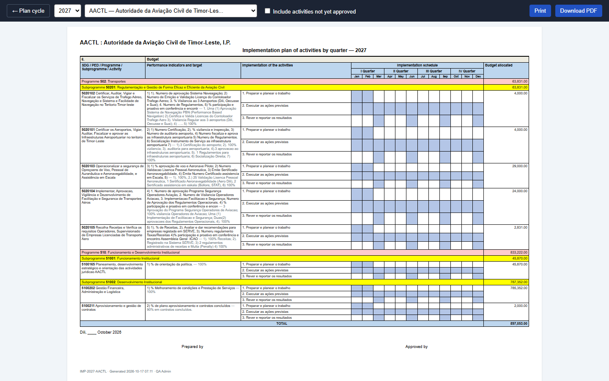

**Plan → Plan cycle → Where things are done → Implementation plan**: choose a unit at the top of the form and print it: each activity with its indicators and its numbered **actions**, a **Jan–Dec grid** grouped by quarter with the months of each action shaded, the **budget allocated** per indicator, and the *Prepared by / Approved by* names taken from the unit's approval lists. By default it lists approved activities; tick *Include activities not yet approved* for a working copy.

### 11.4 The performance report (monthly or quarterly)

**Plan → Plan cycle → Where things are done → Performance report** (or the *Performance report* button of *Report execution*): choose monthly or quarterly and the period. It prints in the same MoF layout with the narratives, the verified spending and the indicator results. **Print** or **PDF**.

### 11.5 Notifications and e-mail

Notifications are delivered inside the application as soon as the action happens; no queue worker or e-mail setup is needed for them.

---

## 12. A whole year, step by step (tutorial)

Follow Ana (technical officer), Bento (director of a unit), Carla (head of a directorate), Dino (finance) and Eva (administrator).

**Before the year (Eva).**
1. *Settings*: check the institution's name, the level and the approval chain.
2. *Structure*: make sure the directorate and its units exist; add the **programmes and subprogrammes** for the new year.
3. *System Users*: give every unit its technical officer and its director.
4. *Reporting windows*: set the dates in which the plan may be submitted, and the months and quarters of reporting.
5. Optionally name **approval lists** for the units that need named people.

**Planning (Ana, Bento).**
6. Ana opens **PAA Activities**. At the start of the year she presses **Copy from last year** (or **+ New activity**).
7. For each activity she completes the dates and quarters, the **indicators** (target, baseline, actions with months) and the **budget lines** (category, amount, funding source).
8. Ana presses **Submit**. The activity is *Prepared*. Bento is notified.

**Certify and approve (Bento, Dino, Carla).**
9. If budget confirmation is on, Dino opens **Budget review** and confirms the lines.
10. Bento opens **Approvals**, reads each activity and presses **Certify**, or **Return** with a reason (Ana corrects and resubmits).
11. If the unit above validates first, its director presses **Certify** once more.
12. Carla opens **Approvals** and approves the activities, one by one or by selecting several and approving them together. Each approved activity is locked.
13. When all of her directorate's activities are decided, the inbox says the plan is ready. Carla opens **PAA Activities → Show directorates → Finalize plan**, writes a remark and confirms. Her directorate takes no new activities.

**Budget (Eva or the budget officer).**
14. The plan is now in force: the amounts of each approved activity are what its unit may spend.
15. When something has to change (a cost went up, an action was added), the unit opens the approved activity, presses **Revise** and gives the reason; the activity is edited and goes through the chain again, while version 1 stays in force.
16. Carla approves the revision; it becomes **version 2**, and the history shows both.

**Execution (all year).**
17. Each month, Ana opens **Report execution**, chooses the month and the activity, and enters what each line **committed** and **paid**, and the narrative. She submits.
18. Dino (spending) or Bento (spending and indicators) opens the figures from **Approvals** and verifies or returns them.
19. At the end of the quarter, the unit reports the indicators; Carla opens **Compile the quarter**, presses **Draft from the reports**, edits and saves.

**Reporting.**
20. Anyone with the right role opens **Reporting** and **Final plan report** (Complete or Summary), the **Performance report** and the **Implementation plan** of a unit, and prints or downloads the PDF.

### Scenario A: a director is away for two weeks

Bento is on leave and activities wait for certification. Carla opens **Approvals → Interim approvers**, picks the unit, appoints Fernanda from the 10th to the 24th. Fernanda can certify and approve for that unit until the 24th or until Carla revokes it.

### Scenario B: a reorganisation

A unit moves from Directorate X to Directorate Y, and Bento is replaced by Gil. The administrator edits the unit and changes its **parent** to Y; the heads and lists above now belong to Y, and pending work follows. Then *Approval lists → Replace someone in every list*: Bento leaves, Gil takes over.

### Scenario C: three signatures on the final approval

A directorate wants the head of the directorate, the legal adviser and the director of finance to approve every activity, in that order. In **Approval lists**, add the three people to **Approve**, tick **Everyone signs, in the order listed**. Each signs in turn; the activity is *Approved* after the third. If the third returns it, a new round starts and the first two signatures stay on record as voided.

---

## 13. Administration

### 13.1 Users and roles

See 4.4. Deactivate rather than delete someone who has acted: their name stays on the records they made.

### 13.2 The audit log

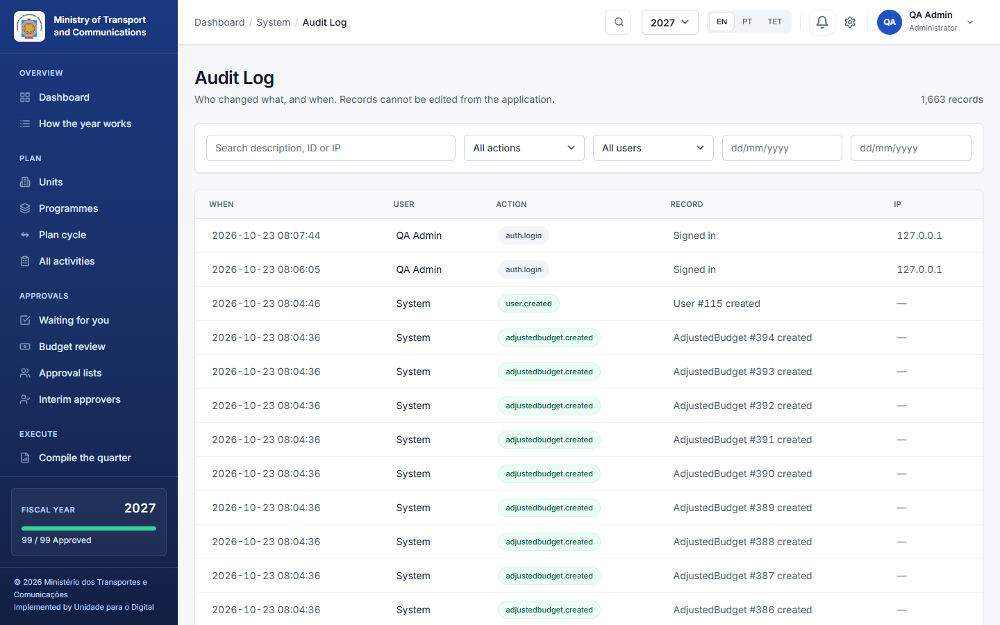

**Administration → Audit Log**: every change to plans, budgets, approvals, users and settings is recorded with **who**, **when**, the old and the new values, and any remark. The log cannot be edited from the application. Use it to answer "who changed this, and why".

### 13.3 Sample data

See 4.8. Loading needs an administrator and is refused in production.

### 13.4 Running the system

For the person who installs and runs it (the *README* has the full instructions):

- **Backups**: `php artisan paa:backup` makes a verified, compressed backup and deletes old ones. It is scheduled nightly at 02:00; the server must run the Laravel scheduler (`* * * * * php artisan schedule:run`).
- **Notifications** are written to the database at once and shown in the application; no queue worker is needed today (see the README, "Queue worker").
- **Health check**: the `/health` address answers for uptime monitoring.
- **Security**: sign-in attempts are rate-limited; registration is closed; permissions are checked on the server for every action, not only hidden in the menu; senior roles use two-factor sign-in.

---

## 14. Roles and what each can do

| Task | Admin | Minister | Director | Technical officer | Finance | Viewer |
|---|:-:|:-:|:-:|:-:|:-:|:-:|
| See own unit's plan | ✔ | ✔ (all) | ✔ | ✔ | ✔ | ✔ |
| See every unit's plan | ✔ | ✔ | own and below | own | own | own |
| Create and edit activities | ✔ | | ✔ | ✔ | | |
| Submit (prepare) | ✔ | | ✔ | ✔ | | |
| Confirm the budget lines | ✔ | | | | ✔ | |
| Certify | ✔ | | ✔ (unit, unit above) | | | |
| Final approval of a plan | ✔ | | ✔ (head of a directorate) | | | |
| Finalize / reopen a directorate's plan | ✔ | | ✔ (own directorate) | | | |
| Keep approval lists, interim approvers | ✔ | | ✔ (own units) | | | |
| Start a revision of an approved activity | ✔ | | ✔ | ✔ (own unit) | | |
| Report execution | ✔ | | ✔ | ✔ | | |
| Verify spending | ✔ | | ✔ | | ✔ | |
| Verify indicator progress | ✔ | | ✔ | | | |
| Compile the quarter | ✔ | | ✔ | | | |
| Reports (view, print) | ✔ | ✔ | ✔ | ✔ | ✔ | ✔ |
| Users, structure, settings, windows, import | ✔ | | | | | |

Exact rules also depend on the unit tree and the approval lists; an administrator can always act.

---

## 15. Questions and troubleshooting

**I cannot submit the activity.** It must have a budget line with an amount, an indicator with a target, an end date not before the start date, and the plan submission window must be open. The message beside the *Submit* button says which.

**The "New activity" button is missing or it says planning has ended.** Your directorate has finalized its plan for that year. Ask the head of your directorate to reopen it, or plan for the next year. (An approved activity can still be revised.)

**It is not my turn.** The activity waits for somebody else. Open it: *Waiting for* names who. If the unit has an approval list that signs in order, the next name must sign first.

**I cannot verify this figure.** You entered it yourself; someone else must verify it.

**I cannot report this month.** The reporting window of the month is closed. An administrator can open it or report for you.

**An approved activity needs a change.** Start a revision: *Revise* on the activity, with a reason. It goes through the chain again and the approved version stays in force meanwhile.

**The approver is away.** Appoint an interim (Part 7.3).

**The pages show text in the wrong language.** Use the EN / PT / TET buttons at the top.

**Somebody left.** Deactivate the user; use *Replace someone in every list* in Approval lists so their approvals pass to a colleague.

---

## 16. Glossary

| Term | Meaning |
|---|---|
| **PAA** | Plano de Ação Anual: the annual action plan. |
| **OGE** | Orçamento Geral do Estado: the State Budget and its classification. |
| **Programme / Subprogramme** | The budget classification an activity belongs to. |
| **Activity** | What a unit will do in the year. |
| **Indicator** | A measurable result with a target and a baseline. |
| **Action** | A numbered step that carries an indicator out, with its months. |
| **Budget line** | An amount in an economic category, with a funding source. |
| **Economic category** | 10 Salaries, 20 Goods and services, 30 Transfers, 40 Minor capital, 50 Development capital. |
| **Version** | A copy of an activity as it was approved; the latest approved version is in force. |
| **Revision** | A change to an approved activity: a reason, the whole approval chain again, the version in force stays until it is approved. |
| **Prepare / Certify / Approve** | The three groups of the approval chain. |
| **Round** | One run of signatures; a return or the start of a revision starts a new round. |
| **Interim** | Someone standing in for a director for given dates. |
| **Window** | The dates between which something may be done. |
| **Directorate** | A top-level unit (directorate, gabinete or autonomous body). |
| **Verified** | Confirmed by someone other than the person who reported it. |
| **MoF form** | The formal template of the Ministry of Finance used for the printed reports. |
