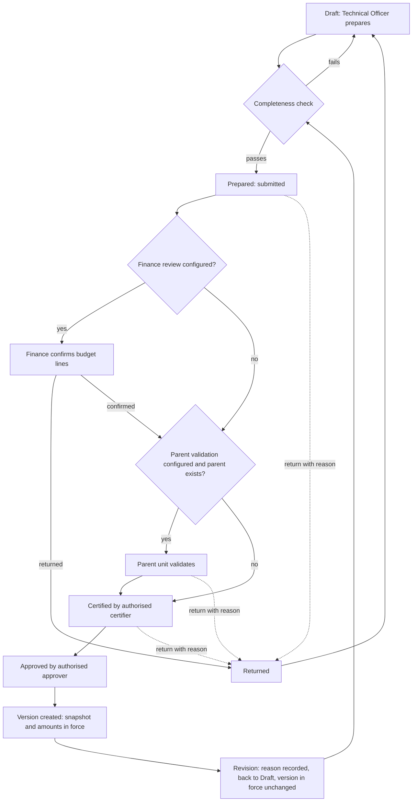
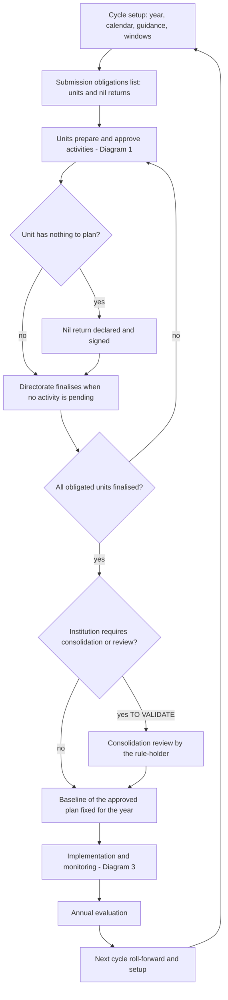
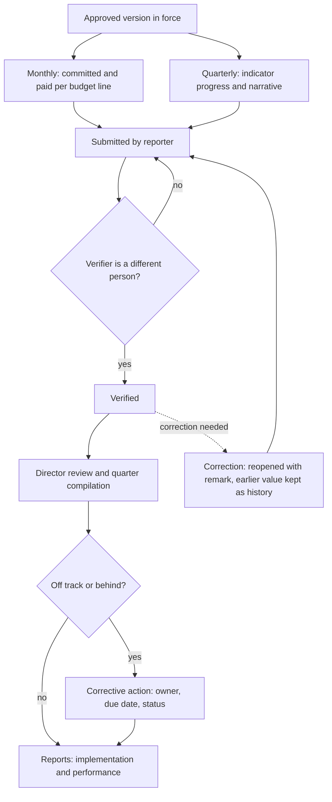

# 03. Target Business Process (TO-BE)

*Step 3 of the improvement brief. Status: **proposal, not yet validated by the institution**. The software support of several stages has changed on branch `improvement`, commit `b9d286a`; the table below gives the current support, and the stage texts keep the support as it was at the baseline.*

## Software support now (branch `improvement`, commit `b9d286a`)

| Stage | Baseline | Now | What changed |
|---|---|---|---|
| 1 Cycle setup | PARTIAL | EXISTS | guidance text per year; optional revision window |
| 2 Submission obligations | NEW | EXISTS (optional, off) | expected directorates; which units are obliged stays to validate |
| 3 Preparation and checks | PARTIAL | EXISTS | name, unit and target checked; extra mandatory fields configurable; codes unique per unit and year |
| 4 Certification | EXISTS (with a bypass) | EXISTS | bypass removed; preparer recorded; segregation rule available (default off) |
| 5 Parent validation | EXISTS (with a bypass) | EXISTS | every path now follows the `parentValidation` setting |
| 6 Finance review | EXISTS | EXISTS | institution-wide finance scope available (optional, off) |
| 7 Final approval | PARTIAL | EXISTS | approval and version are atomic |
| 8 Directorate finalisation | PARTIAL | EXISTS | nil return (optional, off) |
| 9 Consolidation (conditional) | NEW | NEW | not built: no rule-holder is known (R-APP-05, R-CON-03) and none is assumed |
| 10 Baseline (conditional) | NEW | EXISTS (optional, off) | the report reads the version in force; baselines recorded and printed |
| 11 Implementation reporting | EXISTS | EXISTS | — |
| 12 Verification and review | PARTIAL | EXISTS | bulk actions audited; earlier verified values shown |
| 13 Corrective actions | NEW | EXISTS (optional, off) | person responsible, due date, closing note |
| 14 Revision control | PARTIAL | EXISTS | amounts kept, own window, full snapshot with unit path, outside-approval reference (optional, off) |
| 15 Evaluation and next cycle | PARTIAL | PARTIAL | roll-forward complete; annual evaluation report still new |

Cross-cutting: **authority** now has one entry point, checked by a guard test; **audit** covers bulk actions; **notifications** reach the holder of the next step; **labels** are neutral.

## Principles

1. The annual action plan is the centre. There is no envelope, ceiling or distribution stage (R-DEC-02).
2. Every stage tag uses the register's IDs (`02-INSTITUTIONAL-REQUIREMENTS-REGISTER.md`). A rule that depends on an unvalidated requirement is marked **[TO VALIDATE: R-xxx]** and the process must work, configurably, whichever way it is decided.
3. **Stages 9 and 10 are conditional.** No consolidation approval by the Minister or any official is assumed (R-APP-05, R-CON-03). If the institution confirms none, the process ends at stage 8 for planning.
4. Planning approval is an internal planning decision, not legal authorisation of funds (R-FIN-01).
5. Approved records are never edited. They change only through a versioned revision, and history is never deleted.
6. Software support is labelled **EXISTS** (as in `01-AS-IS-CURRENT-STATE.md`), **PARTIAL**, or **NEW** (a gap to be analysed in Step 4).

## Diagram 1: Activity approval

## Diagram 2: Annual plan governance

## Diagram 3: Monitoring and reporting

## Stage register

Each stage lists: purpose, owner, inputs, actions, decision rules, outputs/records, exceptions, audit, software support.

### 1. Annual cycle setup and guidance
- **Purpose:** open a planning year with the correct calendar and instructions.
- **Owner:** Administrator, on instruction from the planning office.
- **Inputs:** official calendar and circular [TO VALIDATE: R-CAL-01]; fiscal year [R-CAL-03]; programme structure and codes [R-OGE-01].
- **Actions:** create the year; load programmes; set the plan, monthly and quarterly windows; publish guidance text; assign approver lists and interim appointees.
- **Decision rules:** windows follow the official calendar; revisions have their own window rule [R-CAL-04, R-AMD-05].
- **Outputs/records:** fiscal year, programmes, windows, lists.
- **Exceptions:** calendar changes mid-year (new window row with reason).
- **Audit:** every window and list change, with user and reason.
- **Software:** PARTIAL. Windows and lists EXIST; a guidance text per cycle and a dedicated revision window are NEW.

### 2. Organisational-unit submission obligations
- **Purpose:** know which units must submit, so silence is visible.
- **Owner:** planning office; Administrator records.
- **Inputs:** organisational structure; units created or dissolved in the year [R-OBL-03]; level at which a unit must submit [R-OBL-01, R-OBL-04].
- **Actions:** generate the expected-submitter list per cycle from the unit tree; track status per unit (not started, in progress, finalised, nil return).
- **Decision rules:** a unit is obliged if it is active in the year at the required level [TO VALIDATE].
- **Outputs/records:** submission-obligation list per cycle.
- **Exceptions:** unit created or dissolved mid-year.
- **Audit:** list generation and manual exclusions with reason.
- **Software:** NEW. Today the list is whatever units have activities (H5).

### 3. Activity preparation and completeness checks
- **Purpose:** a complete, internally consistent draft.
- **Owner:** Technical Officer of the unit.
- **Inputs:** programme, subprogramme, dates, indicators with targets and actions, budget lines.
- **Actions:** create or import; complete mandatory fields; submit.
- **Decision rules:** checks match the official form [R-FRM-01]; each indicator has a target [R-FRM-02]; each line has an amount above zero; dates inside the year.
- **Outputs/records:** Draft, then Prepared; code unique within the year.
- **Exceptions:** import errors listed per row; duplicate code is blocked.
- **Audit:** create, edit, submit, with old and new values.
- **Software:** PARTIAL. Checks EXIST (`ActivityWorkflow::problems`) but message and check differ (H2); unique code enforcement is NEW (O6).

### 4. Unit review and certification
- **Purpose:** confirm that the unit stands behind the content.
- **Owner:** certifier (named list or head of unit).
- **Actions:** certify or return with a reason.
- **Decision rules:** the certifier differs from the preparer [TO VALIDATE: R-APP-04]; skip-level and administrator override are visible exceptions [R-APP-06]; signing in order where a list says so.
- **Outputs/records:** signature with round number; status change.
- **Exceptions:** certifier absent, so an interim appointee signs [R-APP-02].
- **Audit:** signer, actual signer, round, time.
- **Software:** EXISTS, with the segregation-of-duties check NEW (O7). The `paa-approval::review` path must use the same service (R-APP-08, O1).

### 5. Parent-unit validation (where applicable)
- **Purpose:** the unit above checks fit with its own plan.
- **Owner:** parent unit's certifier.
- **Decision rules:** only when `parentValidation` is on and the unit has a parent.
- **Software:** EXISTS in the workflow; a second code path bypasses it (O1).

### 6. Finance review (where configured or required)
- **Purpose:** budget lines are acceptable to finance before certification.
- **Owner:** Finance Officer.
- **Decision rules:** required only where configured [TO VALIDATE: R-FIN-05]; changing a line resets the confirmation; scope may be ministry-wide [R-FIN-06].
- **Outputs/records:** `budget_confirmed_by/at`.
- **Audit:** confirm and reset events.
- **Software:** EXISTS (`BudgetConfirmationTest`). Ministry-wide scope is NEW.

### 7. Final activity approval
- **Purpose:** the authorised person approves the activity as planned.
- **Owner:** head of the top-level unit, a named approver list, or Administrator [TO VALIDATE: R-APP-01].
- **Actions:** approve, or return with a reason.
- **Decision rules:** approval and version creation happen in one transaction with a lock (O2).
- **Outputs/records:** Approved status; version snapshot; amounts in force.
- **Exceptions:** two approvers act at once, so the second sees "already approved" with no error state.
- **Audit:** approver, time, version number.
- **Software:** PARTIAL. Logic EXISTS; atomic single approval is NEW (O2).

### 8. Directorate plan finalisation
- **Purpose:** declare the directorate's plan complete for the year.
- **Owner:** head of the directorate, or Administrator.
- **Decision rules:** blocked while any activity is pending; allowed with a nil return [TO VALIDATE: R-OBL-02]; stops new activities but not revisions [R-CON-01]; reopening needs a reason.
- **Outputs/records:** finalisation record, or nil-return record.
- **Audit:** finalise and reopen, with reason.
- **Software:** PARTIAL. Finalisation EXISTS; nil return NEW (H5).

### 9. Institutional consolidation or review — CONDITIONAL
- **Purpose:** a single institution-wide view and, only if the institution requires it, a formal review.
- **Owner:** to be identified [TO VALIDATE: R-APP-05, R-CON-03]. No person or office is assumed.
- **Design:** the stage is configurable. If off, the system shows a consolidated read-only view and moves to stage 10 automatically once all obligated units have finalised. If on, a configurable rule-holder reviews and records a decision with a reason.
- **Software:** NEW, built only after validation.

### 10. Baseline publication or formal institutional decision — CONDITIONAL
- **Purpose:** a fixed reference of the approved plan for the year, so reports during revisions have a stable basis.
- **Owner:** per stage 9 result.
- **Decision rules:** the baseline is the set of approved versions at a recorded moment [RECOMMENDATION: R-CON-04].
- **Outputs/records:** baseline marker (date, set of version ids).
- **Software:** NEW. Today the report reads live data and drops activities under revision (H1).

### 11. Implementation, monthly financial and quarterly indicator reporting
- **Purpose:** record what was committed, paid and achieved.
- **Owner:** Technical Officer or reporter of the unit.
- **Decision rules:** reporting stages follow the official terms [TO VALIDATE: R-EXE-01]; limits on committed and paid [R-EXE-02]; reporting only inside the open window.
- **Outputs/records:** monthly spending per line; quarterly progress per indicator; narrative with rating [R-FRM-05].
- **Audit:** each save.
- **Software:** EXISTS. Reports continue to use the amounts in force.

### 12. Independent verification and director review
- **Purpose:** figures counted only after independent checking.
- **Owner:** Finance Officer (spending); Director or authorised verifier (progress, narrative).
- **Decision rules:** verifier differs from submitter; a correction keeps the earlier verified value visible [R-EXE-03]; bulk verification writes one audit row per figure [R-EXE-05].
- **Outputs/records:** verified flags; quarter compilation.
- **Software:** PARTIAL. Verification EXISTS; value history and bulk audit are NEW (O3, O8).

### 13. Corrective action tracking
- **Purpose:** each off-track finding leads to an action that is followed up.
- **Owner:** Director of the unit; action owner named per action.
- **Decision rules:** an action has description, owner, due date, status; open actions appear in the next quarter's review [RECOMMENDATION: R-FRM-04].
- **Software:** NEW (O10).

### 14. Revision and amendment control
- **Purpose:** change an approved activity without losing history.
- **Owner:** requester per `reopen` rules; approvers per stage 7.
- **Decision rules:** reason required [R-AMD-01]; the version in force and its amounts stay until the revision is approved (R-AMD-03); revisions follow the revision window rule [R-AMD-05]; changes that need outside approval are flagged [TO VALIDATE: R-AMD-02]; the snapshot holds every meaningful field [R-AMD-04].
- **Outputs/records:** version n+1 with reason and a field-level comparison.
- **Software:** PARTIAL. Revisions EXIST; fixes for the line-delete cascade (O5), the closed-window block (O4) and the snapshot (H4) are NEW.

### 15. Annual evaluation and next-cycle preparation
- **Purpose:** learn from the year and prepare the next.
- **Owner:** planning office; Directors.
- **Actions:** annual evaluation report; roll-forward of chosen activities into the next year.
- **Decision rules:** roll-forward copies a defined field set and only chosen statuses [R-FRM-06]; copies are Drafts and carry no approvals or execution.
- **Software:** PARTIAL. Roll-forward EXISTS with incomplete copying (H3); evaluation report is NEW.

## Cross-cutting rules

- **Authority:** one service decides who may act; every entry point calls it (R-APP-08).
- **Audit:** all state changes recorded, including bulk actions (O3); the audit log is append-only in the application.
- **Notifications:** go to the person holding the next step, including list members and interim appointees (R-LAN-02).
- **Labels:** planned amounts are never called an authorised "budget" without a validated rule (R-FIN-02).
- **Language:** Tetun and Portuguese wording reviewed by competent speakers (R-LAN-01).

## Open points that change this design

| Decision | If yes | If no |
|---|---|---|
| Consolidation approval exists (R-APP-05, R-CON-03) | Build stage 9 with its rule-holder | Remove stage 9; baseline is automatic |
| Nil returns recognised (R-OBL-02) | Add nil-return record to stage 8 | Keep today's rule |
| Segregation of duties required (R-APP-04) | Block preparer = certifier = approver | Flag only |
| Outside approval for some amendments (R-AMD-02) | Add flag and external reference to stage 14 | Local approval for all |
