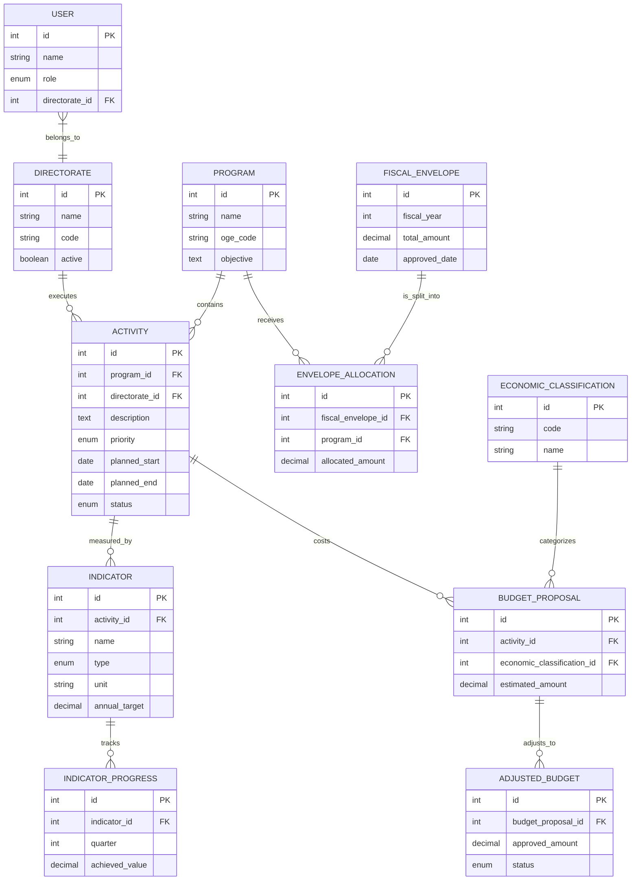

# Sistema de Planeamento Anual e Orçamento – Ministério da Administração Estatal (MAE)

Este documento centraliza todo o planejamento para a criação do sistema PAA + Orçamento do MAE, incluindo:
1. Modelo de Dados
2. Diagrama ERD Visual
3. Regras de Distribuição do Envelope Fiscal
4. PRD (Product Requirements Document) base

---

## 1. Modelo de Dados

### 1.1 Estrutura Organizacional do MAE
**Direções-Gerais ou equivalentes**

| Campo | Tipo | Descrição |
|------|------|-----------|
| id | PK | Identificador da direção |
| name | string | Nome da direção |
| code | string | Código interno |
| active | boolean | Estado |

### 1.2 Programas
Programas orçamentais do MAE conforme OGE 2024.

| Campo | Tipo | Descrição |
|------|------|-----------|
| id | PK | Programa |
| name | string | Nome do programa |
| oge_code | string | Código OGE |
| objective | text | Objetivo do programa |

### 1.3 Atividades
Atividades anuais executadas pelas direções.

| Campo | Tipo | Descrição |
|------|------|-----------|
| id | PK | Atividade |
| program_id | FK | Programa |
| directorate_id | FK | Direção responsável |
| description | text | Descrição detalhada |
| priority | enum | Alta / Média / Baixa |
| planned_start | date | Início planeado |
| planned_end | date | Fim planeado |
| status | enum | Planeada / Aprovada / Cortada |

### 1.4 Indicadores e Metas

| Campo | Tipo | Descrição |
|------|------|-----------|
| id | PK | Indicador |
| activity_id | FK | Atividade |
| name | string | Nome do indicador |
| type | enum | Output / Outcome |
| unit | string | Unidade de medida |
| annual_target | decimal | Meta anual |

### 1.5 Progresso dos Indicadores

| Campo | Tipo | Descrição |
|------|------|-----------|
| id | PK | Registo |
| indicator_id | FK | Indicador |
| quarter | int | Trimestre (1–4) |
| achieved_value | decimal | Valor atingido |

### 1.6 Classificação Económica

| Campo | Tipo | Descrição |
|------|------|-----------|
| id | PK | Classificação |
| code | string | Código económico |
| name | string | Descrição |

### 1.7 Propostas Orçamentais

| Campo | Tipo | Descrição |
|------|------|-----------|
| id | PK | Proposta |
| activity_id | FK | Atividade |
| economic_classification_id | FK | Classificação |
| estimated_amount | decimal | Valor solicitado |

### 1.8 Envelope Fiscal

| Campo | Tipo | Descrição |
|------|------|-----------|
| id | PK | Envelope |
| fiscal_year | int | Ano |
| total_amount | decimal | Valor aprovado |
| approved_date | date | Data de aprovação |

### 1.9 Alocação do Envelope Fiscal

| Campo | Tipo | Descrição |
|------|------|-----------|
| id | PK | Alocação |
| fiscal_envelope_id | FK | Envelope |
| program_id | FK | Programa |
| allocated_amount | decimal | Valor atribuído |

### 1.10 Ajustes Pós-Aprovação

| Campo | Tipo | Descrição |
|------|------|-----------|
| id | PK | Ajuste |
| budget_proposal_id | FK | Proposta |
| approved_amount | decimal | Valor aprovado |
| status | enum | Aprovado / Parcial / Cortado |

### 1.11 Utilizadores e Perfis

| Campo | Tipo | Descrição |
|------|------|-----------|
| id | PK | Utilizador |
| name | string | Nome |
| role | enum | Direção / Planeamento / Orçamento / Admin |
| directorate_id | FK | Direção associada |

---

## 2. Diagrama ERD Visual

- **Entidades**: Directorates, Programs, Activities, Indicators, Progress, Budget Proposals, Adjusted Budgets, Fiscal Envelope, Envelope Allocations, Users
- **Relacionamentos principais**:
  - Directorate → Activities (1:N)
  - Program → Activities (1:N)
  - Activity → Indicators → Progress (1:N:N)
  - Activity → Budget Proposals → Adjusted Budgets (1:N:1)
  - Fiscal Envelope → Program Allocations (1:N)

---

## 3. Regras de Distribuição do Envelope Fiscal

1. **Distribuição proporcional**: Cada programa recebe uma proporção do envelope com base na soma dos valores solicitados.
2. **Prioridade estratégica**: Programas ou atividades com prioridade Alta podem receber ajuste preferencial em caso de envelope insuficiente.
3. **Corte automático**: Se o envelope for menor que o solicitado, atividades de prioridade Baixa podem ser cortadas primeiro.
4. **Limites mínimos/máximos**: Nenhuma atividade pode receber menos de X% do valor solicitado sem revisão manual.
5. **Ajuste de metas**: Metas dos indicadores são recalculadas proporcionalmente ao financiamento aprovado.

---

## 4. PRD – Product Requirements Document (Base)

### 4.1 Objetivo do Sistema
- Automatizar elaboração do PAA
- Consolidar propostas orçamentais
- Distribuir e ajustar envelope fiscal
- Monitorar execução de atividades e indicadores

### 4.2 Módulos do Sistema
1. Planeamento (PAA)
2. Orçamentação
3. Envelope Fiscal
4. Monitorização de Indicadores
5. Relatórios e Exportação para OGE / MPF

### 4.3 Requisitos Funcionais
- CRUD para Direções, Programas, Atividades, Indicadores
- Consolidação de orçamento por programa e atividade
- Recepção do envelope fiscal e distribuição automática
- Ajuste de metas e valores conforme o envelope
- Alertas de desvios e relatórios trimestrais

### 4.4 Requisitos Não Funcionais
- Multi-usuário com perfis distintos
- Segurança e auditoria (logs de alteração)
- Integração futura com SIGF ou sistemas financeiros do MAE
- Suporte a exportação PDF e Excel

### 4.5 Workflow de Aprovação
1. Direções elaboram atividades e indicadores
2. Consolidação em nível ministerial
3. Submissão ao MPF para aprovação
4. Inserção do envelope fiscal aprovado
5. Distribuição automática e ajuste de metas
6. Monitoramento contínuo de execução

### 4.6 Roadmap MVP → Sistema Completo
- MVP: PAA + Propostas Orçamentais + Envelope Fiscal básico
- Fase 2: Distribuição automática com prioridade e corte
- Fase 3: Dashboard de indicadores + relatórios
- Fase 4: Integração com SIGF / sistemas financeiros

---

**Observação:** Este ficheiro serve como **documento centralizado para desenvolvimento**, integrando modelo de dados, ERD (conceitual), regras de envelope e PRD base para guiar a construção do sistema.

